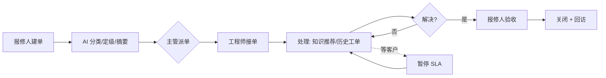

# 智维工单（ServiceDesk AI）

> 企业售后 / 设备报修工单系统 + AI 坐席
> 让报修、派单、处理、知识沉淀、SLA 考核跑在一条线上，AI 只做增强，不替代人。

## 项目介绍

### 背景

设备售后和物业报修普遍存在四个问题：

1. **报修信息散**：电话、微信、口头传递，缺少设备型号、故障现象、紧急度，工程师到场才发现带错工具。
2. **派单靠人**：主管凭经验分配，忙闲不均，紧急单被压在普通单后面。
3. **知识不沉淀**：老师傅的经验在个人脑子里，新人重复踩坑；历史工单解决过的问题搜不到。
4. **SLA 靠催**：响应 / 解决时限没有系统计时，超时无人知道，月底靠 Excel 复盘。

大模型能解决的是其中「理解与检索」的部分：把自然语言变成结构化工单、把历史知识送到工程师手边、把自然语言变成报表。但**流程、权限、时效、审计**仍然要靠传统工程做扎实——这正是本项目的定位。

### 目标用户

| 用户 | 典型场景 | 核心诉求 |
| --- | --- | --- |
| 报修人（客户 / 员工） | 设备坏了，想尽快有人处理 | 少填表、能传图、知道进度 |
| 工程师 | 一天 5-10 单，现场排查 | 快速看懂问题、查到历史方案、少返工 |
| 主管 | 盯 SLA、派单、处理升级 | 知道谁忙、哪单要超时、团队产出 |
| 管理员 | 维护账号、团队、SLA、知识库 | 配置可控、操作可追溯 |

### 产品目标

| 目标 | 衡量方式 |
| --- | --- |
| 降低建单成本 | 建单平均耗时、AI 预填采纳率 |
| 提升一次解决率 | 首次解决率、返工率 |
| 缩短处理时长 | 平均响应时长、MTTR |
| 让知识可复用 | RAG 引用采纳率、知识命中率 |
| 让 SLA 可考核 | SLA 达成率、超时单占比 |

> 本期不承诺具体数值；所有指标在开发完成后用真实数据填 `【】`。

### 价值主张

- 对报修人：说一句话就能建单，能看图、能看进度。
- 对工程师：AI 把「可能相关的手册和历史工单」直接推到手边，带引用可核对。
- 对主管：SLA 倒计时、超时升级、团队负载一屏可见。
- 对企业：知识沉淀在系统里，不随人走。

### 核心闭环



### 范围

**做（MVP）**：账号与角色、工单全生命周期、SLA 计时与升级、知识库与 RAG、AI 建单分类、Agent 工具调用、运营看板、基础系统管理。

**不做（本期）**：多租户、动态 RBAC、复杂工作流引擎、多智能体、图数据库、支付、独立向量数据库集群（Milvus / Pinecone 等，本期用 PostgreSQL + pgvector）、站内通知（P2）、流式输出（P2）。

## 文档索引

| 文档 | 内容 |
| --- | --- |
| [开发文档](backend/src/main/resources/docs/开发文档.md) | 角色权限、32 条功能需求、页面交互、状态机与 SLA、业务规则、非功能需求、验收标准 |
| [ER 图](backend/src/main/resources/docs/ER图.md) | 14 张表的 Mermaid ER 图、字段字典、索引、枚举 |
| [接口文档](backend/src/main/resources/docs/接口文档.md) | 通用约定、9 个模块 51 个接口、请求/响应样例、附录数据结构 |
| [前端说明](frontend/README.md) | 页面与后端进度的对照、原型数据说明 |

## 技术栈

| 层 | 选型 |
| --- | --- |
| 后端 | Spring Boot 3.5.16 + MyBatis-Plus + MySQL 8 + Redis 7 + LangChain4j |
| 数据 | MySQL 8（业务 13 张表）+ PostgreSQL 16（`kb_chunk` 向量表） |
| 前端 | Vue 3 + Vite + Pinia + Element Plus |
| 鉴权 | JWT + 拦截器 + ThreadLocal 用户上下文 |
| 向量 | PostgreSQL 16 + pgvector（`vector(1024)`，HNSW 召回） |
| 对象存储 | 阿里云 OSS（附件 / 知识库文档；`FileStorageService` 接口可替换 MinIO/S3） |
| 部署 | nginx 静态托管 + 本地脚本（`deploy/`） |

## 本地启动

```bash
# 后端：8080，context-path /api
cd backend && mvn spring-boot:run

# 前端开发模式：5173，/api 由 Vite 代理到 8080
cd frontend && npm install && npm run dev

# 或走 nginx（80）：构建 + 发布 + 启动，配置与脚本在 deploy/
powershell -ExecutionPolicy Bypass -File deploy\deploy-frontend.ps1
powershell -ExecutionPolicy Bypass -File deploy\start-nginx.ps1
```

演示账号见 `backend/sql/seed/seed_demo_data.sql`（统一口令 `Sd123456`）；前端页面与后端进度的对照见 [frontend/README.md](frontend/README.md)。

## 命名约定

- 产品名：智维工单（ServiceDesk AI）
- 仓库 / 目录：`servicedesk-ai`
- Java 包名：`com.servicedesk`
- 数据库：MySQL `servicedesk_ai`、PostgreSQL `servicedesk_kb`（向量）
- API 基址：`/api`

## 文档维护规则

- 开发文档、接口文档、ER 图共享同一套角色、状态、枚举、表名、接口路径；改一处必须同步另外两处，并在开发排期第 8 节登记。
- 业务规则统一写在开发文档第 7 章；接口文档只保留基本信息、请求参数、响应数据；实现细则看编码规范。
- 指标未实测的，一律写 `【】` 占位，不编数字。
- 接口文档的响应结构以 `{ code, message, data }` 为准，`code=200` 表示成功。
