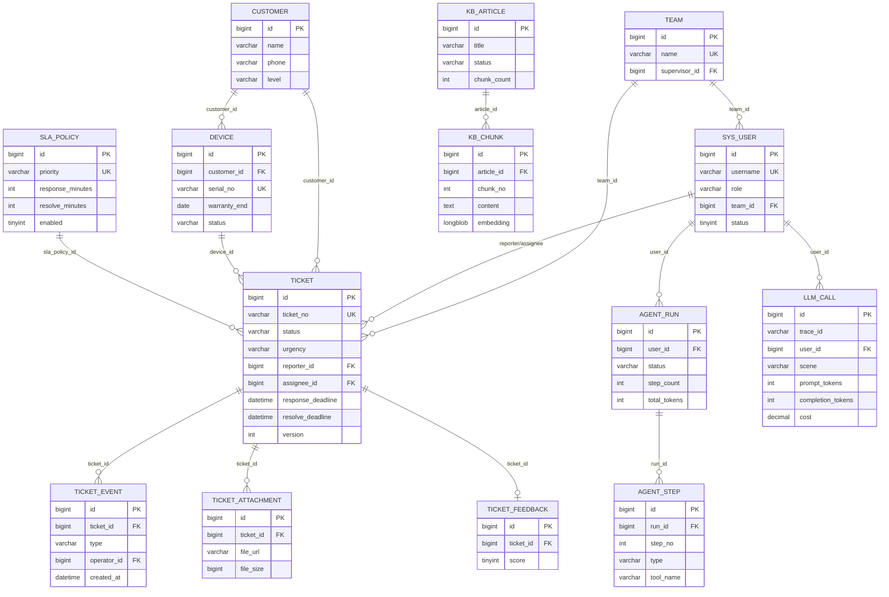

# 智维工单（ServiceDesk AI）· ER 图与数据字典

> 版本：V1.0　｜　日期：2026-10-27
> 关联：[产品文档](产品文档.md) ｜ [接口文档](接口文档.md)
> 约定：MySQL 8.0 / utf8mb4 / InnoDB；逻辑外键（不建物理 FK）；所有表带 `created_at`，可变表带 `updated_at`。

---

## 1. 阅读说明

- ER 图用 Mermaid `erDiagram`，GitHub / Typora 可直接渲染；实体只画主键、外键和 3-5 个关键字段，完整字段见第 4 节。
- 表名小写下划线；Java 实体用大驼峰，Mapper 以 `Mapper` 结尾。
- 金额用 `DECIMAL`，时间用 `DATETIME`，布尔用 `TINYINT(1)`。
- 枚举一律存字符串，不存魔法数字，便于排查和扩展。
- 向量 MVP 存 `LONGBLOB`（1024 维 float32，约 4KB/条），后续可平移到 pgvector。

---

## 2. 总览 ER 图

> `SYS_USER` 与 `TICKET` 有两条外键：`reporter_id`（报修人）和 `assignee_id`（处理人）；图中合并为一条，字段字典中分别说明。

---

## 3. 实体清单与关系

### 3.1 实体清单

| # | 表名 | 职责 | 预估量 |
| --- | --- | --- | --- |
| 1 | `sys_user` | 账号、角色、团队归属 | 百级 |
| 2 | `team` | 团队与主管 | 十级 |
| 3 | `customer` | 客户档案 | 千级 |
| 4 | `device` | 设备档案、保修 | 万级 |
| 5 | `ticket` | 工单主表 | 10 万/年 |
| 6 | `ticket_event` | 工单时间线（追加写） | 50 万/年 |
| 7 | `ticket_attachment` | 工单附件 | 10 万/年 |
| 8 | `sla_policy` | SLA 策略 | 十级 |
| 9 | `kb_article` | 知识文章 | 千级 |
| 10 | `kb_chunk` | 文章分块 + 向量 | 5 万以内 |
| 11 | `agent_run` | Agent 运行记录 | 万级 |
| 12 | `agent_step` | Agent 步骤明细 | 10 万级 |
| 13 | `llm_call` | 模型调用计量 | 百万级（增长最快） |
| 14 | `ticket_feedback` | 工单回访 | 万级 |

### 3.2 关系说明

| 关系 | 基数 | 外键 | 说明 |
| --- | --- | --- | --- |
| 团队 → 用户 | 1:N | `sys_user.team_id` | 一个团队多个成员 |
| 团队 → 工单 | 1:N | `ticket.team_id` | 工单归属团队，用于主管数据范围 |
| 用户 → 工单（报修） | 1:N | `ticket.reporter_id` | 报修人 |
| 用户 → 工单（处理） | 1:N | `ticket.assignee_id` | 当前处理工程师 |
| 客户 → 设备 | 1:N | `device.customer_id` | 一个客户多台设备 |
| 客户 → 工单 | 1:1 | `ticket.customer_id` | 一个客户多张工单 |
| 设备 → 工单 | 1:N | `ticket.device_id` | 一台设备多张工单（可空） |
| SLA 策略 → 工单 | 1:N | `ticket.sla_policy_id` | 建单时按优先级匹配 |
| 工单 → 事件 | 1:N | `ticket_event.ticket_id` | 时间线，追加写 |
| 工单 → 附件 | 1:N | `ticket_attachment.ticket_id` | 图片/文档；上传后未关联工单时 `ticket_id` 为 NULL |
| 工单 → 回访 | 1:1 | `ticket_feedback.ticket_id` | 一单一评 |
| 文章 → 分块 | 1:N | `kb_chunk.article_id` | 一篇多块 |
| Agent 运行 → 步骤 | 1:N | `agent_step.run_id` | 一次运行多步 |
| 用户 → Agent 运行 | 1:N | `agent_run.user_id` | 谁发起 |
| 用户 → 模型调用 | 1:N | `llm_call.user_id` | 计量与配额 |

---

## 4. 表结构明细

### 4.1 `sys_user` 用户

| 字段 | 类型 | 可空 | 默认 | 说明 |
| --- | --- | --- | --- | --- |
| `id` | BIGINT | 否 | AUTO_INCREMENT | 主键 |
| `username` | VARCHAR(32) | 否 | — | 登录名，唯一 |
| `password_hash` | VARCHAR(100) | 否 | — | BCrypt |
| `display_name` | VARCHAR(32) | 否 | — | 显示名 |
| `role` | VARCHAR(16) | 否 | — | `REPORTER/ENGINEER/SUPERVISOR/ADMIN` |
| `team_id` | BIGINT | 是 | NULL | 所属团队 |
| `phone` | VARCHAR(20) | 是 | NULL | 手机号 |
| `email` | VARCHAR(64) | 是 | NULL | 邮箱，唯一；邮箱验证码注册时必填，管理员创建的账号可为空 |
| `status` | TINYINT | 否 | 1 | 1 启用 / 0 停用 |
| `created_at` | DATETIME | 否 | CURRENT_TIMESTAMP | 创建时间 |
| `updated_at` | DATETIME | 否 | CURRENT_TIMESTAMP ON UPDATE | 更新时间 |

### 4.2 `team` 团队

| 字段 | 类型 | 可空 | 默认 | 说明 |
| --- | --- | --- | --- | --- |
| `id` | BIGINT | 否 | AUTO_INCREMENT | 主键 |
| `name` | VARCHAR(64) | 否 | — | 团队名，唯一 |
| `supervisor_id` | BIGINT | 是 | NULL | 主管用户 ID |
| `description` | VARCHAR(255) | 是 | NULL | 描述 |
| `created_at` | DATETIME | 否 | CURRENT_TIMESTAMP | 创建时间 |
| `updated_at` | DATETIME | 否 | CURRENT_TIMESTAMP ON UPDATE | 更新时间 |

### 4.3 `customer` 客户

| 字段 | 类型 | 可空 | 默认 | 说明 |
| --- | --- | --- | --- | --- |
| `id` | BIGINT | 否 | AUTO_INCREMENT | 主键 |
| `name` | VARCHAR(64) | 否 | — | 客户名 |
| `contact` | VARCHAR(32) | 是 | NULL | 联系人 |
| `phone` | VARCHAR(20) | 是 | NULL | 电话 |
| `address` | VARCHAR(255) | 是 | NULL | 地址 |
| `level` | VARCHAR(16) | 否 | `NORMAL` | `KEY/NORMAL` |
| `remark` | VARCHAR(255) | 是 | NULL | 备注 |
| `created_at` | DATETIME | 否 | CURRENT_TIMESTAMP | 创建时间 |
| `updated_at` | DATETIME | 否 | CURRENT_TIMESTAMP ON UPDATE | 更新时间 |

### 4.4 `device` 设备

| 字段 | 类型 | 可空 | 默认 | 说明 |
| --- | --- | --- | --- | --- |
| `id` | BIGINT | 否 | AUTO_INCREMENT | 主键 |
| `customer_id` | BIGINT | 否 | — | 所属客户 |
| `model` | VARCHAR(64) | 是 | NULL | 型号 |
| `serial_no` | VARCHAR(64) | 否 | — | 序列号，唯一 |
| `purchase_date` | DATE | 是 | NULL | 购买日期 |
| `warranty_end` | DATE | 是 | NULL | 保修到期日 |
| `location` | VARCHAR(255) | 是 | NULL | 安装位置 |
| `status` | VARCHAR(16) | 否 | `ACTIVE` | `ACTIVE/SCRAPPED` |
| `created_at` | DATETIME | 否 | CURRENT_TIMESTAMP | 创建时间 |
| `updated_at` | DATETIME | 否 | CURRENT_TIMESTAMP ON UPDATE | 更新时间 |

### 4.5 `ticket` 工单

| 字段 | 类型 | 可空 | 默认 | 说明 |
| --- | --- | --- | --- | --- |
| `id` | BIGINT | 否 | AUTO_INCREMENT | 主键 |
| `ticket_no` | VARCHAR(32) | 否 | — | 工单号，唯一，`TKyyyyMMdd000001` |
| `title` | VARCHAR(128) | 否 | — | 标题 |
| `description` | TEXT | 否 | — | 问题描述 |
| `category` | VARCHAR(16) | 是 | NULL | 6 类故障分类 |
| `urgency` | VARCHAR(8) | 是 | NULL | `P0/P1/P2/P3` |
| `status` | VARCHAR(24) | 否 | `NEW` | 9 状态 |
| `customer_id` | BIGINT | 否 | — | 客户 |
| `device_id` | BIGINT | 是 | NULL | 设备（可空） |
| `reporter_id` | BIGINT | 否 | — | 报修人 |
| `assignee_id` | BIGINT | 是 | NULL | 当前处理工程师 |
| `team_id` | BIGINT | 是 | NULL | 归属团队 |
| `sla_policy_id` | BIGINT | 是 | NULL | 适用 SLA 策略 |
| `response_deadline` | DATETIME | 是 | NULL | 响应截止 |
| `resolve_deadline` | DATETIME | 是 | NULL | 解决截止 |
| `first_response_at` | DATETIME | 是 | NULL | 首次响应时间 |
| `resolved_at` | DATETIME | 是 | NULL | 解决时间 |
| `closed_at` | DATETIME | 是 | NULL | 关闭时间 |
| `paused_at` | DATETIME | 是 | NULL | 本次暂停开始时间 |
| `paused_total_minutes` | INT | 否 | 0 | 累计暂停分钟 |
| `response_escalated_at` | DATETIME | 是 | NULL | 响应超时升级时间（幂等） |
| `resolve_escalated_at` | DATETIME | 是 | NULL | 解决超时升级时间（幂等） |
| `ai_confidence` | DECIMAL(4,3) | 是 | NULL | AI 分类置信度 |
| `ai_raw` | JSON | 是 | NULL | AI 原始输出（分类/紧急度/摘要/理由） |
| `ai_corrected` | TINYINT | 否 | 0 | 人工是否修正过 AI 结果 |
| `version` | INT | 否 | 0 | 乐观锁 |
| `created_at` | DATETIME | 否 | CURRENT_TIMESTAMP | 创建时间 |
| `updated_at` | DATETIME | 否 | CURRENT_TIMESTAMP ON UPDATE | 更新时间 |

### 4.6 `ticket_event` 工单事件

| 字段 | 类型 | 可空 | 默认 | 说明 |
| --- | --- | --- | --- | --- |
| `id` | BIGINT | 否 | AUTO_INCREMENT | 主键 |
| `ticket_id` | BIGINT | 否 | — | 工单 |
| `type` | VARCHAR(24) | 否 | — | `CREATE/ASSIGN/ACCEPT/START/WAIT_CUSTOMER/RESUME/COMMENT/RESOLVE/CLOSE/REOPEN/CANCEL/ESCALATE/AI_SUGGEST/ATTACH` |
| `from_status` | VARCHAR(24) | 是 | NULL | 变更前状态 |
| `to_status` | VARCHAR(24) | 是 | NULL | 变更后状态 |
| `operator_id` | BIGINT | 是 | NULL | 操作人；系统事件为 NULL |
| `content` | TEXT | 是 | NULL | 备注/处理记录/原因 |
| `metadata` | JSON | 是 | NULL | 扩展字段（AI 建议、附件 ID、升级类型等） |
| `created_at` | DATETIME | 否 | CURRENT_TIMESTAMP | 发生时间 |

> 时间线只追加不修改；内部备注用 `metadata.internal=true` 标记（或独立字段，二选一，推荐 metadata）。

### 4.7 `ticket_attachment` 工单附件

| 字段 | 类型 | 可空 | 默认 | 说明 |
| --- | --- | --- | --- | --- |
| `id` | BIGINT | 否 | AUTO_INCREMENT | 主键 |
| `ticket_id` | BIGINT | 是 | NULL | 工单；上传后未关联时为 NULL，建单时回填 |
| `uploader_id` | BIGINT | 否 | — | 上传人 |
| `file_name` | VARCHAR(255) | 否 | — | 原始文件名 |
| `file_url` | VARCHAR(512) | 否 | — | 访问 URL |
| `file_size` | BIGINT | 否 | 0 | 字节 |
| `mime_type` | VARCHAR(64) | 是 | NULL | MIME |
| `created_at` | DATETIME | 否 | CURRENT_TIMESTAMP | 上传时间 |

### 4.8 `sla_policy` SLA 策略

| 字段 | 类型 | 可空 | 默认 | 说明 |
| --- | --- | --- | --- | --- |
| `id` | BIGINT | 否 | AUTO_INCREMENT | 主键 |
| `name` | VARCHAR(64) | 否 | — | 策略名 |
| `priority` | VARCHAR(8) | 否 | — | `P0/P1/P2/P3`，唯一 |
| `response_minutes` | INT | 否 | — | 响应时限（分钟） |
| `resolve_minutes` | INT | 否 | — | 解决时限（分钟） |
| `enabled` | TINYINT | 否 | 1 | 是否启用 |
| `created_at` | DATETIME | 否 | CURRENT_TIMESTAMP | 创建时间 |
| `updated_at` | DATETIME | 否 | CURRENT_TIMESTAMP ON UPDATE | 更新时间 |

### 4.9 `kb_article` 知识文章

| 字段 | 类型 | 可空 | 默认 | 说明 |
| --- | --- | --- | --- | --- |
| `id` | BIGINT | 否 | AUTO_INCREMENT | 主键 |
| `title` | VARCHAR(255) | 否 | — | 标题 |
| `category` | VARCHAR(32) | 是 | NULL | 分类 |
| `content` | LONGTEXT | 否 | — | 正文（Markdown/纯文本） |
| `source` | VARCHAR(255) | 是 | NULL | 来源（手册/历史工单/自写） |
| `status` | VARCHAR(16) | 否 | `PENDING` | `PENDING/PARSING/INDEXING/READY/FAILED` |
| `error_message` | VARCHAR(1024) | 是 | NULL | 失败原因 |
| `chunk_count` | INT | 否 | 0 | 分块数 |
| `version` | INT | 否 | 1 | 内容版本 |
| `created_at` | DATETIME | 否 | CURRENT_TIMESTAMP | 创建时间 |
| `updated_at` | DATETIME | 否 | CURRENT_TIMESTAMP ON UPDATE | 更新时间 |

### 4.10 `kb_chunk` 知识分块

| 字段 | 类型 | 可空 | 默认 | 说明 |
| --- | --- | --- | --- | --- |
| `id` | BIGINT | 否 | AUTO_INCREMENT | 主键 |
| `article_id` | BIGINT | 否 | — | 文章 |
| `chunk_no` | INT | 否 | — | 块序号（从 1 起） |
| `heading` | VARCHAR(255) | 是 | NULL | 所属章节 |
| `content` | TEXT | 否 | — | 块内容 |
| `token_count` | INT | 否 | 0 | 估算 token |
| `embedding` | LONGBLOB | 是 | NULL | 1024 维 float32 |
| `is_active` | TINYINT | 否 | 1 | 是否参与检索 |
| `created_at` | DATETIME | 否 | CURRENT_TIMESTAMP | 创建时间 |

> `UNIQUE(article_id, chunk_no)`；`FULLTEXT(heading, content) WITH PARSER ngram`。

### 4.11 `agent_run` Agent 运行

| 字段 | 类型 | 可空 | 默认 | 说明 |
| --- | --- | --- | --- | --- |
| `id` | BIGINT | 否 | AUTO_INCREMENT | 主键 |
| `user_id` | BIGINT | 否 | — | 发起人 |
| `conversation_id` | VARCHAR(64) | 是 | NULL | 会话 ID |
| `goal` | VARCHAR(1024) | 是 | NULL | 用户目标 |
| `status` | VARCHAR(16) | 否 | `RUNNING` | `RUNNING/SUCCESS/FAILED/NEED_CONFIRM` |
| `step_count` | INT | 否 | 0 | 步数 |
| `total_tokens` | INT | 否 | 0 | token 总量 |
| `latency_ms` | INT | 否 | 0 | 总耗时 |
| `error_message` | VARCHAR(1024) | 是 | NULL | 失败原因 |
| `created_at` | DATETIME | 否 | CURRENT_TIMESTAMP | 创建时间 |
| `updated_at` | DATETIME | 否 | CURRENT_TIMESTAMP ON UPDATE | 更新时间 |

### 4.12 `agent_step` Agent 步骤

| 字段 | 类型 | 可空 | 默认 | 说明 |
| --- | --- | --- | --- | --- |
| `id` | BIGINT | 否 | AUTO_INCREMENT | 主键 |
| `run_id` | BIGINT | 否 | — | 所属运行 |
| `step_no` | INT | 否 | — | 步序号 |
| `type` | VARCHAR(16) | 否 | — | `LLM/TOOL` |
| `tool_name` | VARCHAR(64) | 是 | NULL | 工具名 |
| `arguments` | JSON | 是 | NULL | 入参 |
| `result_summary` | TEXT | 是 | NULL | 结果摘要 |
| `status` | VARCHAR(16) | 否 | — | `OK/FAILED/BLOCKED` |
| `latency_ms` | INT | 否 | 0 | 耗时 |
| `created_at` | DATETIME | 否 | CURRENT_TIMESTAMP | 创建时间 |

### 4.13 `llm_call` 模型调用计量

| 字段 | 类型 | 可空 | 默认 | 说明 |
| --- | --- | --- | --- | --- |
| `id` | BIGINT | 否 | AUTO_INCREMENT | 主键 |
| `trace_id` | VARCHAR(64) | 否 | — | 链路 ID |
| `user_id` | BIGINT | 是 | NULL | 发起人（系统任务可空） |
| `scene` | VARCHAR(32) | 否 | — | `CLASSIFY/SUGGEST/RAG/AGENT/NL2SQL/SUMMARY/EMBEDDING` |
| `model` | VARCHAR(64) | 否 | — | 模型名 |
| `prompt_tokens` | INT | 否 | 0 | 输入 token |
| `completion_tokens` | INT | 否 | 0 | 输出 token |
| `latency_ms` | INT | 否 | 0 | 耗时 |
| `cost` | DECIMAL(10,6) | 否 | 0 | 估算成本（元） |
| `cache_hit` | TINYINT | 否 | 0 | 是否命中缓存 |
| `status` | VARCHAR(16) | 否 | `OK` | `OK/FAILED` |
| `error_message` | VARCHAR(512) | 是 | NULL | 失败原因 |
| `created_at` | DATETIME | 否 | CURRENT_TIMESTAMP | 调用时间 |

### 4.14 `ticket_feedback` 工单回访

| 字段 | 类型 | 可空 | 默认 | 说明 |
| --- | --- | --- | --- | --- |
| `id` | BIGINT | 否 | AUTO_INCREMENT | 主键 |
| `ticket_id` | BIGINT | 否 | — | 工单，唯一 |
| `score` | TINYINT | 否 | — | 1-5 分 |
| `comment` | VARCHAR(500) | 是 | NULL | 评价内容 |
| `created_at` | DATETIME | 否 | CURRENT_TIMESTAMP | 评价时间 |

---

## 5. 索引设计

| 表 | 索引 | 类型 | 用途 |
| --- | --- | --- | --- |
| `sys_user` | `uk_username(username)` | 唯一 | 登录 |
| `sys_user` | `uk_email(email)` | 唯一 | 邮箱登录与注册去重；允许多个 NULL |
| `sys_user` | `idx_team_role(team_id, role)` | 普通 | 团队/角色查询 |
| `team` | `uk_name(name)` | 唯一 | 团队名 |
| `team` | `idx_supervisor(supervisor_id)` | 普通 | 主管查团队 |
| `customer` | `idx_phone(phone)` | 普通 | 客户搜索 |
| `customer` | `idx_name(name)` | 普通 | 客户搜索 |
| `device` | `uk_serial_no(serial_no)` | 唯一 | 序列号 |
| `device` | `idx_customer(customer_id)` | 普通 | 客户设备 |
| `device` | `idx_warranty(warranty_end)` | 普通 | 保修到期 |
| `ticket` | `uk_ticket_no(ticket_no)` | 唯一 | 工单号 |
| `ticket` | `idx_status_created(status, created_at)` | 普通 | 列表默认排序 |
| `ticket` | `idx_assignee_status(assignee_id, status)` | 普通 | 工程师待办 |
| `ticket` | `idx_reporter_created(reporter_id, created_at)` | 普通 | 我的工单 |
| `ticket` | `idx_team_status(team_id, status)` | 普通 | 主管团队 |
| `ticket` | `idx_sla_response(response_deadline, first_response_at)` | 普通 | 响应超时扫描 |
| `ticket` | `idx_sla_resolve(resolve_deadline, resolved_at)` | 普通 | 解决超时扫描 |
| `ticket` | `idx_customer(customer_id)` | 普通 | 客户工单 |
| `ticket_event` | `idx_ticket_created(ticket_id, created_at)` | 普通 | 时间线 |
| `ticket_attachment` | `idx_ticket(ticket_id)` | 普通 | 附件列表 |
| `sla_policy` | `uk_priority(priority)` | 唯一 | 优先级唯一 |
| `kb_article` | `idx_status(status)` | 普通 | 索引状态 |
| `kb_article` | `idx_category(category)` | 普通 | 分类 |
| `kb_chunk` | `uk_article_chunk(article_id, chunk_no)` | 唯一 | 块唯一 |
| `kb_chunk` | `idx_article_active(article_id, is_active)` | 普通 | 有效块 |
| `kb_chunk` | `ft_content(heading, content)` | FULLTEXT(ngram) | 关键词检索 |
| `agent_run` | `idx_user_created(user_id, created_at)` | 普通 | 我的运行 |
| `agent_step` | `idx_run_step(run_id, step_no)` | 普通 | 轨迹 |
| `llm_call` | `idx_trace(trace_id)` | 普通 | 链路 |
| `llm_call` | `idx_user_created(user_id, created_at)` | 普通 | 配额/账单 |
| `llm_call` | `idx_scene_created(scene, created_at)` | 普通 | 场景统计 |
| `ticket_feedback` | `uk_ticket(ticket_id)` | 唯一 | 一单一评 |

---

## 6. 枚举字典

| 枚举 | 值 | 备注 |
| --- | --- | --- |
| 角色 | `REPORTER` / `ENGINEER` / `SUPERVISOR` / `ADMIN` | 写死在 `sys_user.role`，不做动态 RBAC |
| 工单状态 | `NEW` / `ASSIGNED` / `ACCEPTED` / `IN_PROGRESS` / `WAITING_CUSTOMER` / `RESOLVED` / `CLOSED` / `REOPENED` / `CANCELLED` | 终态：`CLOSED` / `CANCELLED` |
| 分类 | `HARDWARE` / `SOFTWARE` / `CONSUMABLE` / `INSTALL` / `COMPLAINT` / `OTHER` | AI 输出 + 人工可改 |
| 紧急度 | `P0` / `P1` / `P2` / `P3` | 与 `sla_policy.priority` 对应 |
| 事件类型 | `CREATE` / `ASSIGN` / `ACCEPT` / `START` / `WAIT_CUSTOMER` / `RESUME` / `COMMENT` / `RESOLVE` / `CLOSE` / `REOPEN` / `CANCEL` / `ESCALATE` / `AI_SUGGEST` / `ATTACH` | 时间线 |
| 知识库状态 | `PENDING` / `PARSING` / `INDEXING` / `READY` / `FAILED` | 入库状态机 |
| Agent 状态 | `RUNNING` / `SUCCESS` / `FAILED` / `NEED_CONFIRM` | 运行 |
| Agent 步骤类型 | `LLM` / `TOOL` | 轨迹 |
| 设备状态 | `ACTIVE` / `SCRAPPED` | 档案 |
| 客户等级 | `KEY` / `NORMAL` | 档案 |

---

## 7. 数据量与增长假设

| 表 | 首年预估 | 增长来源 | 策略 |
| --- | --- | --- | --- |
| `ticket` | 10 万 | 每单一条 | 按年归档；终态不删 |
| `ticket_event` | 50 万 | 每单 3-8 条 | 按月分区（后续） |
| `llm_call` | 100 万+ | 每次模型调用 | 按月归档/汇总；保留 6 个月明细 |
| `kb_chunk` | 5 万以内 | 知识文章 | 内存余弦可承受；超 10 万切 pgvector |
| `agent_step` | 10 万 | 每次 Agent 3-8 步 | 与 run 一起归档 |

**容量判断**：

- 1024 维 float32 = 4KB/条；5 万块 ≈ 200MB，放 MySQL `LONGBLOB` 可接受。
- 启动加载 5 万 × 1024 float 到内存 ≈ 200MB；如果 JVM 只有 512MB，需分页加载或改 pgvector。
- 这是 MVP 的已知约束，产品文档已把「升级 pgvector」列为 P2。

---

## 8. 与代码的对应

| 层 | 约定 | 示例 |
| --- | --- | --- |
| Entity | 大驼峰，与表名对应 | `Ticket`、`TicketEvent`、`KbChunk` |
| Mapper | `XxxMapper` 继承 `BaseMapper` | `TicketMapper` |
| Service | 接口 + `impl` | `TicketService` / `TicketServiceImpl` |
| DTO | `dto/request`、`dto/response` | `TicketCreateRequest`、`TicketVO` |
| 枚举 | `enums` 包，字符串值 | `TicketStatus.NEW` |
| 表前缀 | 无统一前缀；系统表 `sys_`，知识库 `kb_` | — |

---

*本文件是数据库设计的唯一事实来源；接口文档中的字段以本文件为准。*
