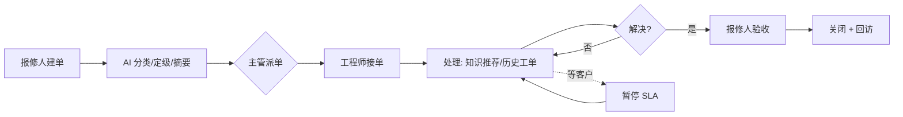
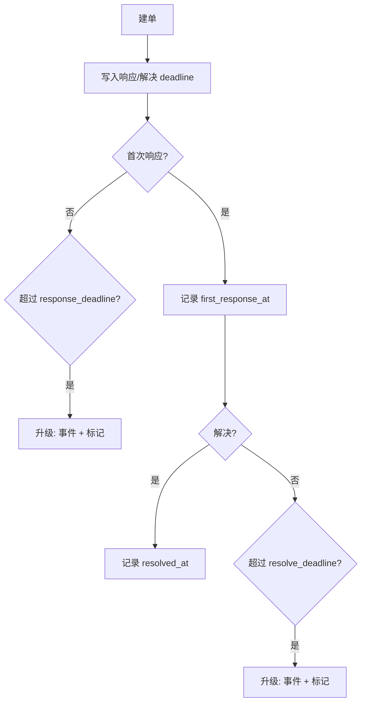
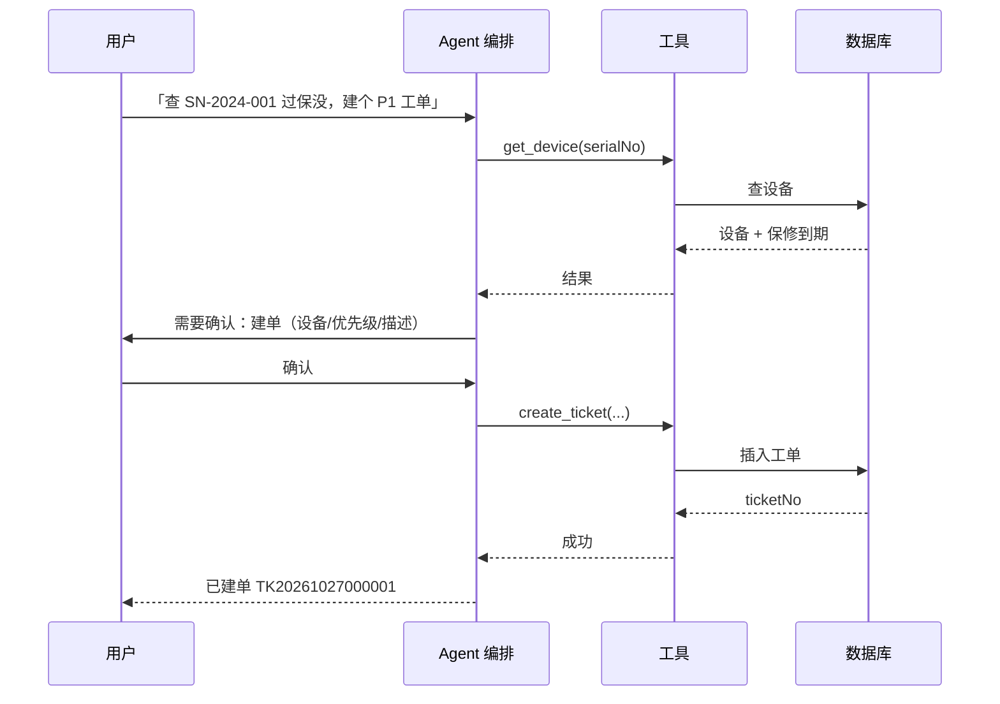

# 智维工单（ServiceDesk AI）· 产品文档

> 版本：V1.0　｜　日期：2026-10-27　｜　状态：设计定稿，待开发
> 读者：产品、后端、前端、测试
> 关联文档：[ER 图](ER图.md) ｜ [接口文档](接口文档.md)

---

## 1. 文档信息

| 项 | 内容 |
| --- | --- |
| 产品名 | 智维工单（ServiceDesk AI） |
| 一句话 | 报修人用自然语言/图片报修，AI 自动分类定级并推荐知识，Agent 帮工程师查设备、查进度、建单、派单，主管用自然语言看 SLA 与故障报表 |
| 业务域 | 中小企业设备售后 / 物业报修 / IT 运维 |
| 本期范围 | 本地可运行的全栈 MVP（不做部署、不做多租户） |
| 文档边界 | 只定义「做什么、为什么、怎么验收」，不写代码实现细节 |
| 关联 | 14 张表、51 个接口、4 个角色、9 个工单状态 |

---

## 2. 产品概述

### 2.1 背景

设备售后和物业报修普遍存在四个问题：

1. **报修信息散**：电话、微信、口头传递，缺少设备型号、故障现象、紧急度，工程师到场才发现带错工具。
2. **派单靠人**：主管凭经验分配，忙闲不均，紧急单被压在普通单后面。
3. **知识不沉淀**：老师傅的经验在个人脑子里，新人重复踩坑；历史工单解决过的问题搜不到。
4. **SLA 靠催**：响应/解决时限没有系统计时，超时无人知道，月底靠 Excel 复盘。

大模型能解决的是其中「理解与检索」的部分：把自然语言变成结构化工单、把历史知识送到工程师手边、把自然语言变成报表。但**流程、权限、时效、审计**仍然要靠传统工程做扎实——这正是本项目的定位。

### 2.2 目标用户

| 用户 | 典型场景 | 核心诉求 |
| --- | --- | --- |
| 报修人（客户/员工） | 设备坏了，想尽快有人处理 | 少填表、能传图、知道进度 |
| 工程师 | 一天 5-10 单，现场排查 | 快速看懂问题、查到历史方案、少返工 |
| 主管 | 盯 SLA、派单、处理升级 | 知道谁忙、哪单要超时、团队产出 |
| 管理员 | 维护账号、团队、SLA、知识库 | 配置可控、操作可追溯 |

### 2.3 产品目标

| 目标 | 衡量方式 |
| --- | --- |
| 降低建单成本 | 建单平均耗时、AI 预填采纳率 |
| 提升一次解决率 | 首次解决率、返工率 |
| 缩短处理时长 | 平均响应时长、MTTR |
| 让知识可复用 | RAG 引用采纳率、知识命中率 |
| 让 SLA 可考核 | SLA 达成率、超时单占比 |

> 本期不承诺具体数值；所有指标在开发完成后用真实数据填 `【】`。

### 2.4 价值主张

- 对报修人：说一句话就能建单，能看图、能看进度。
- 对工程师：AI 把「可能相关的手册和历史工单」直接推到手边，带引用可核对。
- 对主管：SLA 倒计时、超时升级、团队负载一屏可见。
- 对企业：知识沉淀在系统里，不随人走。

### 2.5 范围

**做（MVP）**：账号与角色、工单全生命周期、SLA 计时与升级、知识库与 RAG、AI 建单分类、Agent 工具调用、运营看板、基础系统管理。

**不做（本期）**：多租户、动态 RBAC、复杂工作流引擎、多智能体、图数据库、支付、独立向量集群、站内通知（P2）、流式输出（P2）。

---

## 3. 角色与权限

### 3.1 角色定义

| 角色 | 代码 | 说明 |
| --- | --- | --- |
| 报修人 | `REPORTER` | 提交工单、补充说明、评价 |
| 工程师 | `ENGINEER` | 接单、处理、写记录、请求支援 |
| 主管 | `SUPERVISOR` | 派单、升级、看团队 SLA 与负载 |
| 管理员 | `ADMIN` | 用户/团队/客户/设备/SLA/知识库/全部工单 |

### 3.2 权限矩阵

| 操作 | 报修人 | 工程师 | 主管 | 管理员 |
| --- | --- | --- | --- | --- |
| 查看全部工单 | — | — | — | ✅ |
| 查看本团队工单 | — | — | ✅ | ✅ |
| 查看指派给自己的工单 | — | ✅ | ✅ | ✅ |
| 查看自己提交的工单 | ✅ | — | — | ✅ |
| 建单 | ✅ | ✅ | ✅ | ✅ |
| 编辑工单 | 仅本人、未派单前 | — | ✅ | ✅ |
| 派单 | — | — | ✅ | ✅ |
| 接单/处理 | — | 仅指派给自己 | — | ✅ |
| 状态流转 | 取消/验收/重开 | 接单/开始/等客户/解决 | 取消/验收/重开 | ✅ |
| 知识库管理 | — | — | ✅ | ✅ |
| 查看报表 | — | — | ✅ | ✅ |
| 用户/团队管理 | — | — | — | ✅ |
| 客户/设备档案 | — | — | ✅ | ✅ |
| Agent 写操作 | 建单 | 建单/升级 | 建单/派单/升级 | ✅ |

### 3.3 数据范围规则

| 角色 | SQL 过滤条件 |
| --- | --- |
| `REPORTER` | `ticket.reporter_id = 当前用户` |
| `ENGINEER` | `ticket.assignee_id = 当前用户` |
| `SUPERVISOR` | `ticket.team_id IN (当前用户管理的团队)` |
| `ADMIN` | 无限制 |

**原则**：

1. 数据范围在 **Service/查询层** 统一拼接，不在 Controller 手写 if，也不依赖前端过滤。
2. 越权与不存在统一返回 404，防止通过响应差异枚举他人资源。
3. 模型永远拿不到 `userId`；工具执行前从服务端上下文取，模型传了也忽略。
4. 列表、详情、导出、统计使用同一套数据范围，避免「列表看不到、详情能打开」。

---

## 4. 核心业务流程

### 4.1 报修闭环

### 4.2 SLA 计时与升级

### 4.3 AI 辅助建单

1. 报修人填写标题、描述，可选上传图片、选择设备。
2. 点击「AI 帮我填」，调用分类接口，返回分类/紧急度/设备型号/摘要/置信度。
3. 置信度 ≥ 0.65：字段直接预填，展示「AI 建议」标识。
4. 置信度 < 0.65：字段预填但标黄，提示「AI 不确定，请确认」。
5. 用户可修改任意字段；修改后提交，记录 `ai_corrected=1`。
6. AI 调用失败：不阻塞建单，字段留空，提示「AI 暂不可用，可手动填写」。

### 4.4 知识推荐

1. 工程师打开工单详情，点击「推荐方案」。
2. 系统用工单标题 + 描述 + 设备型号做检索。
3. 返回 Top5 知识片段，每条带来源（文章标题/章节/片段）和相似度。
4. 工程师可「采纳」（把建议写入处理记录，并带上引用）或「忽略」；采纳情况通过处理记录与人工抽查评估，MVP 不做单独的反馈接口。
5. 无命中时明确回「知识库暂未收录」，不生成无依据的答案。

### 4.5 Agent 工具调用

**工具清单（v1）**：

| 工具 | 参数 | 类型 | 权限 |
| --- | --- | --- | --- |
| `search_knowledge` | query, topK | 只读 | 登录用户 |
| `get_device` | serialNo | 只读 | 登录用户 |
| `get_ticket` | ticketNo | 只读 | 数据范围内 |
| `create_ticket` | customerId, deviceId?, title, description, category?, urgency? | 写，需确认 | 登录用户 |
| `assign_ticket` | ticketId, assigneeId | 写，需确认 | 主管/管理员 |
| `escalate_ticket` | ticketId, reason | 写，需确认 | 工程师/主管/管理员 |

**规则**：

- 只读工具可直接执行；写工具必须二次确认。
- 确认令牌一次性、5 分钟有效、绑定当前用户。
- 同一用户 + 同一工具 + 同一参数 hash，重复确认只执行一次。
- 最多 5 步、单步 30 秒、总 token 预算 12k；超限终止并给可读原因。
- 每步落 `agent_step`，可回放「AI 做了什么」。

### 4.6 报表

- 预置看板：SLA 达成率、工单量趋势、故障 TopN、工程师负载、平均处理时长。
- 自然语言报表：输入「本周各团队 SLA 达成率」，生成 SQL → 校验 → 执行 → 图表 + 一句结论。
- 展示生成的 SQL，用户可核对；失败回退到预置报表。

---

## 5. 功能需求

> 优先级：P0 = MVP 必须；P1 = 本期尽量；P2 = 后续。
> 每条验收标准都可直接转成测试用例。

### 5.1 账号与认证

| 编号 | 名称 | 优先级 | 描述 | 验收标准 |
| --- | --- | --- | --- | --- |
| A-01 | 登录 / 登出 / 当前用户 | P0 | 用户名密码登录，BCrypt 校验，签发 JWT（7 天）；`/me` 返回角色与团队；登出后 token 失效 | 正确密码登录成功；错误密码 401；过期/登出 token 401；`/me` 字段完整 |
| A-02 | 角色与数据权限 | P0 | 4 角色 + 数据范围；越权与不存在统一 404 | 报修人访问他人工单 404；工程师访问非指派 404；主管跨团队 404；管理员全量可见 |
| A-03 | 邮箱验证码登录 | P0 | 邮箱 + 6 位验证码登录；验证码存 Redis，5 分钟有效、单次使用、连续 5 次错误作废；登录场景不暴露邮箱是否存在 | 正确验证码登录成功；过期或重复使用 400；未注册邮箱与验证码错误返回同一提示 |
| A-04 | 邮箱验证码注册 | P0 | 唯一注册入口：邮箱 + 验证码 + 用户名 + 密码 + 姓名；注册成功固定 `REPORTER`、无团队、直接签发 token | 无效验证码 400；邮箱或用户名重复 409；注册后无需再登录即可进入系统 |

### 5.2 工单管理

| 编号 | 名称 | 优先级 | 描述 | 验收标准 |
| --- | --- | --- | --- | --- |
| T-01 | 建单 | P0 | 必填标题/描述/客户；可选设备/分类/紧急度/图片；生成工单号；按策略写入 SLA deadline；状态 NEW | 缺参 400；成功返回 ticketNo 与两个 deadline；附件正确关联 |
| T-02 | 工单列表 | P0 | 按关键词/状态/紧急度/分类/工程师/团队/我相关筛选；分页；默认创建时间倒序 | 分页 total 正确；数据范围生效；关键词匹配标题/工单号 |
| T-03 | 工单详情 | P0 | 工单 + 客户/设备 + SLA + AI 摘要 + 附件 + 最近时间线 | 越权 404；SLA 剩余时间正确；AI 引用可定位 |
| T-04 | 编辑工单 | P0 | 报修人仅未派单前可改；主管/管理员随时可改；乐观锁防并发 | 非本人 403/404；状态不允许 409；version 冲突 409 |
| T-05 | 取消工单 | P1 | 报修人（本人）/主管/管理员可取消；终态不可取消；必填原因 | 非法状态 409；原因为空 400；时间线记录原因 |
| T-06 | 工单评价 | P1 | 已关闭工单由报修人评价 1-5 分 + 评论；一单一评 | 未关闭 409；重复评价 409；分数越界 400 |

### 5.3 工单流转

| 编号 | 名称 | 优先级 | 描述 | 验收标准 |
| --- | --- | --- | --- | --- |
| F-01 | 派单 | P0 | 主管/管理员把 NEW/REOPENED 工单派给本团队工程师；记录 assignee/team | 非主管 403；非工程师 400；重复派单 409 |
| F-02 | 状态流转 | P0 | 按状态机迁移；校验角色；乐观锁；写事件；维护 SLA 时间戳 | 非法迁移 409；接单写 first_response_at；解决写 resolved_at；关闭仅能从 RESOLVED |
| F-03 | 处理记录 / 内部备注 | P0 | 工程师写处理记录；`internal=true` 仅工程师/主管/管理员可见；首条工程师记录补 first_response_at | 报修人看不到内部备注；空内容 400；时间线顺序正确 |
| F-04 | 时间线 | P0 | 按时间正序返回创建、派单、接单、记录、状态变更、AI 建议、升级 | 所有事件可见；内部备注按角色过滤 |
| F-05 | 附件 | P1 | 上传 jpg/png/pdf/docx/md，≤10MB；UUID 重命名；本地存储；可删除 | 类型/大小 400；URL 可访问；删除权限正确 |

### 5.4 SLA 与升级

| 编号 | 名称 | 优先级 | 描述 | 验收标准 |
| --- | --- | --- | --- | --- |
| S-01 | SLA 策略管理 | P0 | 按优先级配置响应/解决时限；启用/停用；优先级唯一 | 重复优先级 409；非正数 400；停用后新单不使用 |
| S-02 | SLA 倒计时 / 暂停 / 恢复 | P0 | 建单写 deadline；`WAITING_CUSTOMER` 暂停；恢复补时；暂停上限 7 天 | Clock 单测：暂停 2h 后 deadline 后移 2h；超 7 天自动恢复并按 7 天补 |
| S-03 | 超时升级 | P0 | 每分钟扫描响应/解决超时；写 ESCALATE 事件；标记升级时间；幂等 | 每类超时只升级一次；时间线可见；不会每分钟重复 |
| S-04 | 升级记录与看板 | P1 | 列表筛选「已升级」；看板展示超时单数量与分布 | 筛选结果与事件一致；统计与明细对得上 |

### 5.5 知识库

| 编号 | 名称 | 优先级 | 描述 | 验收标准 |
| --- | --- | --- | --- | --- |
| K-01 | 知识文章管理 | P0 | 文章增删改查；分类；状态（PENDING/PARSING/INDEXING/READY/FAILED） | CRUD 正常；删除后不再被检索；状态流转可见 |
| K-02 | 文档上传 / 解析 / 分块 / 索引 | P0 | 上传 pdf/docx/md；异步解析、结构分块、Embedding、写 chunk；可重建 | 上传后状态到 READY；失败有原因；重复上传不重复召回 |
| K-03 | 检索调试 | P1 | 输入 query，返回向量/关键词/融合后的 TopN 与分数 | 能对比融合前后；分数与排序可见 |

### 5.6 AI 能力

| 编号 | 名称 | 优先级 | 描述 | 验收标准 |
| --- | --- | --- | --- | --- |
| AI-01 | 建单分类 / 定级 / 摘要 | P0 | 输入标题/描述/图片，输出分类/紧急度/设备型号/摘要/置信度 | JSON 可解析；低置信度标记；失败不阻塞建单 |
| AI-02 | 知识推荐 + 引用 | P0 | 工单 → Top5 知识片段；每条带来源与相似度；无命中明确拒答 | 引用可定位；无命中不编；采纳/忽略有记录 |
| AI-03 | Agent 工具调用 | P0 | 6 个工具；ReAct 编排；写操作确认；幂等；审计 | 10 条脚本成功率 ≥80%；越权 100% 拦截；重复确认只执行一次 |
| AI-04 | NL2SQL 报表 | P1 | 自然语言 → SQL → 校验 → 执行 → 图表 + 结论 | 只允许 SELECT；超 200 行截断；50 条 Execution Accuracy【】% |
| AI-05 | 工单摘要 / 质检 | P2 | 解决后生成摘要；抽检处理记录是否违规承诺/泄露信息 | 摘要可读；抽检结果可追溯 |

### 5.7 报表

| 编号 | 名称 | 优先级 | 描述 | 验收标准 |
| --- | --- | --- | --- | --- |
| R-01 | 运营看板 | P1 | SLA 达成率、工单量趋势、故障 TopN、工程师负载、平均处理时长 | 时间范围可调；数字与明细一致 |

### 5.8 系统管理

| 编号 | 名称 | 优先级 | 描述 | 验收标准 |
| --- | --- | --- | --- | --- |
| M-01 | 用户管理 | P0 | 用户增改、启停、分配角色/团队；密码重置 | 用户名唯一；停用后不能登录；角色变更即时生效 |
| M-02 | 团队管理 | P0 | 团队增改；指定主管 | 团队名唯一；主管只能看自己团队 |
| M-03 | 客户与设备档案 | P0 | 客户/设备增改查；设备序列号唯一；保修到期日 | 序列号重复 409；保修状态可计算；工单可关联 |

---

## 6. 页面与交互

### 6.1 页面清单

| 编号 | 页面 | 路由 | 可见角色 | 核心内容 |
| --- | --- | --- | --- | --- |
| P-01 | 登录 | `/login` | 全部 | 用户名/密码、错误提示、登录后跳转 |
| P-02 | 工作台 | `/dashboard` | 全部 | 我的待办、SLA 告警、团队概览（按角色） |
| P-03 | 工单列表 | `/tickets` | 全部 | 筛选、分页、状态标签、SLA 倒计时 |
| P-04 | 工单详情 | `/tickets/:id` | 全部（按数据范围） | 描述、时间线、AI 建议、SLA、操作区 |
| P-05 | 建单 | `/tickets/new` | 全部 | 表单、AI 预填、图片上传 |
| P-06 | 知识库列表 | `/kb` | 主管/管理员 | 文章列表、状态、重建索引 |
| P-07 | 知识文章编辑 | `/kb/:id` | 主管/管理员 | 标题/分类/正文、上传、索引状态 |
| P-08 | 报表 | `/reports` | 主管/管理员 | 预置图表、NL2SQL 输入与结果 |
| P-09 | 用户管理 | `/admin/users` | 管理员 | 列表、新建、编辑、启停 |
| P-10 | 团队管理 | `/admin/teams` | 管理员 | 列表、新建、编辑、主管 |
| P-11 | 客户与设备 | `/admin/assets` | 主管/管理员 | 客户/设备两个 Tab、增改查 |
| P-12 | 注册 | `/register` | 未登录用户 | 邮箱 + 验证码 + 用户名/密码/姓名，提交后自动登录 |
| C-01 | Agent 抽屉 | 全局组件 | 全部 | 对话、工具步骤、确认卡片 |

### 6.2 关键页面说明

#### P-01 登录

- 布局：左侧品牌区（产品名 + 一句话），右侧表单。
- 字段：用户名、密码；回车提交；登录中禁用按钮。
- 错误：401 显示「用户名或密码错误」；网络错误显示「服务暂不可用」。
- 登录成功：按角色跳转（管理员/主管 → 工作台；工程师 → 工单列表；报修人 → 我的工单）。

#### P-02 工作台

- 顶部卡片：待处理、即将超时、今日解决、SLA 达成率（按角色显示不同范围）。
- 中部：SLA 告警列表（按剩余时间升序）、我的待办。
- 底部：近 7 天工单趋势（ECharts 折线）。
- 空状态：无待办时显示「今天没有待处理工单」。

#### P-03 工单列表

- 筛选区：关键词、状态、紧急度、分类、工程师、团队、「我相关」开关。
- 表格列：工单号、标题、客户、设备、分类、紧急度、状态、工程师、SLA 剩余、创建时间。
- 状态用彩色标签；SLA 剩余 < 30 分钟标红，已超时显示「已超时」。
- 行点击进详情；分页 10/20/50。

#### P-04 工单详情

- 左栏：标题、描述、附件、时间线（按时间正序，内部备注带「内部」标签）。
- 右栏：客户/设备卡片、SLA 卡片（响应/解决两个倒计时）、AI 建议卡片（Top5 + 引用 + 采纳/忽略）、操作按钮（派单/接单/开始/等客户/解决/关闭/重开/取消，按状态与角色显示）。
- 底部：处理记录输入框 + 「内部备注」开关。
- 已关闭工单：报修人可评价（1-5 分 + 评论）；已评价则显示分数与内容。
- 状态操作前弹确认框，展示「当前状态 → 目标状态」。

#### P-05 建单

- 字段：标题、描述、客户（搜索选择）、设备（可选，按客户过滤）、分类、紧急度、图片（先上传为附件，提交时关联工单）。
- 「AI 帮我填」按钮：调用分类接口，字段预填；低置信度标黄。
- 提交前校验：标题 ≤128、描述非空、客户必选。
- 成功后跳详情，Toast 显示工单号。

#### P-06 / P-07 知识库

- 列表：标题、分类、状态、分块数、更新时间、操作（编辑/重建索引/删除）。
- 状态标签：PENDING 灰、PARSING/INDEXING 蓝、READY 绿、FAILED 红（悬浮显示原因）。
- 编辑页：标题、分类、正文（Markdown）、上传文件、保存并索引。
- 重建索引：二次确认；期间禁止重复触发。

#### P-08 报表

- 顶部时间范围（今日/近 7 天/近 30 天/自定义）。
- 卡片 + 图表：SLA 达成率、工单量、故障 TopN、工程师负载。
- NL2SQL 输入框：示例问题 chips；生成后展示 SQL、表格、图表、一句结论；失败显示「换一种问法」。

#### P-09 ~ P-11 管理页

- 统一列表 + 右侧抽屉表单；删除用「停用」替代（保留历史数据）。
- 用户：用户名、姓名、角色、团队、状态；重置密码。
- 团队：名称、主管、成员数。
- 客户/设备：两个 Tab；设备必须挂客户；序列号唯一。

#### P-12 注册

- 入口：登录页「还没有账号？立即注册」。
- 字段：邮箱、验证码（右侧「获取验证码」，点击后 60 秒倒计时置灰）、用户名、密码、姓名。
- 交互：先填邮箱并获取验证码，验证码 5 分钟内有效；密码 8-32 位且需同时包含字母与数字。
- 错误：邮箱已注册 409 提示「该邮箱已注册，可直接登录」；验证码错误或过期 400 提示「验证码无效或已过期」。
- 成功：直接返回 token 并进入工作台，无需二次登录。

#### C-01 Agent 抽屉

- 右下角浮动按钮打开；对话消息 + 工具步骤折叠面板。
- 写操作时出现确认卡片：工具名、参数、影响对象、「确认执行/取消」。
- 执行后展示结果与工单号；失败展示原因与「重试」。
- 可查看本次 run 的步骤（LLM/TOOL、耗时、状态）。

### 6.3 通用交互规则

- 加载：骨架屏/按钮 loading，禁止重复提交。
- 空：明确说明「还没有数据」并给下一步按钮。
- 错：400 展示字段错误；401 跳登录；403 提示无权限；404 提示不存在；409 提示「状态已变化，请刷新」；503 提示「AI 服务繁忙」。
- 危险操作（取消/删除/重建索引/写工具）：二次确认。
- 所有列表记住筛选条件（URL query 或 store）。

---

## 7. 业务规则

### 7.1 状态机

| 当前状态 | 事件 | 下一状态 | 允许角色 | SLA / 副作用 |
| --- | --- | --- | --- | --- |
| `NEW` | 派单 | `ASSIGNED` | 主管/管理员 | 记录 assignee/team；响应时钟继续 |
| `ASSIGNED` | 接单 | `ACCEPTED` | 被派工程师 | 写 `first_response_at`（若为空） |
| `ACCEPTED` | 开始处理 | `IN_PROGRESS` | 工程师 | — |
| `IN_PROGRESS` | 等客户 | `WAITING_CUSTOMER` | 工程师 | 写 `paused_at`，时钟暂停 |
| `WAITING_CUSTOMER` | 客户回复 | `IN_PROGRESS` | 工程师/系统 | 补回暂停时长，`paused_at=null` |
| `IN_PROGRESS` | 解决 | `RESOLVED` | 工程师 | 写 `resolved_at`，解决时钟停止 |
| `RESOLVED` | 验收 | `CLOSED` | 报修人/主管/管理员 | 写 `closed_at`，终态 |
| `RESOLVED` | 重开 | `REOPENED` | 报修人/主管/管理员 | `resolved_at=null`；`resolve_deadline=now+策略`；重置解决升级标记 |
| `REOPENED` | 继续处理 | `IN_PROGRESS` | 工程师 | — |
| `REOPENED` | 派单 | `ASSIGNED` | 主管/管理员 | 重新指定工程师 |
| `NEW/ASSIGNED/ACCEPTED/IN_PROGRESS/WAITING_CUSTOMER/REOPENED` | 取消 | `CANCELLED` | 报修人（本人）/主管/管理员 | 必填原因；时钟停止；`RESOLVED` 不可取消，只能关闭或重开 |

**规则**：

- 非法迁移返回 409，message 带当前状态。
- 每次迁移写 `ticket_event`（from/to/operator/备注）。
- `ticket.version` 乐观锁；更新失败返回 409「工单已被他人修改」。
- `ESCALATED` 不是状态，是标记 + 事件。

### 7.2 SLA 计算

| 规则 | 说明 |
| --- | --- |
| 建单 | `response_deadline = created_at + response_minutes`；`resolve_deadline = created_at + resolve_minutes` |
| 首次响应 | 接单或工程师首条处理记录时写 `first_response_at`（取最早） |
| 暂停 | `WAITING_CUSTOMER` 时 `paused_at=now`，两个 deadline 暂停计算 |
| 恢复 | `paused = now - paused_at`；`paused_total_minutes += paused`；两个 deadline 各加 `paused` |
| 暂停上限 | 单次暂停超过 7 天，自动恢复为 `IN_PROGRESS`，按 7 天补时，写系统事件 |
| 重开 | `resolved_at=null`；`resolve_deadline=now+resolve_minutes`；清空 `resolve_escalated_at` |
| 响应超时 | `first_response_at IS NULL AND now > response_deadline` 且非终态 |
| 解决超时 | `resolved_at IS NULL AND now > resolve_deadline` 且非终态 |
| 升级幂等 | 每类超时只升级一次，写 `response_escalated_at` / `resolve_escalated_at` |

### 7.3 默认 SLA 策略

| 优先级 | 响应 | 解决 | 适用 |
| --- | --- | --- | --- |
| `P0` | 15 分钟 | 2 小时 | 停机、安全、多人受影响 |
| `P1` | 30 分钟 | 4 小时 | 主要功能不可用 |
| `P2` | 2 小时 | 8 小时 | 一般故障 |
| `P3` | 8 小时 | 24 小时 | 咨询、优化建议 |

> 7×24 计时；节假日日历、工作日历为 P2。

### 7.4 权限规则

- 数据范围见 3.3；所有查询/详情/统计共用。
- 编辑：报修人仅本人且状态为 `NEW`；主管/管理员不受限（终态除外）。
- 派单：仅主管/管理员；被派人必须是本团队 `ENGINEER` 或 `ADMIN`。
- 内部备注：`internal=true` 仅工程师/主管/管理员可见。
- 用户停用：立即失效，已登录 token 下一次请求 401。

### 7.5 AI 规则

| 规则 | 说明 |
| --- | --- |
| 分类体系 | 6 类：`HARDWARE/SOFTWARE/CONSUMABLE/INSTALL/COMPLAINT/OTHER` |
| 紧急度 | `P0/P1/P2/P3`，由 AI 建议、人工可改 |
| 置信度 | < 0.65 标记「需人工确认」，不阻断提交 |
| 失败兜底 | 分类失败返回空字段 + 提示；不阻塞建单 |
| RAG | Top5；低于相似度阈值直接拒答；每条必须带引用 |
| Agent 写操作 | 建单/派单/升级必须确认；确认令牌一次性、5 分钟、绑定用户 |
| Agent 限制 | 5 步、单步 30s、总 token 12k；连续失败 2 次终止 |
| NL2SQL | 仅 SELECT；表白名单；自动 LIMIT 200；3s 超时；只读账号 |
| 内容安全 | 用户输入包裹为数据；前端 Markdown 消毒；不输出系统提示词 |

### 7.6 工单号规则

`TK` + `yyyyMMdd` + 6 位日序列，例如 `TK20261027000001`。

- Redis `ticket:seq:{yyyyMMdd}` 自增，TTL 2 天。
- Redis 不可用时，降级为「当日最大工单号 + 1」，并记录告警。
- 工单号唯一索引兜底。

---

## 8. 非功能需求

| 类别 | 要求 |
| --- | --- |
| 性能 | 非 AI 接口 P95 < 500ms；AI 分类 P95 < 8s；RAG 回答 P95 < 10s；列表默认 10 条 |
| 并发 | 单机；工单状态更新用乐观锁；SLA 扫描单实例，抢锁防重复 |
| 安全 | JWT + BCrypt；参数校验；MyBatis 预编译；上传白名单 + 大小限制；图片 URL 白名单防 SSRF；Prompt 注入防护；NL2SQL 只读 + AST 校验 |
| 可用性 | 本地单机；关键依赖失败给可读提示，不白屏 |
| 成本 | 单工单 AI 成本上限 `【】` 元；按用户日 token 配额；同类问题缓存 |
| 可观测 | `llm_call` 记录 traceId/模型/token/耗时/成本；Actuator 健康检查；关键操作日志 |
| 兼容 | Chrome/Edge 最近两个大版本；最小 1280×800 |
| 数据 | 软删除/停用保留历史；工单终态不物理删除 |

---

## 9. 数据指标与验收

### 9.1 产品指标

| 指标 | 定义 | 目标 |
| --- | --- | --- |
| AI 预填采纳率 | 未修改直接提交的建单数 / 使用 AI 预填的建单数 | 记录实测 |
| 分类准确率 | 与人工标注一致的单数 / 标注总数 | ≥ 80% |
| 首次解决率 | 一次解决且未重开的工单 / 已解决工单 | 记录实测 |
| MTTR | 平均（resolved_at - created_at） | 记录实测 |
| SLA 达成率 | 未超时工单 / 应完成工单 | 记录实测 |
| 知识采纳率 | 采纳推荐的处理记录数 / 推荐次数 | 记录实测 |
| 单工单 AI 成本 | 该工单所有 llm_call 成本之和 | 记录实测 |

### 9.2 本期验收基线

- 31 条 FR 的验收标准全部通过。
- 演示脚本可完整跑通（见 9.3）。
- 三份文档一致：角色/状态/14 张表/51 个接口无冲突。
- 无 P0 缺陷；P1 缺陷有记录和绕行方案。

### 9.3 演示脚本

1. 报修人提交「空压机异响，已过保？」，AI 分类为硬件故障/P1，摘要一句话。
2. 主管在工作台看到 SLA 倒计时，派给张工。
3. 张工接单，右侧知识推荐 3 条（手册 + 历史工单），点开引用，采纳并写处理记录。
4. 张工解决，报修人验收，工单关闭。
5. 主管问「本周各团队 SLA 达成率」，NL2SQL 出柱状图 + 结论。
6. Agent：「查 SN-2024-001 过保没，建个 P1 工单」，确认后返回工单号。

---

## 10. 版本规划

| 版本 | 范围 | 对应周 |
| --- | --- | --- |
| MVP | A/T/F/S/K/AI-01~03/M 全部 P0 | W1-W6 |
| P1 | R-01、AI-04、S-04、T-05、T-06、F-05 | W7 |
| P2 | 站内通知、流式输出、AI-05、多租户、MCP、节假日日历 | 后续 |

---

## 11. 风险与开放问题

| 风险 | 影响 | 对策 |
| --- | --- | --- |
| 范围膨胀 | 做不完 | 死守 P0；P1 可砍；先跑通闭环 |
| 分类准确率低 | 演示难看 | 6 类 taxonomy 先定死；100 条标注；规则兜底 |
| SLA 难演示 | 等不到超时 | 策略配 2 分钟；Clock 单测 |
| NL2SQL 翻车 | 演示尴尬 | 限 6 张表、50 条问题、失败回退预置报表 |
| AI 成本 | 账单 | 配额 + 缓存 + 只对 Top20 重排 |
| 本地存储迁移 | 后续换 OSS | `FileStorageService` 接口化，本地实现可替换 |

**开放问题**：

1. 真实客户/设备数据从哪来？——先用种子数据（30 客户、50 设备、200 工单）。
2. 是否需要邮件/短信通知？——P2，先站内。
3. 知识库内容版权？——只用公开手册/自写文档/脱敏历史工单。

---

## 12. 附录

### 12.1 枚举字典

| 枚举 | 值 |
| --- | --- |
| 角色 | `REPORTER` / `ENGINEER` / `SUPERVISOR` / `ADMIN` |
| 工单状态 | `NEW` / `ASSIGNED` / `ACCEPTED` / `IN_PROGRESS` / `WAITING_CUSTOMER` / `RESOLVED` / `CLOSED` / `REOPENED` / `CANCELLED` |
| 分类 | `HARDWARE` / `SOFTWARE` / `CONSUMABLE` / `INSTALL` / `COMPLAINT` / `OTHER` |
| 紧急度 | `P0` / `P1` / `P2` / `P3` |
| 事件类型 | `CREATE` / `ASSIGN` / `ACCEPT` / `START` / `WAIT_CUSTOMER` / `RESUME` / `COMMENT` / `RESOLVE` / `CLOSE` / `REOPEN` / `CANCEL` / `ESCALATE` / `AI_SUGGEST` / `ATTACH` |
| 知识库状态 | `PENDING` / `PARSING` / `INDEXING` / `READY` / `FAILED` |
| Agent 状态 | `RUNNING` / `SUCCESS` / `FAILED` / `NEED_CONFIRM` |
| Agent 步骤类型 | `LLM` / `TOOL` |

### 12.2 术语

| 术语 | 说明 |
| --- | --- |
| SLA | 服务级别协议，本项目指响应/解决时限 |
| 首响 | 工程师第一次有效响应（接单或首条处理记录） |
| MTTR | 平均修复时长 |
| RAG | 检索增强生成 |
| Agent | 能调用工具、分步完成任务的模型编排 |
| NL2SQL | 自然语言转 SQL |

---

*本文档与 ER 图、接口文档共同构成开发契约；改任何一处，必须同步另外两处。*
