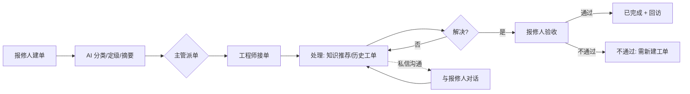
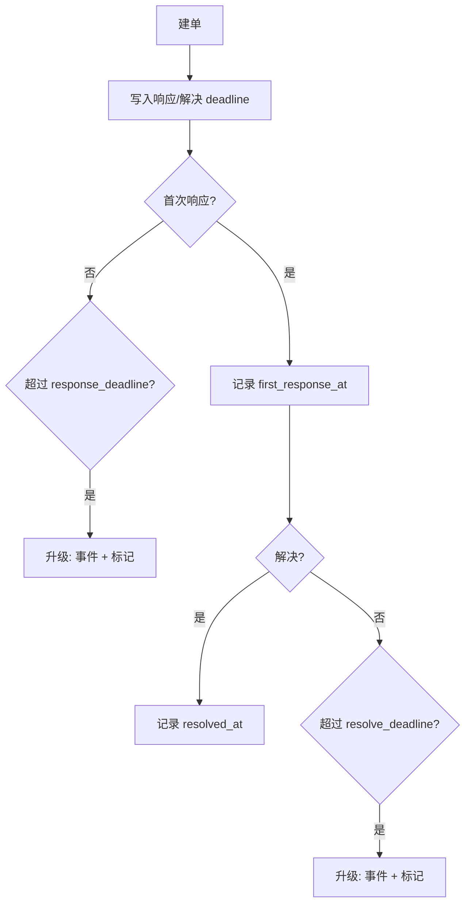
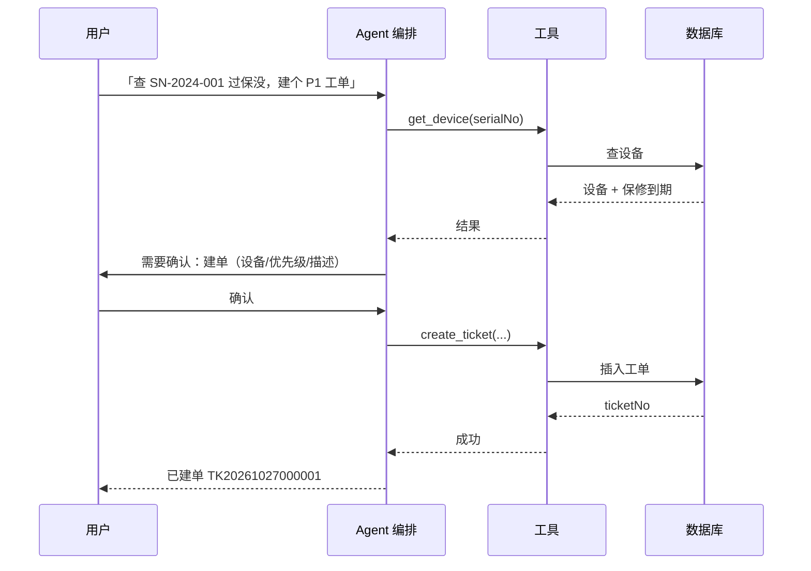

# 智维工单（ServiceDesk AI）· 开发文档

> 版本：V1.2　｜　日期：2026-11-22　｜　状态：开发中，业务规则与实现同步维护
> 读者：后端、前端、测试
> 关联文档：[ER 图](ER图.md) ｜ [接口文档](接口文档.md) ｜ [开发排期](开发排期.md) ｜ 编码规范（本地）

---

## 1. 文档信息

| 项 | 内容 |
| --- | --- |
| 产品名 | 智维工单（ServiceDesk AI） |
| 一句话 | 报修人用自然语言/图片报修，AI 自动分类定级并推荐知识，Agent 帮工程师查设备、查进度、建单、派单，主管用自然语言看 SLA 与故障报表 |
| 业务域 | 中小企业设备售后 / 物业报修 / IT 运维 |
| 本期范围 | 本地可运行的全栈 MVP（不做部署、不做多租户） |
| 文档边界 | 只定义「做什么、业务规则、怎么验收」，不写代码实现细节与表字段类型 |
| 关联 | 14 张表、51 个接口、4 个角色、9 个工单状态、32 条功能需求 |
| 产品背景 | 见 [README](../../../../README.md)「项目介绍」（背景、目标用户、产品目标、价值主张） |

---

## 2. 范围与边界

### 2.1 本期做（MVP）

| 域 | 内容 | 对应需求 |
| --- | --- | --- |
| 账号 | 用户名密码登录、邮箱验证码登录 / 注册、角色与数据范围、JWT 与停用即失效 | A-01 ~ A-04 |
| 工单 | 建单、列表、详情、编辑、取消、评价；8 状态流转；时间线；附件；私信 | T-01 ~ T-06、F-01 ~ F-06 |
| SLA | 策略管理、双时钟、超时升级、升级看板 | S-01 ~ S-04 |
| 知识库 | 文章 CRUD、解析分块索引、检索调试、RAG 推荐 | K-01 ~ K-03、AI-02 |
| AI | 建单分类定级摘要、Agent 工具调用、NL2SQL、摘要质检 | AI-01 ~ AI-05 |
| 报表 | 运营看板、工作台聚合 | R-01、R-02 |
| 系统管理 | 用户、团队、客户与设备档案 | M-01 ~ M-03 |

### 2.2 本期不做

多租户、动态 RBAC、工作流引擎、多智能体、图数据库、支付、独立向量数据库集群（Milvus / Pinecone 等，本期用 PostgreSQL + pgvector）、站内通知（P2）、流式输出（P2）、节假日日历（P2）。

### 2.3 文档分工

| 文档 | 负责什么 | 不写什么 |
| --- | --- | --- |
| 本文档 | 做什么、业务规则、页面交互、验收标准 | 代码实现细节、字段类型 |
| [ER 图](ER图.md) | 表结构、字段、索引、关系、枚举存储值 | 业务流程 |
| [接口文档](接口文档.md) | 路径、方法、权限、出入参、错误码、响应样例 | 业务规则（只留引用） |
| [开发排期](开发排期.md) | 周次、切片、当前进度、降级与回补 | 需求定义 |
| 编码规范 | 分层、命名、事务、日志、测试 | 业务规则 |

---

## 3. 角色与权限

### 3.1 角色定义

| 角色 | 代码 | 说明 |
| --- | --- | --- |
| 报修人 | `REPORTER` | 提交工单、补充说明、评价 |
| 工程师 | `ENGINEER` | 接单、处理、写记录、请求支援 |
| 主管 | `SUPERVISOR` | 派单、升级、看团队 SLA 与负载 |
| 管理员 | `ADMIN` | 用户/团队/客户/设备/SLA/知识库/全部工单 |

### 3.2 权限矩阵

| 操作 | 报修人 | 工程师 | 主管 | 管理员 |
| --- | --- | --- | --- | --- |
| 查看全部工单 | — | — | — | ✅ |
| 查看本团队工单 | — | — | ✅ | ✅ |
| 查看指派给自己的工单 | — | ✅ | ✅ | ✅ |
| 查看自己提交的工单 | ✅ | — | — | ✅ |
| 建单 | ✅ | ✅ | ✅ | ✅ |
| 编辑工单 | 仅本人、未派单前 | — | ✅ | ✅ |
| 派单 | — | — | ✅ | ✅ |
| 接单/处理 | — | 仅指派给自己 | — | ✅ |
| 状态流转 | 取消/验收/验收不通过 | 接单/开始/解决 | 取消/验收/验收不通过 | ✅ |
| 工单私信 | 与处理工程师对话 | 与报修人对话 | —（不可读） | —（不可读） |
| 知识库管理 | — | — | ✅ | ✅ |
| 查看报表 | — | — | ✅ | ✅ |
| 用户/团队管理 | — | — | — | ✅ |
| 客户/设备档案 | — | — | ✅ | ✅ |
| 个人资料 / 改密 | 本人 | 本人 | 本人 | 本人 |
| Agent 写操作 | 建单 | 建单/升级 | 建单/派单/升级 | ✅ |

### 3.3 数据范围规则

数据范围（行级权限）与功能权限是两件事：功能权限决定「能不能调这个接口」，数据范围决定「调了之后能看到哪些行」。

#### 3.3.1 工单

| 角色 | SQL 过滤条件 |
| --- | --- |
| `REPORTER` | `ticket.reporter_id = 当前用户` |
| `ENGINEER` | `ticket.assignee_id = 当前用户` |
| `SUPERVISOR` | `ticket.team_id IN (当前用户管理的团队)` |
| `ADMIN` | 无限制 |

工程落地：规则在 `domain/ticket/TicketScope`，取数（主管管理的团队）在 `service/support/TicketScopeResolver`。

**待派单池过渡口径**：`NEW` 状态的工单尚未归属团队（`ticket.team_id` 为空），按上表主管看不到它们，但派单正需要看到。过渡期允许主管与管理员在**列表查询**中额外放行 `team_id IS NULL AND status = 'NEW'`；该条件不进入 `TicketScope`，也不参与详情判定（待派单工单的详情仍只有管理员可打开）。**派单接口（F-01）单独放行该池**，否则主管无法认领正需要他派的单；派单成功后 `team_id` 随工程师写入，工单随即进入该主管的范围。后续建单时直接写入 `team_id`，届时删除此过渡条件。

#### 3.3.2 用户

| 角色 | SQL 过滤条件 |
| --- | --- |
| `REPORTER` | 仅本人：`sys_user.id = 当前用户` |
| `ENGINEER` | 本团队：`sys_user.team_id = 当前用户所属团队` |
| `SUPERVISOR` | 本团队：`sys_user.team_id IN (当前用户管理的团队)` |
| `ADMIN` | 无限制 |

#### 3.3.3 客户与设备

| 角色 | SQL 过滤条件 |
| --- | --- |
| `REPORTER` | 无列表权限；详情仅限自己工单关联的客户与设备 |
| `ENGINEER` | 与本人工单关联的客户与设备 |
| `SUPERVISOR` | 与本团队工单关联的客户与设备 |
| `ADMIN` | 无限制 |

> 客户与设备的范围需借 `ticket` 表判定（存在关联工单才可见），实现代价明显高于前两张表，安排在工单模块落地后实现；在此之前该功能仅对 `ADMIN` 开放。

**原则**：

1. 数据范围在 **Service/查询层** 统一拼接，不在 Controller 手写 if，也不依赖前端过滤。
2. 越权与不存在统一返回 404，防止通过响应差异枚举他人资源。
3. 模型永远拿不到 `userId`；工具执行前从服务端上下文取，模型传了也忽略。
4. 列表、详情、导出、统计使用同一套数据范围，避免「列表看不到、详情能打开」。
5. 范围为空（例如主管未管理任何团队）表示**看不到任何数据**，绝不能视为「不限条件」。

---

## 4. 核心业务流程

### 4.1 报修闭环

### 4.2 SLA 计时与升级

### 4.3 AI 辅助建单

1. 报修人填写标题、描述，可选上传图片、选择设备。
2. 点击「AI 帮我填」，调用分类接口，返回分类/紧急度/设备型号/摘要/置信度。
3. 置信度 ≥ 0.65：字段直接预填，展示「AI 建议」标识。
4. 置信度 < 0.65：字段预填但标黄，提示「AI 不确定，请确认」。
5. 用户可修改任意字段；修改后提交，记录 `ai_corrected=1`。
6. AI 调用失败：不阻塞建单，字段留空，提示「AI 暂不可用，可手动填写」。

### 4.4 知识推荐

1. 工程师打开工单详情，点击「推荐方案」。
2. 系统用工单标题 + 描述 + 设备型号做检索。
3. 返回 Top5 知识片段，每条带来源（文章标题/章节/片段）和相似度。
4. 工程师可「采纳」（把建议写入处理记录，并带上引用）或「忽略」；采纳情况通过处理记录与人工抽查评估，MVP 不做单独的反馈接口。
5. 无命中时明确回「知识库暂未收录」，不生成无依据的答案。

### 4.5 Agent 工具调用

**工具清单（v1）**：

| 工具 | 参数 | 类型 | 权限 |
| --- | --- | --- | --- |
| `search_knowledge` | query, topK | 只读 | 登录用户 |
| `get_device` | serialNo | 只读 | 登录用户 |
| `get_ticket` | ticketNo | 只读 | 数据范围内 |
| `create_ticket` | customerId, deviceId?, title, description, category?, urgency? | 写，需确认 | 登录用户 |
| `assign_ticket` | ticketId, assigneeId | 写，需确认 | 主管/管理员 |
| `escalate_ticket` | ticketId, reason | 写，需确认 | 工程师/主管/管理员 |

**规则**：

- 只读工具可直接执行；写工具必须二次确认。
- 确认令牌一次性、5 分钟有效、绑定当前用户。
- 同一用户 + 同一工具 + 同一参数 hash，重复确认只执行一次。
- 最多 5 步、单步 30 秒、总 token 预算 12k；超限终止并给可读原因。
- 每步落 `agent_step`，可回放「AI 做了什么」。

### 4.6 报表与工作台

- 工作台：按角色聚合待处理、即将超时、今日解决、SLA 达成率、SLA 告警、我的待办与近 7 天趋势，口径见 7.18。
- 预置看板：SLA 达成率、工单量趋势、故障 TopN、工程师负载、平均处理时长。
- 自然语言报表：输入「本周各团队 SLA 达成率」，生成 SQL → 校验 → 执行 → 图表 + 一句结论。
- 展示生成的 SQL，用户可核对；失败回退到预置报表。

---

## 5. 功能需求

> 优先级：P0 = MVP 必须；P1 = 本期尽量；P2 = 后续。
> 每条验收标准都可直接转成测试用例。

### 5.1 账号与认证

| 编号 | 名称 | 优先级 | 描述 | 验收标准 |
| --- | --- | --- | --- | --- |
| A-01 | 登录 / 登出 / 当前用户 | P0 | 用户名密码登录，BCrypt 校验，签发 JWT（7 天）；`/me` 返回角色与团队；登出后 token 失效 | 正确密码登录成功；错误密码 401；过期/登出 token 401；`/me` 字段完整 |
| A-02 | 角色与数据权限 | P0 | 4 角色 + 数据范围；越权与不存在统一 404 | 报修人访问他人工单 404；工程师访问非指派 404；主管跨团队 404；管理员全量可见 |
| A-03 | 邮箱验证码登录 | P0 | 邮箱 + 6 位验证码登录；验证码存 Redis，5 分钟有效、单次使用、连续 5 次错误作废；登录场景不暴露邮箱是否存在 | 正确验证码登录成功；过期或重复使用 400；未注册邮箱与验证码错误返回同一提示 |
| A-04 | 邮箱验证码注册 | P0 | 唯一注册入口：邮箱 + 验证码 + 用户名 + 密码 + 姓名；注册成功固定 `REPORTER`、无团队、直接签发 token | 无效验证码 400；邮箱或用户名重复 409；注册后无需再登录即可进入系统 |
| A-05 | 个人资料与密码管理 | P0 | 查看本人基本信息与所属团队 / 所属客户；校验原密码后自助修改密码 | 归属二选一展示；原密码错误 400；新旧密码相同 400；未登录 401 |

### 5.2 工单管理

| 编号 | 名称 | 优先级 | 描述 | 验收标准 |
| --- | --- | --- | --- | --- |
| T-01 | 建单 | P0 | 必填标题/描述/客户；可选设备/分类/紧急度/图片；生成工单号；按策略写入 SLA deadline；状态 NEW | 缺参 400；成功返回 ticketNo 与两个 deadline；附件正确关联 |
| T-02 | 工单列表 | P0 | 按关键词/状态/紧急度/分类/工程师/团队/我相关筛选；分页；默认创建时间倒序 | 分页 total 正确；数据范围生效；关键词匹配标题/工单号 |
| T-03 | 工单详情 | P0 | 工单 + 客户/设备 + SLA + AI 摘要 + 附件 + 最近时间线 | 越权 404；SLA 剩余时间正确；AI 引用可定位 |
| T-04 | 编辑工单 | P0 | 报修人仅未派单前可改；主管/管理员随时可改；乐观锁防并发 | 非本人 403/404；状态不允许 409；version 冲突 409 |
| T-05 | 取消工单 | P1 | 报修人（本人）/主管/管理员可取消；终态不可取消；必填原因 | 非法状态 409；原因为空 400；时间线记录原因 |
| T-06 | 工单评价 | P1 | 已关闭工单由报修人评价 1-5 分 + 评论；一单一评 | 未关闭 409；重复评价 409；分数越界 400 |

### 5.3 工单流转

| 编号 | 名称 | 优先级 | 描述 | 验收标准 |
| --- | --- | --- | --- | --- |
| F-01 | 派单 | P0 | 主管/管理员把 NEW 工单派给本团队工程师；记录 assignee/team | 非主管 403；工程师不存在/停用/非工程师/跨团队 400；非 NEW 409 |
| F-02 | 状态流转 | P0 | 按状态机迁移（接单 / 开始处理 / 解决 / 验收通过 / 验收不通过）；校验角色；乐观锁；写事件；维护 SLA 时间戳 | 非法迁移 409；接单写 first_response_at；解决写 resolved_at；验收动作仅能从 RESOLVED |
| F-03 | 处理记录 / 内部备注 | P0 | 工程师写处理记录；`internal=true` 仅工程师/主管/管理员可见；首条工程师记录补 first_response_at | 报修人看不到内部备注；空内容 400；时间线顺序正确 |
| F-04 | 时间线 | P0 | 按时间正序返回该工单的全部事件，不分页 | 所有事件可见；内部备注按角色过滤；排序稳定 |
| F-05 | 附件 | P1 | 上传 jpg/png/pdf/docx/md，≤10MB；UUID 重命名；OSS 对象存储；可删除 | 类型 400 / 大小 413；URL 可访问；删除权限正确 |
| F-06 | 工单私信 | P0 | 报修人与被派工程师在工单内一对一私信；主管/管理员不可读；终态后聊天关闭 | 非对话双方 404；终态发言 409；私信不进时间线 |

### 5.4 SLA 与升级

| 编号 | 名称 | 优先级 | 描述 | 验收标准 |
| --- | --- | --- | --- | --- |
| S-01 | SLA 策略管理 | P0 | 按优先级配置响应/解决时限；启用/停用；优先级唯一 | 重复优先级 409；非正数 400；停用后新单不使用 |
| S-02 | SLA 倒计时 | P0 | 建单写两个 deadline；编辑紧急度时按新策略重算；终态停止计时（不提供暂停 / 恢复） | Clock 单测：deadline = 基准 + 策略分钟；超时判定排除终态 |
| S-03 | 超时升级 | P0 | 每分钟扫描响应/解决超时；写 ESCALATE 事件；标记升级时间；幂等 | 每类超时只升级一次；时间线可见；不会每分钟重复 |
| S-04 | 升级记录与看板 | P1 | 列表筛选「已升级」；看板展示超时单数量与分布 | 筛选结果与事件一致；统计与明细对得上 |

### 5.5 知识库

| 编号 | 名称 | 优先级 | 描述 | 验收标准 |
| --- | --- | --- | --- | --- |
| K-01 | 知识文章管理 | P0 | 文章增删改查；分类；状态（PENDING/PARSING/INDEXING/READY/FAILED） | CRUD 正常；删除后不再被检索；状态流转可见 |
| K-02 | 文档上传 / 解析 / 分块 / 索引 | P0 | 上传 pdf/docx/md；异步解析、结构分块、Embedding、写 chunk（PostgreSQL + pgvector）；可重建 | 上传后状态到 READY；失败有原因；重复上传不重复召回 |
| K-03 | 检索调试 | P1 | 输入 query，返回向量/关键词/融合后的 TopN 与分数 | 能对比融合前后；分数与排序可见 |

### 5.6 AI 能力

| 编号 | 名称 | 优先级 | 描述 | 验收标准 |
| --- | --- | --- | --- | --- |
| AI-01 | 建单分类 / 定级 / 摘要 | P0 | 输入标题/描述/图片，输出分类/紧急度/设备型号/摘要/置信度 | JSON 可解析；低置信度标记；失败不阻塞建单 |
| AI-02 | 知识推荐 + 引用 | P0 | 工单 → Top5 知识片段；每条带来源与相似度；无命中明确拒答 | 引用可定位；无命中不编；采纳/忽略有记录 |
| AI-03 | Agent 工具调用 | P0 | 6 个工具；ReAct 编排；写操作确认；幂等；审计 | 10 条脚本成功率 ≥80%；越权 100% 拦截；重复确认只执行一次 |
| AI-04 | NL2SQL 报表 | P1 | 自然语言 → SQL → 校验 → 执行 → 图表 + 结论 | 只允许 SELECT；超 200 行截断；50 条 Execution Accuracy【】% |
| AI-05 | 工单摘要 / 质检 | P2 | 解决后生成摘要；抽检处理记录是否违规承诺/泄露信息 | 摘要可读；抽检结果可追溯 |

### 5.7 报表

| 编号 | 名称 | 优先级 | 描述 | 验收标准 |
| --- | --- | --- | --- | --- |
| R-01 | 运营看板 | P1 | SLA 达成率、工单量趋势、故障 TopN、工程师负载、平均处理时长 | 时间范围可调；数字与明细一致 |
| R-02 | 工作台聚合 | P1 | 按角色返回待处理数量、即将超时 / 已超时数量、今日解决、SLA 达成率、SLA 告警列表、我的待办、近 7 天趋势与状态分布 | 四角色数据范围正确；卡片数字与告警列表、明细对得上；无待办时显示空状态 |

### 5.8 系统管理

| 编号 | 名称 | 优先级 | 描述 | 验收标准 |
| --- | --- | --- | --- | --- |
| M-01 | 用户管理 | P0 | 用户增改、启停、分配角色/团队或客户；密码重置 | 用户名唯一；停用后不能登录；角色变更即时生效；团队与客户互斥 |
| M-02 | 团队管理 | P0 | 团队增改；指定主管 | 团队名唯一；主管只能看自己团队 |
| M-03 | 客户与设备档案 | P0 | 客户/设备增改查；设备序列号唯一；保修到期日 | 序列号重复 409；保修状态可计算；工单可关联 |

---

## 6. 页面与交互

### 6.1 页面清单

| 编号 | 页面 | 路由 | 可见角色 | 核心内容 |
| --- | --- | --- | --- | --- |
| P-01 | 登录 | `/login` | 全部 | 用户名/密码、错误提示、登录后跳转 |
| P-02 | 工作台 | `/dashboard` | 全部 | 我的待办、SLA 告警、团队概览（按角色） |
| P-03 | 工单列表 | `/tickets` | 全部 | 筛选、分页、状态标签、SLA 倒计时 |
| P-04 | 工单详情 | `/tickets/:id` | 全部（按数据范围） | 描述、时间线、AI 建议、SLA、操作区 |
| P-05 | 建单 | `/tickets/new` | 全部 | 表单、AI 预填、图片上传 |
| P-06 | 知识库列表 | `/kb` | 主管/管理员 | 文章列表、状态、重建索引 |
| P-07 | 知识文章编辑 | `/kb/:id`、`/kb/new` | 主管/管理员 | 标题/分类/正文、上传、索引状态 |
| P-08 | 报表 | `/reports` | 主管/管理员 | 预置图表、NL2SQL 输入与结果 |
| P-09 | 用户管理 | `/admin/users` | 管理员 | 列表、新建、编辑、启停 |
| P-10 | 团队管理 | `/admin/teams` | 管理员 | 列表、新建、编辑、主管 |
| P-11 | 客户与设备 | `/admin/assets` | 主管/管理员 | 客户/设备两个 Tab、增改查 |
| P-12 | 注册 | `/register` | 未登录用户 | 邮箱 + 验证码 + 用户名/密码/姓名，提交后自动登录 |
| P-13 | 个人中心 | `/profile` | 全部 | 基本信息、所属团队或所属客户、密码管理 |
| C-01 | Agent 抽屉 | 全局组件 | 全部 | 对话、工具步骤、确认卡片 |

### 6.2 关键页面说明

#### P-01 登录

- 布局：左侧品牌区（产品名、一句话、三条能力介绍），右侧表单。
- 字段：用户名、密码；回车提交；登录中禁用按钮并显示「登录中…」。
- 演示环境：表单下方提供四个演示账号（`admin` / `sup1` / `eng1` / `rep1`），点击回填用户名与统一口令，仅用于本地演示。
- 入口：底部「还没有账号？立即注册」跳 `/register`。
- 错误：401 显示「用户名或密码错误」；网络错误显示「服务暂不可用」；错误提示展示在表单上方，重新输入时清除。
- 登录成功：沿用被拦截前的 `redirect`；无 redirect 时管理员 / 主管进 `/dashboard`，工程师 / 报修人进 `/tickets`（报修人列表只显示本人提交的工单，不单独提供「我的工单」路由）。

#### P-02 工作台

- 头部：问候语 + 数据范围说明（管理员「全公司」/ 主管「本团队」/ 工程师「我的工单与团队待办」/ 报修人「我的报修」），右侧展示当日日期。
- 顶部四张卡片（口径见 7.18）：待处理工单、即将超时 / 已超时、今日解决、SLA 达成率；每张卡显示环比或明细补充文案。
- 中部左：SLA 告警列表，按剩余时间升序，含已超时；每行显示紧急度、标题、工单号、状态、工程师、SLA 剩余，超时行标红，点击进入详情。
- 中部右：我的待办，按角色取「待我派单 / 待我接单 / 我处理中 / 待我验收」，显示工单号、紧急度与一句上下文；点击进入详情；「查看全部」跳工单列表。
- 底部左：近 7 天「新建 / 解决」双折线趋势；底部右：状态分布堆叠条 + 图例数量。
- 空状态：无待办显示「今天没有待处理的工单」；无告警显示「当前没有 SLA 告警」。
- 数据范围：四个区块与列表使用同一套范围，不允许出现「卡片有数字、列表点进去 404」。

#### P-03 工单列表

- 筛选区：关键词（工单号 / 标题）、状态、紧急度、分类、「只看与我相关」开关；查询与重置按钮；右上角显示命中总数。
- 表格列：工单号（下方小字显示创建时间）、标题、客户、分类、紧急度、状态、工程师、SLA 剩余。
- 状态用彩色标签；SLA 剩余 < 30 分钟标红，120 分钟以内橙色，已超时显示「已超时」，终态显示「已完成 / 已关闭 / 已取消」。
- 行点击进详情；分页 10/20/50，底部显示「显示 1-10 条，共 N 条」。
- 筛选条件写入 URL query，刷新、前进后退不丢条件；查询时回到第 1 页。
- 空状态：无数据时表格显示「暂无数据」，条件过窄时提示重置筛选。

#### P-04 工单详情

- 头部：返回列表、工单号、状态标签、紧急度标签；标题卡展示客户、设备、创建时间与来源。
- 操作区：按当前状态与角色渲染「派单 / 接单 / 开始处理 / 解决 / 验收通过 / 验收不通过 / 取消工单」，不可用动作不显示；无可用动作时显示「当前状态无可用操作」。
- 左栏上：问题描述（保留换行）与附件列表（文件名 + 大小，可下载）。
- 左栏下：时间线按时间正序全量展示（不分页），状态变更、派单、处理记录混排；内部备注带「内部」标签且仅工程师 / 主管 / 管理员可见；底部处理记录输入框（≤2000 字）+「内部备注」开关。
- 私信：详情页提供「私信」入口，新开聊天窗展示本单报修人与被派工程师的一对一对话；仅这两方可读写，主管 / 管理员不可读且不显示入口；终态后聊天窗口只读，不再接受新消息。
- 右栏上：客户卡片（名称、等级、联系人、电话脱敏）与设备卡片（型号、序列号、采购日期、保修状态）；当前处理人与团队。
- 右栏中：SLA 双时钟。响应时钟展示「已响应 / 用时 N 分钟 / 截止时间」，未响应时展示倒计时；解决时钟展示剩余时间 + 进度条 + 截止时间，剩余 ≤30 分钟标红。
- 右栏下：AI 知识建议 Top5，每条含标题、相似度、片段、来源（文章 / 章节），支持「采纳」与「忽略」；默认展示 3 条，可展开其余。
- 已完成工单（`CLOSED`）：报修人可评价（1-5 分 + 评论）；已评价则展示分数、内容与时间，表单不再出现；`REJECTED`（不通过）与 `CANCELLED` 不提供评价。
- 交互：状态操作前弹确认框，展示「当前状态 → 目标状态」；失败按错误码提示，409 提示刷新；数据范围外统一按 404 处理。

#### P-05 建单

- 字段：标题（≤128）、描述（≤5000）、客户（搜索选择，必填）、设备（可选，按客户过滤）、分类（默认「其他」）、紧急度（默认 P2）、图片 / 附件（最多 5 个、单个 ≤10MB，先上传再随建单关联）。
- 紧急度选择时实时展示 SLA 预览（「响应 30 分钟 / 解决 4 小时」），口径见 7.3。
- 「AI 帮我填」按钮：调用分类接口预填分类 / 紧急度 / 摘要；置信度 < 0.65 标黄提示「AI 不确定，请确认」；AI 失败不阻塞提交。
- 客户选择权限：主管 / 管理员可从客户档案搜索；报修人当前无客户列表权限，其客户来源见第 11 章开放问题。
- 提交前校验：标题与描述非空、客户必选；提交中禁用按钮，禁止重复提交。
- 成功：Toast 显示工单号并跳转详情页。
- 失败：400 展示字段错误；503 提示「SLA 策略未配置，请联系管理员」。

#### P-06 / P-07 知识库

- 列表页 `/kb`：顶部四张统计卡（文章总数、已就绪、处理中、索引失败）；搜索框（标题 / 分类）与状态筛选；右侧「新建文章」。
- 列表表格：文章标题（下方小字显示分类、作者、更新时间）、状态、分块数、操作（编辑 / 重建索引 / 删除）；索引中的行禁止重复触发重建。
- 状态标签：`PENDING` 灰、`PARSING` / `INDEXING` 蓝、`READY` 绿、`FAILED` 红；失败悬浮显示失败原因。
- 编辑页 `/kb/:id`、新建页 `/kb/new`：以右侧抽屉呈现，字段为标题（≤128）、分类、Markdown 正文、附件上传区；底部「保存」「保存并索引」。
- 保存：正文变更后状态回到 `PENDING`，提示「需重建索引才会参与 AI 推荐」；保存并索引直接进入 `INDEXING`。
- 重建索引：二次确认后提交异步任务，期间按钮置灰，完成后状态与分块数刷新；失败保留原因。
- 删除：二次确认，删除后不再参与检索，历史引用记录保留。
- 路由：抽屉状态写在 URL 上，刷新与后退不丢；关闭抽屉回到 `/kb`。
- 空状态：无匹配文章时显示「还没有匹配的知识文章」并提供「新建第一篇」。

#### P-08 报表

- 顶部：标题 + 数据范围说明；时间范围切换（今日 / 近 7 天 / 近 30 天 / 自定义日期区间），口径见 7.18。
- KPI 卡：SLA 达成率、平均响应、平均解决、工单总量；每张卡附环比或目标对比说明。
- 图表区：工单量趋势（新建 / 解决双线）、故障分类分布（横向条形 + 数量）、工程师负载（处理量、平均解决、SLA 达成率）、故障设备 Top5（次数、涉及客户、环比）。
- NL2SQL：示例问题 chips + 输入框；生成后依次展示生成的 SQL、结果表格（≤200 行）、一句结论；生成中禁用按钮；失败提示「换一种问法」并可回退到预置图表。
- 数据一致性：卡片、图表与明细使用同一时间范围与数据范围；自定义区间超过 90 天时按周聚合。

#### P-09 ~ P-11 管理页

- 统一形态：列表 + 右侧抽屉表单；不使用物理删除，用「停用 / 报废」保留历史；列表支持关键词与状态筛选。
- 用户 `/admin/users`：用户名（唯一、不可改）、姓名、角色、团队、手机号、邮箱、状态；支持新建、编辑、启用 / 停用；重置密码走二次确认，新密码由管理员设置并告知本人；停用后该账号下一次请求即 401。
- 团队 `/admin/teams`：名称（唯一）、主管、成员数、描述；主管只能从启用用户中选择；修改主管后数据范围即时生效。
- 客户与设备 `/admin/assets`：两个 Tab。客户字段为名称、等级（重点 / 普通）、联系人、电话、地址、备注；设备字段为所属客户（必选）、型号、序列号（唯一）、采购日期、保修到期日、状态（在用 / 报废）。序列号重复返回 409。
- 保修状态：按 `warranty_end` 与当天日期实时计算（保修中 / 已过保 / 未登记），不落库。
- 权限：用户与团队仅管理员；客户与设备对主管、管理员开放；行级范围见 3.3.3。

#### P-12 注册

- 布局：与登录页一致（左侧品牌 + 右侧表单），页面可滚动。
- 字段：邮箱、验证码、用户名、密码、姓名；密码 8-32 位且需同时包含字母与数字，用户名为 4-20 位字母、数字或下划线。
- 交互：先填邮箱并点「获取验证码」，按钮进入 60 秒倒计时并置灰；验证码 5 分钟内有效、单次使用。
- 错误：邮箱已注册 409 提示「该邮箱已注册，可直接登录」；验证码错误或过期 400 提示「验证码无效或已过期」；用户名重复 409 提示「用户名已存在」。
- 成功：服务端返回 token 与用户信息，前端直接写入登录态并进入工作台，无需二次登录。
- 失败兜底：注册接口不可用时保留表单内容，不跳转、不清空。

#### P-13 个人中心

- 入口：左侧栏底部头像、顶栏头像下拉「个人中心」；所有角色可见，只展示本人信息。
- 基本信息：显示名、用户名、角色标签；手机号与邮箱为空时显示「未填写」。
- 归属：`teamName` 非空显示所属团队，`customerName` 非空显示所属客户；都为空显示「未分配」，两者不会同时出现。
- 密码管理：原密码、新密码、确认新密码；前端先校验两次一致与「8-32 位含字母与数字」，提交成功后清空表单并提示「密码已修改，下次登录请使用新密码」。
- 错误：原密码错误 400 原样提示；未登录 401 跳登录页。
- 说明：本期不提供修改显示名、手机号、邮箱的入口，资料维护仍由管理员在用户管理完成。

#### C-01 Agent 抽屉

- 入口：所有登录页右下角浮动按钮，带红点提示；抽屉从右侧滑出，不遮挡当前页面的面包屑。
- 头部：AI 坐席标识与在线状态，副标题说明「只读操作直接执行，写操作需确认」。
- 会话区：用户与助手气泡、时间戳；首次进入显示 3 条快捷问题（查工单、查知识、建工单）。
- 工具步骤：本次 run 的工具名、动作摘要、耗时、状态（成功 / 等待确认 / 失败），默认展开可折叠。
- 确认卡片：写操作展示工具名、影响对象、参数键值、取消 / 确认执行；确认前不得写库。
- 结果：成功后展示工单号或结果摘要；失败展示可读原因与「重试」；取消后提示「系统没有任何变更」。
- 限制：单次 run 最多 5 步、单步 30 秒、总 token 12k；连续失败 2 次终止并提示转人工。

### 6.3 通用交互规则

- 加载：骨架屏/按钮 loading，禁止重复提交。
- 空：明确说明「还没有数据」并给下一步按钮。
- 错：400 展示字段错误；401 跳登录；403 提示无权限；404 提示不存在；409 提示「状态已变化，请刷新」；503 提示「AI 服务繁忙」。
- 危险操作（取消/删除/重建索引/写工具）：二次确认。
- 所有列表记住筛选条件（URL query 或 store）。

---

## 7. 业务规则

### 7.1 状态机

| 当前状态 | 事件 | 下一状态 | 允许角色 | SLA / 副作用 |
| --- | --- | --- | --- | --- |
| `NEW` | 派单 | `ASSIGNED` | 主管/管理员 | 记录 assignee/team；响应时钟继续 |
| `ASSIGNED` | 接单 | `ACCEPTED` | 被派工程师 | 写 `first_response_at`（若为空） |
| `ACCEPTED` | 开始处理 | `IN_PROGRESS` | 被派工程师 | — |
| `IN_PROGRESS` | 解决 | `RESOLVED` | 被派工程师 | 写 `resolved_at`，解决时钟停止 |
| `RESOLVED` | 验收通过 | `CLOSED` | 报修人（本人）/主管/管理员 | 写 `closed_at`，终态 |
| `RESOLVED` | 验收不通过 | `REJECTED` | 报修人（本人）/主管/管理员 | 终态；不写 `closed_at`，只写 `REJECT` 事件 |
| `NEW/ASSIGNED/ACCEPTED/IN_PROGRESS` | 取消 | `CANCELLED` | 报修人（本人）/主管/管理员 | 必填原因；时钟停止；`RESOLVED` 不可取消，只能验收 |

**规则**：

- 非法迁移返回 409，message 带当前状态。
- 每次迁移写 `ticket_event`（from/to/operator/备注）。
- `ticket.version` 乐观锁；更新失败返回 409「工单已被他人修改」。
- `ESCALATED` 不是状态，是标记 + 事件。
- 状态共 8 个，终态 3 个：`CLOSED`（已完成）、`REJECTED`（不通过）、`CANCELLED`（已取消）。终态不可再迁出，也不可取消。
- 状态机不含「等客户 / 客户回复」与「重开」：需要客户补充信息时用私信（F-06）沟通，不改变工单状态；验收不通过后若问题复现，新建工单并在描述中引用原单号。

### 7.2 SLA 计算

| 规则 | 说明 |
| --- | --- |
| 建单 | `response_deadline = created_at + response_minutes`；`resolve_deadline = created_at + resolve_minutes` |
| 首次响应 | 接单或工程师首条处理记录时写 `first_response_at`（取最早） |
| 编辑紧急度 | `urgency` 变化时按新优先级重新匹配启用策略，`policy_id` 与两个 deadline 以 `now` 为基准重算 |
| 暂停字段 | `paused_at` / `paused_total_minutes` 保留列但本期不再写入，恒为 `NULL` / `0`；读接口一律按「未暂停」返回 |
| 终态 | `CLOSED` / `REJECTED` / `CANCELLED` 停止计时，不再计入响应与解决超时 |
| 响应超时 | `first_response_at IS NULL AND now > response_deadline` 且非终态 |
| 解决超时 | `resolved_at IS NULL AND now > resolve_deadline` 且非终态 |
| 升级幂等 | 每类超时只升级一次，写 `response_escalated_at` / `resolve_escalated_at` |

### 7.3 默认 SLA 策略

| 优先级 | 响应 | 解决 | 适用 |
| --- | --- | --- | --- |
| `P0` | 15 分钟 | 2 小时 | 停机、安全、多人受影响 |
| `P1` | 30 分钟 | 4 小时 | 主要功能不可用 |
| `P2` | 2 小时 | 8 小时 | 一般故障 |
| `P3` | 8 小时 | 24 小时 | 咨询、优化建议 |

> 7×24 计时；节假日日历、工作日历为 P2。

### 7.4 权限规则

- 数据范围见 3.3；所有查询/详情/统计共用。
- 编辑：报修人仅本人且状态为 `NEW`；主管/管理员不受限（终态除外）；字段与并发规则见 7.9。
- 派单：仅主管/管理员；被派人必须是启用中的 `ENGINEER`，且属于主管管理的团队（管理员不受团队限制）；`NEW` 之外的状态返回 409。
- 内部备注：`internal=true` 仅工程师/主管/管理员可见。
- 私信：仅本单报修人与被派工程师可读写；主管/管理员及其他角色不可读，统一 404；终态后双方只读。
- 用户停用：立即失效，已登录 token 下一次请求 401。

### 7.5 AI 规则

| 规则 | 说明 |
| --- | --- |
| 分类体系 | 6 类：`HARDWARE/SOFTWARE/CONSUMABLE/INSTALL/COMPLAINT/OTHER` |
| 紧急度 | `P0/P1/P2/P3`，由 AI 建议、人工可改 |
| 置信度 | < 0.65 标记「需人工确认」，不阻断提交 |
| 失败兜底 | 分类失败返回空字段 + 提示；不阻塞建单 |
| RAG | pgvector 向量召回 Top5；低于相似度阈值直接拒答；每条必须带引用 |
| Agent 写操作 | 建单/派单/升级必须确认；确认令牌一次性、5 分钟、绑定用户 |
| Agent 限制 | 5 步、单步 30s、总 token 12k；连续失败 2 次终止 |
| NL2SQL | 仅 SELECT；表白名单；自动 LIMIT 200；3s 超时；只读账号 |
| 内容安全 | 用户输入包裹为数据；前端 Markdown 消毒；不输出系统提示词 |

### 7.6 工单号规则

`TK` + `yyyyMMdd` + 6 位日序列，例如 `TK20261027000001`。

- Redis `ticket:seq:{yyyyMMdd}` 自增，TTL 2 天。
- Redis 不可用时，降级为「当日最大工单号 + 1」，并记录告警。
- 工单号唯一索引兜底。

### 7.7 工单建单规则

| 规则 | 说明 |
| --- | --- |
| 默认值 | `category` 缺省 `OTHER`，`urgency` 缺省 `P2`；传字典外的值返回 400 |
| 设备归属 | `deviceId` 非空时必须属于 `customerId`，否则 400，不允许跨客户挂设备 |
| SLA 匹配 | 按 `urgency` 匹配一条启用中的 `sla_policy`，无启用策略返回 503 |
| 截止时间 | `response_deadline = created_at + response_minutes`，`resolve_deadline = created_at + resolve_minutes`，基准时刻只取一次 |
| 附件 | `imageUrls` 最多 5 个，必须是当前账号上传且尚未关联工单的附件，否则 400；回填与工单插入同一事务 |
| 服务端字段 | 报修人取当前登录用户，状态固定 `NEW`，工单号由服务端生成，均不可由请求指定 |

### 7.8 工单查询规则

| 规则 | 说明 |
| --- | --- |
| 数据范围 | 报修人看自己报的、工程师看指派给自己的、主管看本团队、管理员全量；条件下推 SQL 后再分页，`total` 只统计可见行，规则见 3.3 |
| 排序 | 默认 `created_at` 倒序，同一时刻按 `id` 倒序，保证翻页稳定 |
| 关键词 | `keyword` 模糊匹配标题或工单号，与其他过滤条件是「与」关系 |
| 我相关 | `mine=true` 表示「我报修或我处理」，是数据范围之上的追加条件 |
| 已升级 | `escalated=true` 只看 `response_escalated_at` 或 `resolve_escalated_at` 非空的工单 |
| 取值校验 | `status` / `urgency` / `category` 传字典外的值返回 400，不静默忽略 |
| 分页 | `page` 默认 1，`size` 默认 10、上限 100 |
| 剩余时间 | `slaRemainingMinutes` 是**解决**剩余分钟，负数表示已超时；以请求时刻为基准计算（见 7.2）；历史数据无 deadline 时为 null |

### 7.9 工单编辑规则

| 规则 | 说明 |
| --- | --- |
| 权限 | 报修人仅本人且状态为 `NEW`；主管仅本团队；管理员不限团队；`CLOSED` / `CANCELLED` 终态一律不可编辑；工程师不可编辑（403）。数据范围外统一 404，见 7.4 |
| 字段可选 | `title` / `description` / `category` / `urgency` / `deviceId` 均可选，不传或传 `null` 表示保留原值；本期不支持清空字段，含解除设备关联 |
| 取值校验 | `title` / `description` 传了不能是空白串（400）；`category` / `urgency` 传了必须在字典内（400），空串视为未传 |
| 设备归属 | `deviceId` 非空时必须属于工单的 `customerId`，否则 400；客户不可编辑 |
| 空更新 | 一个业务字段都没传时不更新任何列，直接返回当前详情，`version` 不变 |
| 并发 | `version` 必填，与库中不一致返回 409「工单已被他人修改，请刷新后重试」 |
| 紧急度变化 | 与当前值**不同**才触发：按新优先级重匹配启用策略、更新 `policy_id` 并重算两个 deadline，算法见 7.2；无启用策略返回 503；值相同不重算 |
| 审计 | 有字段变更时写一条 `UPDATE` 事件：`metadata.fields` 记录实际变更的字段名，旧值不入事件；空更新不写事件，只落 `updated_at` 与 `version` |

### 7.10 账号与邮箱验证码规则

#### 7.10.1 发送邮箱验证码

| 规则 | 说明 |
| --- | --- |
| 存储 | 6 位数字，存 Redis 不落库，有效期 5 分钟，校验通过后立即删除，禁止重复使用 |
| 频率 | 同一邮箱 60 秒内重复请求返回 429；每小时上限 5 次，每天上限 10 次 |
| REGISTER 场景 | 邮箱已存在返回 409「邮箱已被注册」，避免用户填完表单才被拒 |
| LOGIN 场景 | 防邮箱枚举：无论邮箱是否存在都返回 200，仅对已注册且启用的账号实际投递 |
| 安全 | 邮箱格式非法返回 400；验证码不得出现在响应体与日志中 |

#### 7.10.2 邮箱验证码登录

| 规则 | 说明 |
| --- | --- |
| 校验失败 | 验证码错误、过期、已使用、尝试超过 5 次，统一 400「验证码无效或已过期」，不区分原因 |
| 防枚举 | 邮箱未注册或未收到验证码同样返回该 400，不暴露邮箱是否存在，与 7.10.1 一致 |
| 停用账号 | 返回 403「账号已停用」，由管理员在系统管理中恢复 |
| 签发 | 登录成功签发新 token，旧 token 不主动失效，按有效期自然过期 |

#### 7.10.3 邮箱注册

| 规则 | 说明 |
| --- | --- |
| 入口 | 注册唯一入口是邮箱验证码，不提供「用户名 + 密码」直接注册，不允许自选角色或团队 |
| 验证码 | 必须是 `REGISTER` 场景签发、未使用且在有效期内，否则 400；用 `LOGIN` 场景的验证码注册同样 400 |
| 唯一键 | 邮箱已注册 409「邮箱已被注册」；用户名已存在 409「用户名已存在」 |
| 初始值 | 固定写入 `role=REPORTER`、`team_id=null`、`status=1`，团队由管理员后续分配 |
| 密码 | BCrypt 存储，响应与日志不得出现明文 |

### 7.11 工单取消与评价规则

#### 7.11.1 取消

| 规则 | 说明 |
| --- | --- |
| 可取消状态 | `NEW` / `ASSIGNED` / `ACCEPTED` / `IN_PROGRESS`；`RESOLVED` 只能验收；`CLOSED` / `REJECTED` / `CANCELLED` 终态不可取消 |
| 权限 | 报修人仅本人；主管仅本团队；管理员不限团队；工程师不可取消（403） |
| 原因 | 必填，≤255；交互上由前端表单提供「预置选项 + 自定义输入」，后端只接收最终文本，不新增字典接口 |
| 并发 | `version` 必填，与库中不一致返回 409；重复取消命中状态校验同样 409 |
| 时间线 | 写一条 `CANCEL` 事件：`from_status` 为取消前状态、`to_status=CANCELLED`、`content` 为原因、`operator_id` 为操作人 |
| 时钟 | 取消即终结，SLA 不再计入超时（终态不计超时），不写 `resolved_at`、不写 `closed_at` |
| 404 口径 | 数据范围外的工单统一 404，不区分不存在与越权 |
| 幂等 | 不幂等，第二次取消返回 409，不会产生第二条事件 |

取消原因预置文案（前端下拉直接用，**不属于接口契约**，改文案不需要改后端）：

1. 客户自行恢复，无需上门
2. 问题重复提交
3. 信息填写有误，重新建单
4. 客户取消服务
5. 其他（自定义填写）

#### 7.11.2 评价

| 规则 | 说明 |
| --- | --- |
| 权限 | 仅报修人本人，其他角色（工程师/主管/管理员）403 |
| 状态 | 仅 `CLOSED`（已完成）可评价；`REJECTED`（不通过）与其它状态 409 |
| 一单一评 | 已评价再提交 409；并发由 `ticket_feedback.uk_ticket` 唯一索引兜底 |
| 分数 | 1-5 的整数，越界 400 |
| 内容 | 可选，≤500；空白视为未填，存 `NULL` 而不是空串 |
| 不可改 | 评价写入后不提供修改/删除接口，统计口径以首次评价为准 |
| 404 口径 | 非本人或不存在统一 404 |

### 7.12 派单规则（F-01）

派单是「把未归属的工单交给某个工程师」的动作，也是工单第一次获得团队归属的时机。

| 规则 | 说明 |
| --- | --- |
| 权限 | 仅主管、管理员；其他角色调接口 403 |
| 可派状态 | 仅 `NEW`；`ASSIGNED` 及之后的状态返回 409「当前状态 X 不可派单」 |
| 被派人 | 必须存在、`status=1`、角色为 `ENGINEER`（不能派给主管 / 管理员 / 报修人） |
| 团队归属 | 被派人必须已加入团队；主管只能派给**自己管理的团队**的工程师，管理员不受团队限制 |
| 待派单池 | `NEW` 且 `team_id` 为空的工单对主管放行（否则无法认领）；详情仍按 3.3.1 处理 |
| 团队落库 | `ticket.team_id` 随被派工程师写入，改派时同步更新，禁止出现「工程师在 A 组、工单挂 B 组」 |
| 状态与时间戳 | 状态置 `ASSIGNED`；**派单不算首次响应**，不写 `first_response_at`，响应时钟继续 |
| 时间线 | 写一条 `ASSIGN` 事件：`from_status`、`to_status=ASSIGNED`、`operator_id`、`content` 为「指派工程师：X；备注：Y」 |
| 并发 | `version` 必填，不一致返回 409「工单已被他人修改，请刷新后重试」 |
| 幂等 | 不幂等，重复派单命中状态校验返回 409，不产生第二条事件 |
| 404 口径 | 工单不存在、或工单已归属团队且不在主管范围，统一 404「工单不存在」 |
| 校验顺序 | 404 → 版本 409 → 状态 409 → 被派人 400，顺序不可调换 |

被派人校验的四种失败及提示：

| 场景 | 提示 |
| --- | --- |
| 用户不存在或已停用 | 工程师不存在或已停用 |
| 角色不是工程师 | 只能派给工程师 |
| 工程师未加入团队 | 该工程师未加入团队，无法派单 |
| 工程师不在主管管理的团队 | 只能派给本团队工程师 |

### 7.13 状态流转规则（F-02）

除派单（7.12）、取消与评价（7.11）外，其余状态迁移按下表执行。所有动作共用三条底线：

1. `version` 必填，与库中不一致 409；每次迁移写 `ticket_event`。
2. 数据范围外统一 404；角色不符 403；状态不允许 409，`message` 带当前状态。
3. 工程师只能操作 `assignee_id = 自己` 的工单；主管限本团队；管理员不限。

| 动作 | 前置状态 | 目标状态 | 允许角色 | 副作用 |
| --- | --- | --- | --- | --- |
| 接单 | `ASSIGNED` | `ACCEPTED` | 被派工程师 | 若 `first_response_at` 为空则写当前时间；事件 `ACCEPT` |
| 开始处理 | `ACCEPTED` | `IN_PROGRESS` | 被派工程师 | 无时间戳；事件 `START` |
| 解决 | `IN_PROGRESS` | `RESOLVED` | 被派工程师 | 写 `resolved_at`，解决时钟停止；事件 `RESOLVE` |
| 验收通过 | `RESOLVED` | `CLOSED` | 报修人（本人）/ 主管 / 管理员 | 写 `closed_at`，终态；事件 `CLOSE` |
| 验收不通过 | `RESOLVED` | `REJECTED` | 报修人（本人）/ 主管 / 管理员 | 终态，不写 `closed_at`；事件 `REJECT` |

补充规则：

- **接单与派单分离**：派单只是指派，工程师必须显式接单；主管 / 管理员也不能替工程师接单。
- **验收唯一入口**：`CLOSED` 与 `REJECTED` 都只能从 `RESOLVED` 进入，`NEW` 等状态不能直接验收。
- **三个终态**：`CLOSED`（已完成）、`REJECTED`（不通过）、`CANCELLED`（已取消）为终态，不提供重开动作；验收不通过或问题复现时新建工单，并在描述中引用原单号。本期不提供「验收不通过后继续处理」的返工流转。
- **不通过不写 closed_at**：`closed_at` 的语义是「验收通过时刻」，`REJECTED` 的结论时间以 `REJECT` 事件为准，避免统计「关闭时长」时把不通过算进来。
- **沟通走私信**：需要客户补充信息或照片时用私信（7.23）沟通，不占用工单状态，也不影响 SLA 时钟。
- **重复提交**：同一动作第二次提交命中状态校验，返回 409，不写第二条事件。

### 7.14 处理记录与内部备注（F-03）

| 规则 | 说明 |
| --- | --- |
| 可写角色 | 数据范围内用户：报修人（本人）、被派工程师、主管（本团队）、管理员；报修人只能写对客记录 |
| 前置状态 | 非终态（`CLOSED` / `REJECTED` / `CANCELLED` 不可写，返回 409） |
| 内容 | 必填，去空白后长度 1-2000（接口文档 3.3.2）；空白 400；保留换行，前端按纯文本渲染 |
| 内部备注 | `internal=true` 仅工程师 / 主管 / 管理员可写、可见；报修人传 `true` 返回 400。`metadata` 记录 `internal` 标记，事件类型 `COMMENT` |
| 首响 | 若 `first_response_at` 为空，工程师第一条处理记录写入时补写当前时间（与接单取最早者） |
| 时间线 | 记录按时间正序追加，不可编辑、不可删除；纠错通过追加新记录完成 |
| 附件 | 处理记录暂不单独挂附件，图片随工单附件统一管理（见 7.16） |
| 审计 | 日志只记长度与角色，不记正文；内部备注不得出现在报修人可见的任何响应里 |

### 7.15 时间线规则（F-04）

| 规则 | 说明 |
| --- | --- |
| 排序 | 按 `created_at` 正序，同一时刻按 `id` 正序，保证多次刷新顺序稳定 |
| 内容 | 每条含：事件类型、操作人显示名与角色、时间、正文；状态类事件带 `from_status` / `to_status` |
| 可见性 | 报修人看不到内部备注；工程师 / 主管 / 管理员可见全部；越权判定在数据范围之后 |
| 事件覆盖 | 建单、编辑、派单、接单、开始、处理记录、解决、验收通过、验收不通过、取消、评价、附件、升级、AI 建议 |
| 不分页 | 一次返回该工单全部事件，按时间正序；单工单事件量为百级，服务端硬上限 500 条，超出时返回最近 500 条 |
| 不可变 | 时间线只追加不修改，任何「修正」都是新事件 |

### 7.16 附件规则（F-05）

| 规则 | 说明 |
| --- | --- |
| 类型 | jpg / jpeg / png / pdf / docx / md；其他类型 400 |
| 大小 | 单文件 ≤10MB，超出返回 413 |
| 数量 | 建单一次最多关联 5 个附件；知识库文章附件数量不单独限制，但受单文件大小约束 |
| 存储 | 对象存储（当前 OSS），对象名使用 UUID，禁止使用原始文件名做路径 |
| 归属校验 | 建单只能关联「当前账号上传且尚未关联工单」的附件，否则 400；回填与工单插入同一事务 |
| 删除 | 上传者可删除未关联附件；已关联工单的附件不提供物理删除，随工单保留 |
| 访问 | 下载地址为受控 URL；图片外链域名白名单，防 SSRF |
| 失败 | 存储不可用返回 503，不落半条附件记录 |

### 7.17 知识库规则（K-01 ~ K-03）

**状态机**：`PENDING`（待解析）→ `PARSING`（解析中）→ `INDEXING`（索引中）→ `READY`（已就绪）；任一阶段失败进入 `FAILED` 并记录原因；`READY` 重建索引回到 `INDEXING`。

| 规则 | 说明 |
| --- | --- |
| 字段 | 标题 ≤128 必填、分类必填（6 类故障分类复用）、正文与附件至少填一项 |
| 标题唯一性 | 不要求唯一，同主题允许多版本，靠分类、更新时间与状态区分 |
| 正文变更 | 正文或分类变更后状态回到 `PENDING`，必须重建索引才参与检索 |
| 分块 | 按 Markdown 标题层级切分，单块带文章 ID、章节标题与顺序号；分块数写入文章 |
| 索引幂等 | 重建先清理该文章的旧 chunk 再写新 chunk，避免重复召回；重建期间再次触发返回 409 |
| 删除 | 删除后文章与 chunk 不再参与检索；历史工单引用记录保留，只展示标题快照 |
| 检索 | 向量召回 Top5（相似度阈值 0.65），可叠加关键词召回；每条结果必须带 `articleId`、`title`、`chunkId`、`score` |
| 无命中 | 低于阈值直接返回「知识库暂未收录」，禁止生成无引用答案 |
| 失败处理 | `FAILED` 保留失败原因（如「PDF 已加密」）；重新上传或编辑后可再次重建 |
| 权限 | 文章管理仅主管 / 管理员；检索对所有登录用户开放，结果按数据范围过滤 |

### 7.18 报表与工作台口径（R-01、R-02、AI-04）

所有指标统一使用同一时间范围与数据范围；「今日」以注入的 `Clock` 时区计算，一次请求只取一次当前时间。

| 指标 / 区块 | 定义 |
| --- | --- |
| 待处理工单 | 范围内状态属于 `NEW/ASSIGNED/ACCEPTED/IN_PROGRESS` 的数量 |
| 即将超时 | 未终结且解决剩余时间 `(0, 30]` 分钟 |
| 已超时 | 未终结且解决剩余时间 `≤0`，或后端标记 `slaBreached=true` |
| 今日解决 | `resolved_at` 落在今日 00:00 至当前时刻 |
| SLA 达成率 | 时间范围内已结束（`RESOLVED/CLOSED`）且未超时的工单数 ÷ 已结束工单数；分母为 0 时显示「—」 |
| 平均响应 | `avg(first_response_at - created_at)`，仅统计已响应工单 |
| 平均解决 / MTTR | `avg(resolved_at - created_at)`，仅统计已解决工单，两者口径一致 |
| 工单量趋势 | 按天分桶（今日按 2 小时分桶），新建按 `created_at`，解决按 `resolved_at` |
| 故障分类分布 | 按 `category` 计数，按数量倒序 |
| 工程师负载 | 处理量、平均解决时长、SLA 达成率，按处理量倒序 |
| 故障设备 Top5 | 按设备型号统计工单次数与涉及客户数，近 30 天 |
| 状态分布 | 当前未终结工单按状态计数，用于工作台堆叠条 |
| 我的待办 | 主管「待派单 + 本团队待验收」；工程师「待接单 + 我处理中」；报修人「待我验收 + 我最近提交」；管理员同主管但范围全量 |
| 时间范围 | 今日、近 7 天（含今天）、近 30 天、自定义；自定义超过 90 天按周聚合，避免点数过多 |
| 一致性 | 卡片数字必须等于对应列表 / 明细的条数，禁止两套口径 |

**NL2SQL 规则**：

| 规则 | 说明 |
| --- | --- |
| 只读 | 只生成 `SELECT`；出现增删改、DDL、多语句直接拒绝 |
| 表白名单 | 仅允许工单、时间线、客户、设备、团队、用户、SLA 策略、知识文章 8 张表 |
| 行数 | 自动追加 `LIMIT 200`，超出部分截断并在结论中说明 |
| 超时 | 生成 10 秒、执行 3 秒；超时提示「换一种问法」，不影响其它图表 |
| 展示 | 依次展示 SQL、结果表格、一句结论；SQL 不可折叠隐藏，便于核对 |
| 失败回退 | 生成或校验失败时回退到预置图表，不展示错误 SQL |
| 数据范围 | 执行时拼接当前用户的数据范围，模型无法绕过 |

### 7.19 Agent 会话规则（AI-03）

| 规则 | 说明 |
| --- | --- |
| 入口 | 所有登录用户可用；工具权限按角色裁剪，越权工具直接拒绝并记录 |
| 只读 / 写 | 只读工具（查工单、查设备、查知识）直接执行；写工具（建单、派单、升级）必须确认 |
| 确认令牌 | 一次性、5 分钟有效、绑定当前用户与参数 hash；重复确认只执行一次 |
| 参数 | `userId` 永不由模型提供，统一从服务端上下文取；参数按 JSON Schema 校验 |
| 限制 | 单次 run 最多 5 步、单步 30 秒、总 token 12k；连续失败 2 次终止 |
| 审计 | 每次 run 与 step 落库，含 LLM / TOOL 类型、入参摘要、耗时、状态、错误 |
| 失败 | 返回可读原因与「重试」；重试沿用原参数，不静默改参 |
| 内容安全 | 用户输入按数据处理；不输出系统提示词；回答中的知识引用必须可定位 |
| 与页面关系 | 抽屉关闭不中断 run；重新打开可看到最近一次 run 的步骤 |

### 7.20 系统管理规则（M-01 ~ M-03）

| 规则 | 说明 |
| --- | --- |
| 用户名 | 唯一、4-32 位、创建后不可修改；重复返回 409 |
| 停用 | 停用后立即失效，已登录 token 下一次请求返回 401；历史工单与时间线保留 |
| 角色变更 | 即时生效，下一次请求按新角色判定；降级后原可见数据立即收窄 |
| 密码重置 | 仅管理员；新密码 8-32 位含字母与数字；响应与日志不得出现明文 |
| 归属 | 「团队」与「客户」只能二选一：同时传返回 400；`customer_id` 非空时必须指向存在的客户；切换归属时另一列必须显式清空 |
| 管理员保护 | 不能停用自己，不能停用最后一个启用中的管理员 |
| 团队 | 名称唯一；一个团队一个主管；主管必须为启用状态；删除团队前必须先移出成员并清空主管 |
| 客户 | 名称、等级、联系人、电话、地址、备注；不做物理删除，历史工单保留客户快照 |
| 设备 | 必须挂客户；序列号全局唯一（409）；报废设备仍可查历史工单，但建单时不可选 |
| 保修 | 按 `warranty_end` 与当天实时计算，不落库；到期日为空显示「未登记」 |
| 审计 | 上述写操作记录操作人、时间与变更摘要，日志不出现敏感字段 |

### 7.21 通知与提醒（本期范围）

- 本期不做站内信、邮件、短信；SLA 提醒通过工作台告警、列表红字与升级事件呈现。
- 升级事件在时间线中可查，主管可在列表用「已升级」筛选。
- 站内通知、消息中心、企业微信 / 钉钉推送列为 P2，届时新增通知表与订阅规则，不改现有工单契约。

### 7.22 个人资料与密码管理（A-05、P-13）

| 规则 | 说明 |
| --- | --- |
| 入口 | 左侧栏底部头像与顶栏头像下拉都可进入 `/profile`；所有角色可见，只能看自己 |
| 基本信息 | 用户名、显示名、角色、手机号、邮箱；用户名与角色只读，本期不支持自助修改资料 |
| 归属展示 | `team_id` 非空显示「所属团队」，`customer_id` 非空显示「所属客户」，都没有显示「未分配」；两者互斥，由 7.20 的用户管理保证 |
| 改密入口 | 个人中心「密码管理」；原密码必填，新密码 8-32 位且含字母与数字，新旧不能相同 |
| 改密校验 | 原密码错误 400「原密码不正确」；新密码不合规 400；未登录 401。入参不接收 `userId`，只能改自己 |
| 改密后会话 | 不主动失效当前 token，其他设备的 token 按有效期自然过期；前端提示「下次登录请使用新密码」 |
| 与管理员重置的关系 | 管理员重置密码仍走 7.20，与自助改密互不影响；两条路径都不改 token 有效期 |
| 密码落库 | 新旧密码都只在本次请求内以明文出现，落库前 BCrypt，响应与日志不得出现明文或哈希 |
| 数据范围 | 个人中心只查当前登录用户；`customer_id` 本期只用于归属展示，不参与工单数据范围，也不改变建单默认客户 |
| 审计 | 改密成功/失败记录 `userId` 与结果，不记录密码内容；连续错误由登录频控负责，不在本接口重复计数 |

### 7.23 工单私信规则（F-06）

私信是工单内的一对一沟通通道：报修人补充细节、工程师索要照片，都在这里完成，不再用状态流转表达「在等客户」。

| 规则 | 说明 |
| --- | --- |
| 会话粒度 | 一单一会话，不跨工单复用；消息存 `ticket_message`，与时间线（`ticket_event`）相互独立 |
| 可读角色 | 仅本单报修人与被派工程师；主管 / 管理员及其他角色不可读，统一 404 |
| 可写角色 | 仅本单报修人与被派工程师；主管 / 管理员及其他角色 404 |
| 前置状态 | 三个终态（`CLOSED` / `REJECTED` / `CANCELLED`）只读，双方发言返回 409 |
| 建会话时机 | 派单后才有对话双方；`NEW` 状态没有工程师，双方读写均返回 409「工单尚未派单」；非参与方先按 404 处理 |
| 入口可见性 | 详情页「私信」入口仅对话双方可见；主管 / 管理员不显示 |
| 内容 | 必填，去空白后 1-1000 字；空白 400；保留换行，前端按纯文本渲染 |
| 不进时间线 | 私信不写 `ticket_event`：时间线只记录工单履历，逐条对话混进去会让状态流水难以阅读 |
| 排序与分页 | 按 `created_at` 倒序分页，默认 20 条、最大 100；前端翻转后正序展示，向上滚动加载更早消息 |
| 已读状态 | 本期不做未读计数与已读回执 |
| 实时性 | 不做服务端推送；进入聊天窗拉一次，窗口打开期间每 15 秒轮询一次 |
| 审计 | 日志只记 `ticketId`、`senderId` 与内容长度，不记正文 |

---

## 8. 非功能需求

| 类别 | 要求 |
| --- | --- |
| 性能 | 非 AI 接口 P95 < 500ms；AI 分类 P95 < 8s；RAG 回答 P95 < 10s；列表默认 10 条 |
| 并发 | 单机；工单状态更新用乐观锁；SLA 扫描单实例，抢锁防重复 |
| 安全 | JWT + BCrypt；参数校验；MyBatis 预编译；上传白名单 + 大小限制；图片 URL 白名单防 SSRF；Prompt 注入防护；NL2SQL 只读 + AST 校验 |
| 可用性 | 本地单机；关键依赖失败给可读提示，不白屏 |
| 成本 | 单工单 AI 成本上限 `【】` 元；按用户日 token 配额；同类问题缓存 |
| 可观测 | `llm_call` 记录 traceId/模型/token/耗时/成本；Actuator 健康检查；关键操作日志 |
| 兼容 | Chrome/Edge 最近两个大版本；最小 1280×800 |
| 数据 | 软删除/停用保留历史；工单终态不物理删除 |

---

## 9. 数据指标与验收

### 9.1 产品指标

| 指标 | 定义 | 目标 |
| --- | --- | --- |
| AI 预填采纳率 | 未修改直接提交的建单数 / 使用 AI 预填的建单数 | 记录实测 |
| 分类准确率 | 与人工标注一致的单数 / 标注总数 | ≥ 80% |
| 首次解决率 | 一次解决且最终验收通过的工单 / 已解决工单 | 记录实测 |
| MTTR | 平均（resolved_at - created_at） | 记录实测 |
| SLA 达成率 | 未超时工单 / 应完成工单 | 记录实测 |
| 知识采纳率 | 采纳推荐的处理记录数 / 推荐次数 | 记录实测 |
| 单工单 AI 成本 | 该工单所有 llm_call 成本之和 | 记录实测 |

### 9.2 本期验收基线

- 32 条 FR 的验收标准全部通过。
- 演示脚本可完整跑通（见 9.3）。
- 三份文档一致：角色/状态/14 张表/51 个接口无冲突。
- 无 P0 缺陷；P1 缺陷有记录和绕行方案。

### 9.3 演示脚本

1. 新用户从登录页进入注册页，邮箱验证码注册成功，直接进入工作台。
2. 报修人提交「空压机异响，已过保？」，AI 分类为硬件故障 / P1，摘要一句话。
3. 主管在工作台看到 SLA 告警与待办，从详情页把工单派给本团队张工，时间线出现 `ASSIGN`。
4. 张工接单，右侧知识推荐 3 条（手册 + 历史工单），点开引用，采纳并写处理记录。
5. 张工解决，报修人验收，工单关闭并评价 5 分。
6. 主管问「本周各团队 SLA 达成率」，NL2SQL 出表格 + 结论；工作台与报表数字对得上。
7. 主管在知识库上传一篇手册，状态从 `PENDING` 走到 `READY`，工程师再查同类问题能命中。
8. Agent：「查 SN-2024-001 过保没，建个 P1 工单」，确认卡片通过后返回工单号。

---

## 10. 版本规划

| 版本 | 范围 | 对应周 |
| --- | --- | --- |
| MVP | A/T/F/S/K/AI-01~03/M 全部 P0，以及提前落地的 T-05 取消、T-06 评价、F-01 派单、F-05 附件 | W1-W4（11/05-12/02）+ 缓冲 12/03-12/05 |
| P1 | R-01 运营看板、R-02 工作台聚合、AI-04 NL2SQL、S-04 升级看板、K-03 检索调试 | 本期尽量，回补顺序见 [开发排期](开发排期.md) 第 5 节 |
| P2 | 站内通知、流式输出、AI-05、多租户、MCP、节假日日历 | 后续 |

> 周次口径以 [开发排期](开发排期.md) 为准：W1 地基与账号、W2 工单主链与 SLA、W3 AI 接入、W4 前端闭环，W5 起为后续版本。

---

## 11. 风险与开放问题

| 风险 | 影响 | 对策 |
| --- | --- | --- |
| 范围膨胀 | 做不完 | 死守 P0；P1 可砍；先跑通闭环 |
| 分类准确率低 | 演示难看 | 6 类 taxonomy 先定死；100 条标注；规则兜底 |
| SLA 难演示 | 等不到超时 | 策略配 2 分钟；Clock 单测 |
| NL2SQL 翻车 | 演示尴尬 | 限 6 张表、50 条问题、失败回退预置报表 |
| AI 成本 | 账单 | 配额 + 缓存 + 只对 Top20 重排 |
| 对象存储不可用 | 上传/删除失败 | 存储走 `FileStorageService` 接口，OSS 未配置或调用异常返回 503；可换 MinIO/S3 实现，接口与表结构不变 |

**开放问题**：

1. 真实客户/设备数据从哪来？——先用种子数据（30 客户、50 设备、200 工单）。
2. 是否需要邮件/短信通知？——P2，先站内。
3. 知识库内容版权？——只用公开手册/自写文档/脱敏历史工单。
4. 报修人建单时客户从哪来？——客户档案查询仅主管 / 管理员；报修人注册后没有客户归属字段。待定方案：`sys_user` 增加 `customer_id`、或新增客户联系人关联表、或由主管代建。确认前 P-05 对报修人只展示「联系服务台」提示。
5. 已关闭工单是否支持重开？——已决策：不支持。状态机不含重开动作，三个终态均不可迁出；问题复现时新建工单并在描述中引用原单号。
6. 是否需要多语言与时区？——本期固定 `Asia/Shanghai`、简体中文。

---

## 12. 附录

### 12.1 枚举字典

| 枚举 | 值 |
| --- | --- |
| 角色 | `REPORTER` / `ENGINEER` / `SUPERVISOR` / `ADMIN` |
| 客户等级 | `KEY` / `NORMAL` |
| 工单状态 | `NEW` / `ASSIGNED` / `ACCEPTED` / `IN_PROGRESS` / `RESOLVED` / `CLOSED` / `REJECTED` / `CANCELLED` |
| 分类 | `HARDWARE` / `SOFTWARE` / `CONSUMABLE` / `INSTALL` / `COMPLAINT` / `OTHER` |
| 紧急度 | `P0` / `P1` / `P2` / `P3` |
| 设备状态 | `ACTIVE` / `SCRAPPED` |
| 保修状态 | `IN_WARRANTY` / `EXPIRED` / `UNKNOWN` |
| 事件类型 | `CREATE` / `UPDATE` / `ASSIGN` / `ACCEPT` / `START` / `COMMENT` / `RESOLVE` / `CLOSE` / `REJECT` / `CANCEL` / `FEEDBACK` / `ESCALATE` / `AI_SUGGEST` / `ATTACH` |
| 知识库状态 | `PENDING` / `PARSING` / `INDEXING` / `READY` / `FAILED` |
| Agent 状态 | `RUNNING` / `SUCCESS` / `FAILED` / `NEED_CONFIRM` |
| Agent 步骤类型 | `LLM` / `TOOL` |

> 保修状态为读接口时按 `device.warranty_end` 实时计算，不落库，因此只在本表登记、不进 ER 图第 6 节。

### 12.2 术语

| 术语 | 说明 |
| --- | --- |
| SLA | 服务级别协议，本项目指响应/解决时限 |
| 首响 | 工程师第一次有效响应（接单或首条处理记录） |
| MTTR | 平均修复时长 |
| RAG | 检索增强生成 |
| Agent | 能调用工具、分步完成任务的模型编排 |
| NL2SQL | 自然语言转 SQL |

---

*本文档与 ER 图、接口文档共同构成开发契约；改任何一处，必须同步另外两处。*
