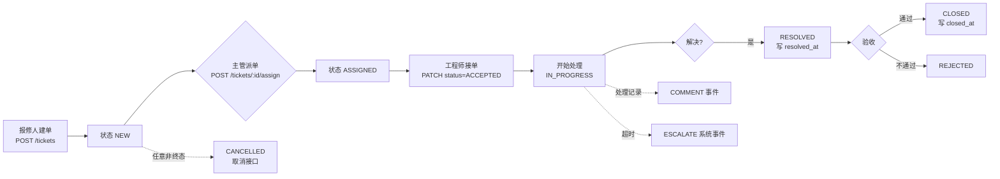

# 01 · 项目概览

## 1. 一句话定位

智维工单（ServiceDesk AI）是一套**企业售后 / 设备报修工单系统**：把报修、派单、处理、知识沉淀、SLA 考核串在一条线上，AI 只做增强，不替代人。

## 2. 要解决的四个问题

| 问题 | 现状 | 系统对策（当前代码） |
| --- | --- | --- |
| 报修信息散 | 电话、微信、口头传递，缺设备型号与紧急度 | 结构化工单：客户、设备、分类、紧急度、描述、图片附件 |
| 派单靠人 | 主管凭经验分配，忙闲不均 | 派单接口 + 团队归属 + 工程师校验；数据范围约束可见性 |
| 知识不沉淀 | 经验在个人脑子里，历史工单搜不到 | 已预留知识库表结构与前端原型，后端检索 / RAG 尚未实现 |
| SLA 靠催 | 无系统计时，超时无人知道 | SLA 策略、双 deadline、每分钟超时扫描与升级事件 |

## 3. 目标用户与核心诉求

| 用户 | 角色编码 | 典型场景 | 核心诉求 |
| --- | --- | --- | --- |
| 报修人（客户 / 员工） | `REPORTER` | 设备坏了，想尽快有人处理 | 少填表、能传图、知道进度 |
| 工程师 | `ENGINEER` | 一天 5-10 单，现场排查 | 快速看懂问题、查到历史方案、少返工 |
| 主管 | `SUPERVISOR` | 盯 SLA、派单、处理升级 | 知道谁忙、哪单要超时、团队产出 |
| 管理员 | `ADMIN` | 维护账号、团队、SLA、知识库 | 配置可控、操作可追溯 |

## 4. 核心闭环



> 注意：`ASSIGNED` 与 `CANCELLED` 只能由独立接口产生，不在通用状态迁移表中；状态机细节见 [07 工单领域设计](./07-工单领域设计.md)。

## 5. 产品目标与衡量方式

| 目标 | 衡量方式 | 代码支撑现状 |
| --- | --- | --- |
| 降低建单成本 | 建单平均耗时、AI 预填采纳率 | 建单接口已实现；AI 预填未实现 |
| 提升一次解决率 | 首次解决率、返工率 | 状态机与事件可统计；报表未实现 |
| 缩短处理时长 | 平均响应时长、MTTR | `first_response_at` / `resolved_at` 已落库 |
| 让知识可复用 | RAG 引用采纳率、知识命中率 | 未实现 |
| 让 SLA 可考核 | SLA 达成率、超时单占比 | 超时标记与升级事件已实现；报表未实现 |

## 6. 范围

### 6.1 本期做（MVP）与代码实现状态

| 能力 | 规划编号 | 状态 | 代码位置 |
| --- | --- | --- | --- |
| 账号与角色、JWT 鉴权 | A-01 | 已实现 | `security/`、`AuthController` |
| 工单建单 / 列表 / 详情 / 编辑 / 取消 | T-01 ~ T-05 | 已实现 | `TicketService` / `TicketServiceImpl` |
| 工单评价 | T-06 | 已实现 | `TicketServiceImpl#feedback` |
| 派单 | F-01 | 已实现 | `TicketServiceImpl#assign` |
| 状态迁移（接单 / 开始 / 解决 / 验收） | F-02 | 已实现 | `TicketTransitionService` |
| 处理记录与时间线 | F-03 / F-04 | 已实现 | `TicketCommentService` |
| 附件上传 / 删除（OSS） | F-05 | 已实现 | `FileAttachmentService`、`storage/` |
| SLA 策略管理与 SLA 状态 | S-01 / S-02 | 已实现 | `SlaPolicyService`、`TicketAssembler#assembleSla` |
| SLA 超时升级扫描 | S-03 | 已实现 | `SlaEscalationServiceImpl`（每分钟定时） |
| 用户 / 团队 / 客户 / 设备管理 | M-01 ~ M-03 | 已实现 | 4 个 Admin Service + Controller |
| 知识库与 RAG | K-01 / K-02、AI-02 | 仅 pgvector 分块表脚本 + 前端原型 | `backend/sql/pg/V1__kb_chunk.sql` |
| AI 建单分类 / 定级 / 摘要 | AI-01 | 未实现 | 依赖已引入 LangChain4j |
| Agent 工具调用 | AI-03 | 未实现 | 前端 `AgentDrawer.vue` 为原型 |
| 运营看板 / NL2SQL 报表 | R-01 / R-02 | 未实现 | 前端 `DashboardView` / `ReportsView` 为原型 |

### 6.2 本期不做

多租户、动态 RBAC、复杂工作流引擎、多智能体、图数据库、支付、独立向量数据库集群（改用 PostgreSQL + pgvector）、站内通知（P2）、流式输出（P2）。

## 7. 技术栈

| 层 | 选型 | 版本 / 说明 |
| --- | --- | --- |
| 语言 | Java | 17 |
| 后端框架 | Spring Boot | 3.5.16（Web、Validation、Data Redis、Actuator） |
| ORM | MyBatis-Plus | 3.5.18（分页、乐观锁、Lambda 条件构造器） |
| 数据库 | MySQL | 8，库名 `servicedesk_ai`，utf8mb4 |
| 缓存 / 计数 | Redis | 7，Lettuce 连接池 |
| 鉴权 | JJWT + 自研拦截器 | HS256，默认 7 天；不启用 Spring Security 过滤器链，只用其 `spring-security-crypto` 做 BCrypt |
| 文档 | springdoc-openapi | 2.10.0，Swagger UI `/api/swagger-ui.html` |
| 对象存储 | 阿里云 OSS SDK | 3.18.5，`FileStorageService` 可替换 MinIO / S3 |
| 向量库（预留） | PostgreSQL 16 + pgvector | `vector(1024)` + HNSW，代码尚未接入 |
| AI（预留） | LangChain4j | 1.23.0，已声明依赖但无业务代码 |
| 文档解析（预留） | Apache POI 5.2.5、PDFBox 3.0.3 | 已声明依赖但无业务代码 |
| 前端 | Vue 3 + Vite 6 + Pinia 3 + Element Plus 2.9 | 见 [11 前端架构](./11-前端架构.md) |
| 部署 | nginx 静态托管 + 反向代理 | `deploy/` 下 Windows 自包含脚本 |

## 8. 关键术语

| 术语 | 含义 |
| --- | --- |
| 工单（Ticket） | 一次报修请求，核心业务实体，8 个状态 |
| 工单号 | `TKyyyyMMdd000001`，Redis 日序列生成，唯一索引兜底 |
| 派单（Assign） | 主管把 `NEW` 工单指派给本团队工程师，进入 `ASSIGNED` |
| 接单（Accept） | 工程师确认接单，写首次响应时间 |
| SLA | 服务级别协议，每个紧急度对应一条策略（响应 / 解决时限，单位分钟） |
| 响应超时 | 未写 `first_response_at` 且超过 `response_deadline`，且非终态 |
| 解决超时 | 未写 `resolved_at` 且超过 `resolve_deadline`，且非终态 |
| 终态 | `CLOSED` / `REJECTED` / `CANCELLED`，停止 SLA 计时，不可再流转 |
| 内部备注 | `ticket_event.metadata.internal=true`，报修人不可见 |
| 数据范围 | 由 `TicketScope` 决定「当前用户能看哪些工单」，越权与不存在统一 404 |
| 逻辑外键 | 表间关系只在业务层校验，数据库不建物理 FK |

## 9. 仓库导航

```
servicedesk-ai/
├── backend/     Spring Boot 后端（Java 源码、SQL、既有文档）
├── frontend/    Vue 3 前端（真实接口 + 原型页面）
├── deploy/      nginx 配置与 PowerShell 脚本
├── design/      静态设计稿（PNG）
└── docs/code-wiki/  本 Wiki
```

详细目录说明见 [03 目录结构](./03-目录结构.md)。

## 10. 当前实现边界（务必知悉）

1. **AI / 知识库 / Agent / 报表均未落到后端代码**：仓库只有表结构脚本、前端原型与产品文档。`pom.xml` 中的 LangChain4j、POI、PDFBox 属于预置依赖。
2. **PostgreSQL 未接入 Spring 多数据源**：`application.yml` 只配置了 MySQL 与 Redis；`kb_chunk` 建表脚本独立于应用运行。
3. **前端 6 个页面仍是原型**：工作台、工单详情、知识库、运营报表、注册、Agent 抽屉，数据来自 `frontend/src/mock/prototype.js`。
4. **注册接口未实现**：`AuthService` 只有登录、登出、当前用户、改密；前端注册页提交后仅跳转登录。
5. **站内私信、知识库文章、AI 接口、报表接口**在《接口文档》中有契约，但对应 Controller / Service 不存在。
