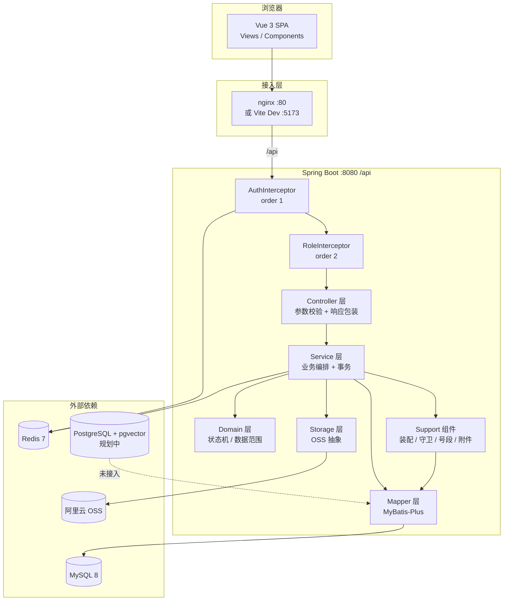
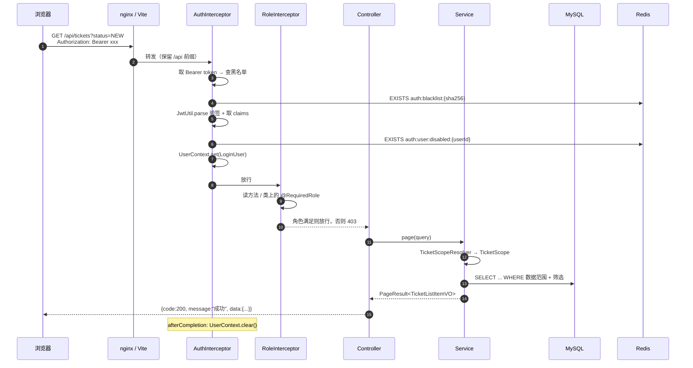

# 02 · 系统架构

## 1. 总体分层



包级结构与上图一一对应：

| 包 | 层 | 职责 |
| --- | --- | --- |
| `com.servicedesk.controller` | 接口层 | REST 路由、`@Valid` 校验、统一包装 `Result` |
| `com.servicedesk.service` | 业务接口层 | 用例契约与事务边界说明 |
| `com.servicedesk.service.impl` | 业务实现层 | 编排、事务、错误码、事件写入 |
| `com.servicedesk.service.support` | 业务支撑层 | 无状态 / 单职责辅助组件 |
| `com.servicedesk.domain.ticket` | 领域层 | 纯内存规则：状态迁移表、数据范围 |
| `com.servicedesk.security` | 鉴权基础设施 | JWT、拦截器、限流、黑名单、停用缓存 |
| `com.servicedesk.entity` | 持久化实体 | 与表一一对应的 POJO 与枚举 |
| `com.servicedesk.mapper` | 持久化访问 | MyBatis-Plus `BaseMapper` |
| `com.servicedesk.dto.request` | 入参模型 | 请求 DTO，带 Bean Validation |
| `com.servicedesk.vo` | 出参模型 | 视图对象，不暴露实体与密码 |
| `com.servicedesk.common` | 公共层 | 统一响应、异常、上下文、配置、Redis 工具 |
| `com.servicedesk.storage` | 存储层 | 文件存储接口与 OSS 实现 |

## 2. 请求生命周期

以一次「带 JWT 的业务请求」为例：



要点：

1. **`UserContext` 是 ThreadLocal**，必须在 `afterCompletion` 清理，否则 Tomcat 线程复用会串号。见 `AuthInterceptor#afterCompletion`。
2. **拦截器顺序是硬约束**：`AuthInterceptor` 必须 `order(1)`，`RoleInterceptor` 必须 `order(2)`；后者依赖前者写入的用户上下文。
3. **白名单只放行登录与文档 / 健康检查**：`/auth/login`、`/v3/api-docs/**`、`/swagger-ui/**`、`/swagger-ui.html`、`/actuator/**`、`/error`。
4. **`OPTIONS` 预检请求直接放行**（`AuthInterceptor#preHandle`）。

## 3. 模块划分与职责

```mermaid
flowchart LR
    subgraph 认证域
      AuthC[AuthController] --> AuthS[AuthService]
      AuthS --> Jwt[JwtUtil]
      AuthS --> RL[LoginRateLimiter]
      AuthS --> BL[TokenBlackList]
    end

    subgraph 工单域
      TC[TicketController] --> TS[TicketService]
      TC --> TTS[TicketTransitionService]
      TC --> TCS[TicketCommentService]
      TS --> TTSupport[Scope/Guard/Assembler/Linker/NoGen]
      TTS --> TTSupport
      TCS --> TTSupport
    end

    subgraph 系统管理域
      UC[UserAdminController] --> US[UserAdminService]
      TmC[TeamAdminController] --> TmS[TeamAdminService]
      CC[CustomerAdminController] --> CS[CustomerAdminService]
      DC[DeviceAdminController] --> DS[DeviceAdminService]
    end

    subgraph SLA 域
      SPC[SlaPolicyController] --> SPS[SlaPolicyService]
      ESC[SlaEscalationServiceImpl<br/>@Scheduled] --> TM[TicketMapper]
    end

    subgraph 附件域
      FC[FileController] --> FS[FileAttachmentService]
      FS --> STO[FileStorageService → OSS]
    end
```

| 模块 | 主要类 | 说明 |
| --- | --- | --- |
| 认证 | `AuthController`、`AuthServiceImpl` | 登录、登出、当前用户、改密 |
| 鉴权 | `AuthInterceptor`、`RoleInterceptor`、`JwtUtil` | 无状态 JWT + 服务端开关 |
| 工单主链路 | `TicketServiceImpl` | 建单、列表、详情、编辑、取消、评价、派单、SLA 查询 |
| 状态迁移 | `TicketTransitionServiceImpl` + `TicketTransition` | 5 个流转动作 |
| 时间线 | `TicketCommentServiceImpl` | 写 `COMMENT`，读事件（报修人过滤内部备注） |
| SLA | `SlaPolicyServiceImpl`、`SlaEscalationServiceImpl` | 策略 CRUD；每分钟扫描超时 |
| 系统管理 | 4 个 Admin Service | 用户、团队、客户、设备 |
| 文件 | `FileAttachmentServiceImpl`、`OssFileStorageService` | 元数据落库 + 对象存储 |
| 前端 | 见 [11 前端架构](./11-前端架构.md) | SPA，nginx 托管 |

## 4. 横切关注点

| 关注点 | 实现位置 | 约定 |
| --- | --- | --- |
| 统一响应 | `common/api/Result` | `{code, message, data}`，`code` 与 HTTP 状态一致 |
| 分页 | `common/api/PageResult` + `MybatisPlusConfig` | 对外只暴露 `records/total/curPage/pageSize/pages`；单页上限 100 |
| 异常 | `BusinessException` + `GlobalExceptionHandler` | 业务异常带状态码；未知异常 500 且不泄露堆栈 |
| 用户上下文 | `common/context/UserContext` | ThreadLocal，请求结束清理 |
| 时间 | `common/config/TimeConfig` | 注入 `Clock`，固定 `Asia/Shanghai`，统一截断纳秒 |
| 参数校验 | DTO 上的 `jakarta.validation` 注解 + `@Valid` | 字段级错误统一 400，提示格式「字段: 提示」 |
| 事务 | `@Transactional(rollbackFor = Exception.class)` | 只包「状态 + 事件」这类必须同生共死的写操作 |
| 日志 | SLF4J | 成功 info、拒绝 warn、故障 error；不记录密码、备注原文、正文 |
| 接口文档 | `springdoc` + `OpenApiConfig` | JWT 方案声明为全局安全要求 |
| 乐观锁 | `@Version` + `OptimisticLockerInnerInterceptor` | 影响行数 0 → 409 |

## 5. 关键设计决策

### 5.1 不用 Spring Security 过滤器链

项目只引入 `spring-security-crypto` 获取 `BCryptPasswordEncoder`，鉴权由两个 `HandlerInterceptor` 完成。原因：接口粒度角色控制用注解更直观，且避免 Security 默认过滤器链带来的配置噪音。代价是需要自己保证 ThreadLocal 清理与白名单一致性（已通过 `WebMvcConfig` 共用常量降低风险）。

### 5.2 逻辑外键、不建物理 FK

所有 `customer_id`、`device_id`、`ticket_id` 等均为逻辑外键，关系由业务层在写库前显式校验。好处是便于分库 / 归档与测试造数；代价是必须记住「每个引用都要查一次存在性」，否则会产生悬空引用。

### 5.3 数据范围下推到 SQL

`TicketScope` 同时提供 `allows(...)`（内存判定）与 `visibility()`（下推条件）。列表查询必须下推，否则分页 `total` 会把不可见行算进去；详情必须用同一套规则判定，保证「列表看不到的，详情也打不开」。

### 5.4 事件只追加

`ticket_event` 没有 `updated_at`，也没有更新入口。所有业务动作（建单、派单、状态迁移、处理记录、取消、评价、附件、超时升级）都追加事件，时间线可回放。

### 5.5 服务拆分按用例而非按表

- `TicketService` 保留主链路；
- `TicketTransitionService` 单独承载状态机；
- `TicketCommentService` 单独承载时间线。

三个实现类**互不注入**，共享 `support` 组件与 Mapper，避免服务之间形成环。

### 5.6 固定窗口限流与失败开放 / 关闭

| 场景 | 策略 |
| --- | --- |
| 登录前检查是否被锁 | **fail-closed**：Redis 不可用返回 503，不放行 |
| 登录失败记账 | **fail-open**：Redis 不可用只告警，不影响本次响应 |
| 停用标记检查 | **fail-closed**：异常向上抛，由拦截器转 503 |

### 5.7 时间只取一次

单条响应内只允许一个 `now`：建单时 `createdAt` 与两个 deadline 同源；列表 / 详情 / SLA 的剩余分钟用同一基准；事件时间与状态时间同源。所有时间统一 `withNano(0)`，与 `DATETIME(0)` 精度一致。

## 6. 并发、幂等与一致性策略

| 场景 | 手段 | 结果 |
| --- | --- | --- |
| 工单编辑 / 取消 / 派单 / 状态迁移 | `version` 乐观锁 + 请求版本号显式比对 | 冲突 409 |
| 工单号生成 | Redis `INCR` + `EXPIRE`（Lua 原子） | 跨天自动归零，允许跳号 |
| 工单号降级 | 查库内当日最大号 + 1 | 多实例可能撞号，由 `uk_ticket_no` 兜底，建单重试 1 次 |
| SLA 超时升级 | 条件更新 `*_escalated_at IS NULL` 抢占 | 多实例 / 重复扫描只成功一次 |
| 一单一评 | `ticket_feedback.uk_ticket` 唯一索引 | 并发重复提交 409 |
| 附件回填 | 更新条件带「上传人 + 未关联」 | 并发抢占 409，整单回滚 |
| 附件上传 | 先写 OSS 再写库，写库失败补偿删除 | 避免孤儿文件 |
| 登录限流 | Redis Lua 固定窗口 | 账号 5 次 / IP 20 次 / 300 秒 |

## 7. 运行时拓扑与端口

| 组件 | 默认地址 | 说明 |
| --- | --- | --- |
| 后端 | `http://localhost:8080/api` | `server.port=8080`、`context-path=/api` |
| 前端开发服务器 | `http://127.0.0.1:5173` | Vite 将 `/api` 代理到 8080 |
| nginx | `http://localhost/`（80） | 静态资源 + `/api` 反代 |
| MySQL | `localhost:3306/servicedesk_ai` | 账号密码由环境变量覆盖 |
| Redis | `localhost:6379/0` | 密码 `REDIS_PASSWORD` |
| OSS | 由 `storage.oss.endpoint` 决定 | 未配置时上传 / 删除返回 503 |
| PostgreSQL | `localhost:5432/servicedesk_kb` | 仅 SQL 脚本，应用未连接 |

## 8. 扩展点

| 扩展需求 | 推荐做法 |
| --- | --- |
| 换对象存储（MinIO / S3） | 新增 `FileStorageService` 实现，不改业务层与表结构 |
| 接入知识库 / RAG | 新增 `KbArticle` 实体与 Mapper（MySQL）、`KbChunk` Mapper（PG 独立数据源）、`KbService` |
| 接入 AI 分类 | 新增 `AiClient` 抽象，建单前调用；失败降级为人工填写（现有建单链路已支持分类 / 紧急度缺省） |
| 增加工单状态 / 动作 | 改 `TicketStatus` 与 `TicketTransition` 表，再补 `applyTransition` 的时间戳分支 |
| 增加角色 | 改 `Role` 枚举、`TicketScope.of`、前端 `ROLE_LABELS`，并检查所有 `@RequiredRole` |
| 多租户 | 需要在 `TicketScope`、所有查询与唯一索引上引入租户维度，属于架构级改造 |

## 9. 已知架构限制

1. 无刷新 token、无设备管理；修改密码不会使旧 token 失效（仅靠有效期自然过期）。
2. `UserStatusCache` 只存「停用」标记，Redis 丢数据会让被停用者短暂恢复访问。
3. 工单号降级路径不保证唯一，依赖唯一索引兜底。
4. 时间线不分页，硬上限 500 条；超出时只保留最近 500 条。
5. 报表、知识库、AI、Agent 只有接口文档与前端原型，后端无实现。
6. 设备保修状态计算（`DeviceAdminServiceImpl`）直接使用 `LocalDate.now()`，未统一走注入的 `Clock`；同一响应内已保证只取一次基准日，但跨零点请求之间仍可能有口径差异。
