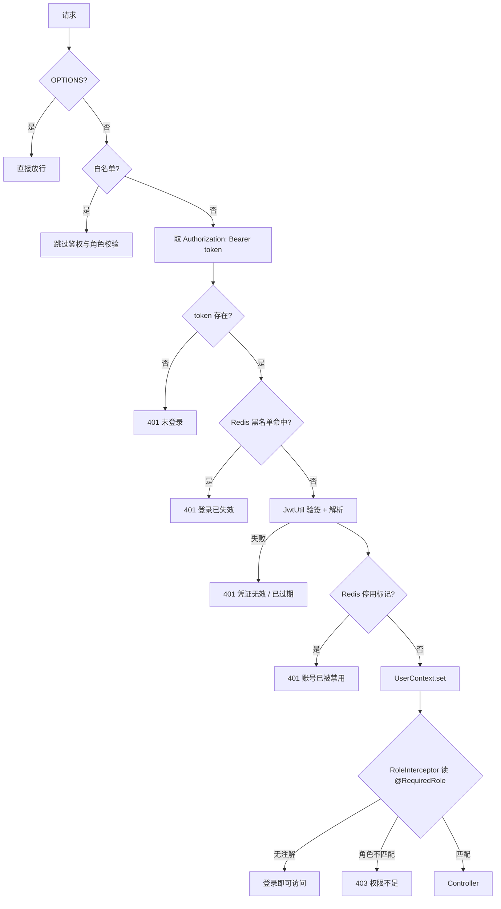

# 06 · 安全与鉴权

涉及包：`com.servicedesk.security`、`com.servicedesk.common.context`、`com.servicedesk.common.config.WebMvcConfig`。

## 1. 安全模型总览



## 2. JWT

### 2.1 配置

`JwtProperties` 绑定 `jwt` 前缀：

| 配置项 | 环境变量 | 默认值 | 说明 |
| --- | --- | --- | --- |
| `jwt.secret` | `JWT_SECRET` | 开发默认串（≥32 字节） | HS256 密钥，生产必须覆盖 |
| `jwt.expire-seconds` | — | `604800`（7 天） | token 有效期 |

`JwtUtil` 构造时用 `Keys.hmacShaKeyFor` 校验密钥长度；不足 32 字节直接抛 `IllegalStateException`，属于**启动期配置错误**，避免线上使用弱密钥。

### 2.2 载荷

| Claim | 含义 |
| --- | --- |
| `sub` | 用户 ID |
| `username` | 登录名 |
| `displayName` | 显示名 |
| `role` | 角色编码 |
| `teamId` | 团队 ID（可为空） |
| `iat` / `exp` | 签发 / 过期时间 |

载荷**不放密码、手机号、邮箱**；前端传来的角色与用户 ID 一律不信任，全部以解析结果为准。

### 2.3 关键方法

| 方法 | 行为 |
| --- | --- |
| `generate(LoginUser)` | 签发 token |
| `parse(token)` | 验签并还原 `LoginUser`；过期 → 401「登录已过期」，伪造 / 格式错误 → 401「登录凭证无效」 |
| `remainingSeconds(token)` | 计算剩余有效期，供黑名单 TTL 使用；失败返回 0 |
| `getExpireSeconds()` | 登录响应里的 `expiresIn` |
| `parseClaims(token)` | 仅取载荷，供黑名单模块使用 |

解析失败统一 401，**不向调用方区分「过期」与「伪造」**，避免给攻击者反馈。

## 3. 拦截器链

### 3.1 `AuthInterceptor`（order = 1）

执行顺序固定：

1. `OPTIONS` 直接放行（CORS 预检）；
2. 从 `Authorization` 提取 `Bearer ` 后的 token；缺失 → 401「未登录」；
3. 查 Redis 黑名单；命中 → 401「登录已失效，请重新登录」；
4. `JwtUtil.parse` 验签解析；
5. 查账号停用标记；命中 → 401「账号已被禁用，请联系管理员」；Redis 异常 → 503；
6. `UserContext.set(loginUser)`；
7. 请求结束 `afterCompletion` → `UserContext.clear()`。

**为什么停用检查放在验签之后**：停用标记按 `userId` 存储，`userId` 只能来自验签通过的载荷；否则任何人报一个 ID 就能探测账号状态。

### 3.2 `RoleInterceptor`（order = 2）

- 只处理 `HandlerMethod`，静态资源 / `/error` 直接放行；
- 规则解析：**方法注解优先，其次类注解，都没有则放行**（登录即可访问）；
- 类注解与方法注解是**替换关系**，不是追加：类上 `ADMIN`、方法上 `SUPERVISOR` 表示该方法只允许主管；
- `@RequiredRole({})`（空数组）视为配置错误，**fail-closed 返回 403**；
- 角色不足返回 403「权限不足，拒绝访问！」。

### 3.3 白名单

```java
private static final String[] WHITE_LIST = {
    "/auth/login", "/v3/api-docs/**", "/swagger-ui/**", "/swagger-ui.html",
    "/actuator/**", "/error"
};
```

两个拦截器共用同一常量，防止新增白名单时只改一处。新增免鉴权接口必须显式登记。

## 4. 接口级权限矩阵

| 接口 | 路径 | 允许角色 |
| --- | --- | --- |
| 登录 | `POST /auth/login` | 白名单（匿名） |
| 登出 / 当前用户 / 改密 | `/auth/logout`、`/auth/me`、`/auth/password` | 登录即可 |
| 建单 / 列表 / 详情 / 时间线 / SLA | `/tickets` 相关读与建单 | 登录即可（能看到哪些行由数据范围决定） |
| 编辑工单 | `PUT /tickets/{id}` | `REPORTER`、`SUPERVISOR`、`ADMIN` |
| 取消工单 | `POST /tickets/{id}/cancel` | `REPORTER`、`SUPERVISOR`、`ADMIN` |
| 评价 | `POST /tickets/{id}/feedback` | `REPORTER` |
| 派单 | `POST /tickets/{id}/assign` | `SUPERVISOR`、`ADMIN` |
| 状态迁移 | `PATCH /tickets/{id}/status` | 登录即可，由迁移表按动作判角色（403） |
| 处理记录 | `POST /tickets/{id}/comments` | 登录即可，内部备注限非报修人 |
| 用户管理 | `/admin/users/**` | `ADMIN`（类注解） |
| 团队管理 | `/admin/teams/**` | `ADMIN`（类注解） |
| 客户 / 设备 | `/admin/customers/**`、`/admin/devices/**` | `SUPERVISOR`、`ADMIN`（类注解） |
| SLA 查询 | `GET /sla-policies` | 登录即可 |
| SLA 写操作 | `POST/PUT/DELETE /sla-policies/**` | `ADMIN`（方法注解） |
| 附件上传 / 删除 | `/files/**` | 登录即可（删除限上传人或管理员） |

## 5. `@RequiredRole` 设计细节

位置：`security/RequiredRole.java`

```java
@Target({ ElementType.METHOD, ElementType.TYPE })
@Retention(RetentionPolicy.RUNTIME)
public @interface RequiredRole {
    Role[] value(); // 没有默认值，漏填编译失败
}
```

三条关键约束：

1. **无默认值**：`@RequiredRole` 漏写角色会编译失败，避免「标了却等于没标」；
2. **空数组 fail-closed**：`@RequiredRole({})` 被拦截器按 403 拒绝，绝不解释为不限角色；
3. **未标注解 ≠ 匿名访问**：只表示「登录即可」，登录校验仍由 `AuthInterceptor` 负责。

## 6. 登录失败限流

位置：`security/LoginRateLimiter.java`

| 维度 | 阈值 | 窗口 | Key |
| --- | --- | --- | --- |
| 账号 | 5 次 | 300 秒 | `auth:loginFail:user:{username}` |
| 客户端 IP | 20 次 | 300 秒 | `auth:loginFail:ip:{ip}` |

设计要点：

- 两个维度**独立计数、独立判定**，缺一都会被绕过：账号维度防单账号爆破，IP 维度防「一个 IP 遍历海量用户名」；
- IP 阈值明显高于账号阈值，因为办公网 NAT 出口会共用 IP，阈值太小会误伤同事；
- 账号与 IP 使用不同命名空间，防止注册一个形如 `ip:1.2.3.4` 的用户名污染 IP 计数；
- 计数在 key 首次创建时设置 TTL，之后不续期，构成固定窗口；
- 锁定提示固定为「登录失败次数过多，请 5 分钟后再试」，**不回显用户名或 IP**，避免确认账号存在；
- 登录成功只清账号计数，**刻意不清 IP 计数**（否则攻击者持有一个可用账号即可不断重置 IP 配额）。

调用顺序（`AuthServiceImpl#login`）：

```
账号锁检查 → IP 锁检查 → 查库 → 校验密码 → 校验状态 → 清账号计数 → 签发 token
```

两次锁定检查都在查库之前，被限流的请求不消耗数据库连接。

### 6.1 fail-open 与 fail-closed

| 操作 | Redis 不可用时 |
| --- | --- |
| `checkUserLocked` / `checkIpLocked` | **fail-closed**：抛 503「服务暂时不可用」 |
| `recordFailure` | **fail-open**：只告警，不阻断登录响应 |
| `isDisabled`（停用检查） | **fail-closed**：拦截器转 503 |

## 7. Token 黑名单（登出）

位置：`security/TokenBlackList.java`

| 方法 | 行为 |
| --- | --- |
| `sha256Hex(token)` | 对 token 原文做 SHA-256，避免把 JWT 原串直接作为 Redis key |
| `addBlackList(token)` | 解析 token，TTL = 剩余有效期（已过期则至少 1 秒），value 固定 `1` |
| `isInBlackList(token)` | Redis 查询；Redis 异常时返回 false（放行）并记 error |

Key 前缀：`auth:blacklist:{sha256}`。

登出流程：`AuthController#logout` 从请求头提取 token → `AuthService#logout` → `TokenBlackList#addBlackList`。登出是幂等的：无效 token 只记日志，不报错。

## 8. 账号停用即时生效

位置：`security/UserStatusCache.java`

JWT 一旦签发，在有效期内自证有效，服务端无法直接撤销。因此引入 Redis 停用标记：

| 方法 | 行为 |
| --- | --- |
| `isDisabled(userId)` | `EXISTS auth:user:disabled:{userId}` |
| `markDisabled(userId)` | `SET key 1 EX jwt.expire-seconds` |
| `clearDisabled(userId)` | `DEL key` |

设计取舍：

- **只存「停用」一种标记**，key 不存在即视为正常。Redis 丢数据只会让被停用者短暂恢复访问（影响面小），不会把所有用户锁死；
- TTL 取 token 最长存活时间，到期时旧 token 本身也已失效；
- 停用流程（`UserAdminServiceImpl#updateStatus`）先改数据库，再写标记；标记失败返回 503 但保留数据库变更，操作幂等可重试。

## 9. 密码处理

位置：`security/PasswordEncoderConfig.java`

```java
@Bean
public PasswordEncoder passwordEncoder() {
    return new BCryptPasswordEncoder(10);
}
```

- 项目只引入 `spring-security-crypto`，不启用 Spring Security 过滤器链；
- BCrypt 自带随机盐，同一明文每次编码结果不同，校验必须用 `matches(raw, hash)`；
- 密码只在写入前出现，落库即编码，响应与日志都不出现明文或哈希；
- 改密只认 `UserContext` 里的用户 ID，请求体不接收 `userId`；
- 改密**不会主动失效当前 token**：用户刚完成身份校验，强制重登只会制造摩擦；其他设备 token 按有效期自然过期。

## 10. 客户端 IP 解析

位置：`security/ClientIpResolver.java`

| 配置 `app.client-ip.trust-proxy` | 取值来源 |
| --- | --- |
| `false`（默认） | `request.getRemoteAddr()`，不信任任何请求头 |
| `true` | `X-Forwarded-For` 的第一个地址 |

安全约束：

- 请求头可被任意伪造，直连部署时开启 `trust-proxy=true` 会让攻击者每次换一个伪造 IP 绕过 IP 维度限流；
- 只有在可信反向代理（nginx）之后才可开启；
- 拿不到地址统一返回 `unknown`，让这些请求共用一个计数桶，避免限流整体失效；
- IP 值截断到 64 字符，防止超长请求头撑大 Redis key。

nginx 侧已设置 `X-Forwarded-For`；若要后端识别真实 IP，需同时设置 `TRUST_PROXY=true`。

## 11. 安全相关错误码

| 场景 | code | message |
| --- | --- | --- |
| 未携带 token | 401 | 未登录 |
| token 过期 | 401 | 登录已过期，请重新登录 |
| token 伪造 / 格式错误 | 401 | 登录凭证无效 |
| token 已登出 | 401 | 登录已失效，请重新登录 |
| 账号停用 | 401 | 账号已被禁用,请联系管理员 |
| 登录账号或密码错误 | 401 | 用户名或密码错误 |
| 登录时账号停用 | 403 | 账号已停用，请联系管理员 |
| 接口角色不足 | 403 | 权限不足，拒绝访问！ |
| 登录失败次数超限 | 429 | 登录失败次数过多，请 5 分钟后再试 |
| 频控 / 停用检查依赖不可用 | 503 | 服务暂时不可用 / 检查账号状态失败 |

## 12. 已知限制与加固建议

| 限制 | 影响 | 建议 |
| --- | --- | --- |
| 无刷新 token | 7 天后必须重新登录 | 引入 refresh token + 轮换 |
| 改密不撤销旧 token | 旧设备仍可用 | 增加 `password_changed_at` 校验或用户级 token 版本 |
| 黑名单查询失败时放行 | Redis 故障期间已登出 token 可用 | 评估改为 fail-closed |
| 停用标记依赖 Redis | Redis 丢数据后停用短暂失效 | 关键操作前回查数据库状态 |
| 无 CSRF 防护 | 纯 Bearer + localStorage，天然不随 Cookie 发送 | 若改为 Cookie 存储需补 CSRF |
| Demo 默认密钥 | 开发方便但不可用于生产 | 生产必须设置 `JWT_SECRET`（≥32 字节） |
