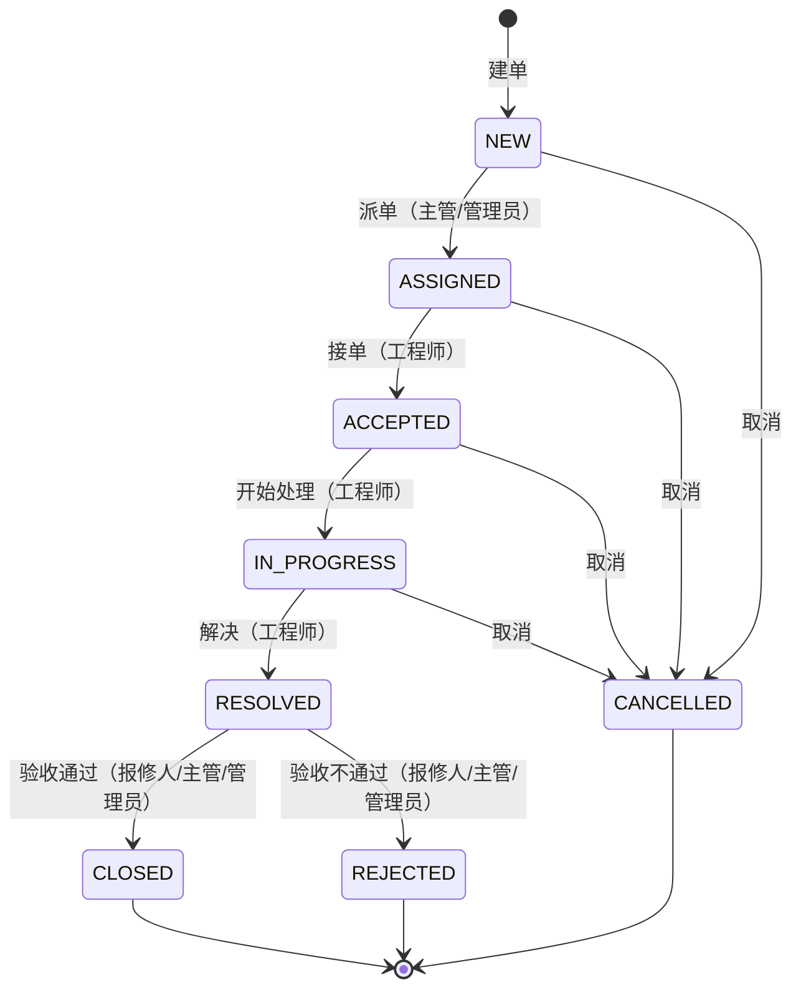
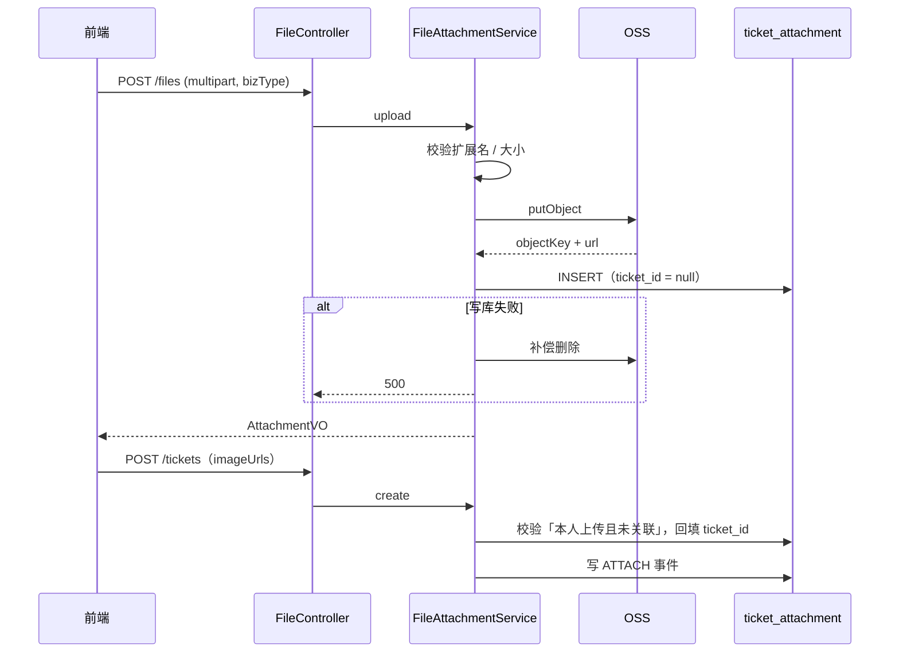

# 07 · 工单领域设计

本文件覆盖工单核心业务规则：状态机、数据范围、SLA、工单号、并发控制、时间线与附件。核心代码位于 `domain/ticket` 与 `service/impl` 的三个工单服务。

## 1. 状态机

### 1.1 8 个状态

| 状态 | 中文 | 含义 | 终态 |
| --- | --- | --- | --- |
| `NEW` | 待派单 | 报修人已提交 | 否 |
| `ASSIGNED` | 已派单 | 主管指定了处理工程师 | 否 |
| `ACCEPTED` | 已接单 | 工程师确认接单 | 否 |
| `IN_PROGRESS` | 处理中 | 工程师已开始处理 | 否 |
| `RESOLVED` | 已解决 | 等待报修人验收 | 否 |
| `CLOSED` | 已完成 | 验收通过 | **是** |
| `REJECTED` | 不通过 | 验收不通过 | **是** |
| `CANCELLED` | 已取消 | 报修人撤回或无效工单 | **是** |

终态判定统一走 `TicketStatus#isTerminal()`，并由它派生 `TERMINAL_NAMES` 供 SQL `NOT IN` 使用，避免「内存判定」与「SQL 名单」两处分叉。

### 1.2 流转图



注意：

- `ASSIGNED` 只能由派单接口产生，`CANCELLED` 只能由取消接口产生，二者**不在**通用状态迁移表中；
- `RESOLVED` 不可取消；
- 验收不通过后不提供返工流转，问题复现需新建工单。

### 1.3 迁移表 `TicketTransition`

位置：`domain/ticket/TicketTransition.java`，纯枚举、无 Spring、无 IO。

| 动作 | 起始状态 | 目标状态 | 写入事件 | 允许角色 | 时间戳副作用 |
| --- | --- | --- | --- | --- | --- |
| `ACCEPT` | `ASSIGNED` | `ACCEPTED` | `ACCEPT` | `ENGINEER` | 首次响应时间（为空时补写） |
| `START` | `ACCEPTED` | `IN_PROGRESS` | `START` | `ENGINEER` | 无 |
| `RESOLVE` | `IN_PROGRESS` | `RESOLVED` | `RESOLVE` | `ENGINEER` | `resolved_at = now` |
| `CLOSE` | `RESOLVED` | `CLOSED` | `CLOSE` | `REPORTER`、`SUPERVISOR`、`ADMIN` | `closed_at = now` |
| `REJECT` | `RESOLVED` | `REJECTED` | `REJECT` | `REPORTER`、`SUPERVISOR`、`ADMIN` | 无（不写 `closed_at`） |

`resolve(from, target)` 只做内存查表；表里没有的组合返回空，由调用方转 409。角色只表达「动作级」权限，行级归属（本单处理人 / 本团队）由数据范围负责。

### 1.4 迁移判定顺序

`TicketTransitionServiceImpl#transitionStatus` 固定顺序：

```
可见性 404 → 版本 409 → 目标状态字典 400 → 迁移表 409 → 角色 403
```

顺序理由：

1. 先 404 再 409，避免通过状态码差异确认工单是否存在；
2. 版本放在状态之前，与其他写操作口径一致；
3. 角色放最后：动作本身不合法时，无论谁来点都是 409，先暴露「流转不存在」更贴近真实错误。

## 2. 数据范围 `TicketScope`

位置：`domain/ticket/TicketScope.java`，`sealed interface`，四种实现互斥。

| 角色 | 实现 | 可见范围 | 下推条件 |
| --- | --- | --- | --- |
| `ADMIN` | `All` | 全部工单 | 无条件 |
| `REPORTER` | `Reporter(userId)` | `reporter_id = 自己` | `reporter_id = ?` |
| `ENGINEER` | `Engineer(userId)` | `assignee_id = 自己` | `assignee_id = ?` |
| `SUPERVISOR` | `Supervisor(teamIds)` | `team_id ∈ 我管理的团队` | `team_id IN (...)` |

关键约束：

- 主管的 `teamIds` 来自 `team.supervisor_id = 当前用户`，**不是**自己所属的 `team_id`；
- 主管没有任何团队时 `teamIds` 为空集合，语义是「什么都看不到」；列表查询必须拼 `1 = 0`，因为 `IN ()` 是非法 SQL；
- 报修人即使同时是处理人，也只按 `reporter_id` 判定；
- 工程师刻意不按团队过滤，保证待办列表干净；
- 判定入参必须来自数据库行，不能来自请求参数。

### 2.1 解析器 `TicketScopeResolver`

唯一 IO 点：只有 `SUPERVISOR` 才查 `team` 表；其他角色不产生额外查询。同一 Service 方法内只调用一次，结果向下传，避免列表每查一次多一次团队查询。

## 3. SLA 设计

### 3.1 策略与匹配

- 一个紧急度最多一条策略，`sla_policy.uk_priority` 兜底；
- 建单时按 `urgency` 匹配 `priority` 且 `enabled = 1` 的策略；
- 找不到策略 → 503「SLA 策略未配置，请联系管理员」；
- 策略只存分钟数，改策略不影响已建工单。

### 3.2 截止时间

建单时：

```
now = LocalDateTime.now(clock).withNano(0)
response_deadline = now + policy.responseMinutes
resolve_deadline  = now + policy.resolveMinutes
```

两个 deadline 是**绝对时刻**，写入后冻结。

编辑紧急度时：

```
rebaseSla(ticket, 新策略, now)
  → sla_policy_id = 新策略
  → response_deadline = now + 新策略.responseMinutes
  → resolve_deadline  = now + 新策略.resolveMinutes
```

RC-001 后没有暂停与补时，deadline 一律从本次请求时刻重算。

### 3.3 SLA 状态计算

`TicketAssembler#assembleSla` 是唯一口径，详情内嵌与 `GET /tickets/{id}/sla` 共用：

| 字段 | 计算方式 |
| --- | --- |
| `responseRemainingMinutes` | `Duration.between(now, responseDeadline).toMinutes()`，可为负 |
| `resolveRemainingMinutes` | 同上 |
| `responseBreached` | 非终态 且 `first_response_at == null` 且 `now > response_deadline` |
| `resolveBreached` | 非终态 且 `resolved_at == null` 且 `now > resolve_deadline` |
| `paused` / `pausedTotalMinutes` | RC-001 后恒 `false` / `0`，保留字段兼容前端 |

历史数据若策略与两个 deadline 全为空，返回 `null`。

### 3.4 超时升级（S-03）

`SlaEscalationServiceImpl`：

```java
@Scheduled(cron = "0 * * * * *", zone = "Asia/Shanghai")
@Transactional(rollbackFor = Exception.class)
public int escalateOverdue()
```

每轮流程：

1. 扫描响应超时：`response_escalated_at IS NULL`、`first_response_at IS NULL`、`response_deadline < now`、状态非终态，按 deadline 升序，最多 200 条；
2. 逐条条件更新 `response_escalated_at = now`（重复一遍上述条件），影响行数为 1 才算抢到升级权；
3. 抢到才写 `ESCALATE` 事件（`operator_id = null`，metadata 含 `escalationType`、`deadline`、`overdueMinutes`）；
4. 解决超时同理，使用 `resolve_escalated_at` / `resolved_at` / `resolve_deadline`。

幂等性来自条件更新；多实例并发扫描也只会成功一次。整轮一个事务，标记与事件同生共死。单轮每类最多 200 条，积压下一分钟继续，避免长事务。

## 4. 工单号生成

`TicketNoGenerator`：

```
TK + yyyyMMdd + 6 位日序列（不足左补零）
```

| 路径 | 逻辑 |
| --- | --- |
| 主路径 | Redis `ticket:seq:{yyyyMMdd}` 原子自增，TTL 2 天 |
| 降级路径 | Redis 访问异常时 `SELECT MAX(ticket_no) WHERE ticket_no LIKE 'TK{date}%'` + 1 |
| 容量上限 | 单日 999999，超出 503 |
| 唯一性 | `ticket.uk_ticket_no` 兜底；建单捕获 `DuplicateKeyException` 重新取号，最多 2 次 |
| 事务 | 只写 Redis，不参与数据库事务；数据库回滚不退号，允许跳号 |

降级路径不保证唯一（多实例可能撞号），由唯一索引兜底并重试，这是刻意的「可用性优先」取舍。

## 5. 并发控制与判定顺序

### 5.1 乐观锁

- `Ticket.version` 标 `@Version`；
- `TicketAccessGuard#assertVersionMatches` 显式比较请求版本与库中版本；不一致 409；
- `updateById` 返回 0 也转 409，兜住「两个请求同时提交」的竞态。

为什么必须显式比较：MyBatis-Plus 乐观锁用的是「查出来的实体」上的 `version`，请求体里的版本不会自动进入 WHERE；少了这一步，旧页面提交也会成功覆盖。

### 5.2 各写操作的判定顺序

| 操作 | 顺序 |
| --- | --- |
| 编辑 | 可见性 404 → 可编辑 409 → 版本 409 → 字段校验 400 → 更新 |
| 取消 | 可见性 404 → 版本 409 → 状态可取消 409 |
| 派单 | 可见性（含待派单池）404 → 版本 409 → 状态 409 → 工程师校验 400 |
| 状态迁移 | 可见性 404 → 版本 409 → 字典 400 → 迁移表 409 → 角色 403 |
| 处理记录 | 可见性 404 → 终态 409 → 内部备注越权 400 → 正文 400 |
| 评价 | 可见性 404 → 已关闭 409 → 重复评价 409 |

统一原则：**先 404 再 409**，不让调用方通过状态码差异确认工单存在。

## 6. 派单规则（F-01）

| 规则 | 说明 |
| --- | --- |
| 只允许 `NEW` | 其他状态 409 |
| 角色 | 接口层 `@RequiredRole(SUPERVISOR, ADMIN)` |
| 待派单池例外 | `NEW` 且 `team_id` 为空的工单，所有主管都能看到并认领；派单成功后团队随工程师写入 |
| 工程师校验 | 存在且启用、角色为 `ENGINEER`、已加入团队；主管只能派本团队，管理员不限 |
| 团队随人走 | `ticket.team_id = assignee.team_id`，不允许「工程师在 A 组、工单挂 B 组」 |
| 事件 | 写 `ASSIGN` 事件，正文「指派工程师：X；备注：Y」 |

## 7. 编辑规则

- 可编辑字段：`title`、`description`、`category`、`urgency`、`deviceId`；
- 五个字段全可选，不传保留原值；不支持清空（包括解除设备关联）；
- 终态不可编辑；报修人只能在 `NEW` 阶段编辑；
- 空更新（没有字段真的变化）不写库、不写事件、不刷新 `version` / `updated_at`；
- 紧急度变化才重算 SLA；
- 设备变更时必须属于该工单的客户。

## 8. 取消与评价

### 8.1 取消（T-05）

- 允许角色：报修人、主管、管理员；
- `RESOLVED` 与三个终态不可取消（409）；
- 原因必填，写入 `CANCEL` 事件正文；
- 写 `status = CANCELLED` 与事件在同一事务。

### 8.2 评价（T-06）

- 仅报修人；
- 工单必须 `CLOSED`；
- 评分 1-5，评价内容 ≤500；
- 一单一评：先查重，`uk_ticket` 兜底并发，重复 409；
- 评价正文只存 `ticket_feedback`，事件只写 `metadata.score`，避免同一段文字双写。

## 9. 时间线与处理记录

### 9.1 事件模型

| 事件 | 触发 | `from/to` | 正文 / metadata |
| --- | --- | --- | --- |
| `CREATE` | 建单 | null → `NEW` | 无正文 |
| `UPDATE` | 编辑且确有变更 | 无 | `fields: [字段名]` |
| `ASSIGN` | 派单 | 旧 → `ASSIGNED` | 「指派工程师：X；备注：Y」 |
| `ACCEPT` / `START` / `RESOLVE` / `CLOSE` / `REJECT` | 状态迁移 | 旧 → 新 | 迁移备注（可选） |
| `COMMENT` | 处理记录 | 无 | 正文 + `metadata.internal` |
| `CANCEL` | 取消 | 旧 → `CANCELLED` | 取消原因 |
| `FEEDBACK` | 评价 | 无 | `metadata.score` |
| `ESCALATE` | 超时扫描 | 无 | `escalationType` / `deadline` / `overdueMinutes`；`operator_id=null` |
| `ATTACH` | 挂载 / 删除附件 | 无 | `action` / `attachmentId` / `fileName` |

### 9.2 写处理记录

- 数据范围内四类角色都能写对客记录；
- 报修人不能写内部备注（400）；
- 正文去空白后不能为空，≤2000 字；
- 终态不可追加（409）；
- 工程师写记录且 `first_response_at` 为空时，条件更新补写首响（`WHERE first_response_at IS NULL`），与接单并发时以先落库者为准。

### 9.3 读时间线

- 不分页，一次返回全部可见事件；
- 服务端硬上限 500 条：先按 `created_at DESC, id DESC` 取最近 500，再翻转成正序；
- 报修人看不到内部备注：过滤在 SQL 中完成（`COALESCE(JSON_UNQUOTE(JSON_EXTRACT(metadata,'$.internal')),'false') = 'false'`），先过滤再取上限；
- 操作人姓名按当前页批量回填，metadata 逐条解析，不产生 N+1。

## 10. 附件生命周期



规则：

| 规则 | 值 / 说明 |
| --- | --- |
| 单次建单最多关联 | 5 个附件 |
| 扩展名 | `TICKET`：jpg/jpeg/png/pdf/docx/md；`KB`：pdf/docx/md |
| 大小 | `TICKET` 10MB；`KB` 20MB；容器上限单文件 20MB、请求 25MB |
| 关联条件 | 上传人 = 当前用户，且 `ticket_id IS NULL` |
| 并发回填 | 更新条件重复上述限制，影响行数不符 409，整单回滚 |
| 删除权限 | 上传人本人或管理员；其他人统一 404 |
| 删除顺序 | 已关联工单先写 `ATTACH delete` 事件 → 删 OSS 对象 → 删数据库记录 |

## 11. 业务规则速查

| 主题 | 规则 |
| --- | --- |
| 工单号 | 写入后不可改；允许跳号；唯一索引兜底 |
| 报修人 | 取当前登录用户，请求参数不可指定 |
| 客户 / 设备 | 设备必须属于该客户 |
| 分类 / 紧急度 | 缺省 `OTHER` / `P2`；非法值 400 |
| SLA 缺失 | 建单或改紧急度时无启用策略 → 503 |
| 终态 | 停止 SLA 计时；不可编辑 / 追加记录 / 再次迁移 |
| 删除策略 | 有工单引用时降级为停用，不物理删除 |
| 删除设备 / 客户 | 不提供删除，避免悬空引用 |
| 停用用户 | 不能停用自己；不能把自己降级为非管理员 |
