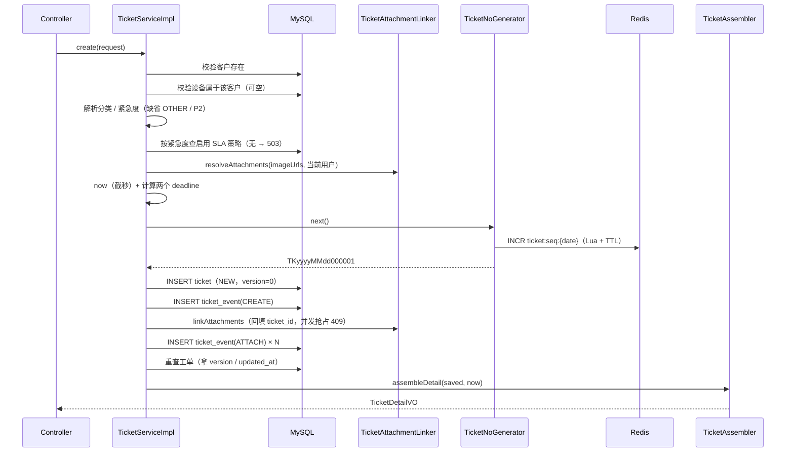

# 09 · 业务服务层

## 1. 分层与依赖原则

```
Controller
  → Service 接口
    → ServiceImpl（编排 / 事务 / 错误码）
      → support 组件（装配 / 守卫 / 号段 / 附件）
      → domain 规则（纯内存）
      → Mapper（MyBatis-Plus）
      → storage（文件存储抽象）
```

硬约束：

1. **ServiceImpl 之间不互相注入**。三个工单服务共享 `support` 组件，不形成调用环；
2. **support 只依赖 Mapper 与领域对象**，不依赖 Service；
3. **domain 不依赖 Spring、不访问数据库**；
4. **角色校验只在接口层**（`@RequiredRole`），Service 不重复判 403；行级范围与状态由 Service 判 404 / 409。

## 2. Service 清单

| 接口 | 实现 | 职责 | 事务 |
| --- | --- | --- | --- |
| `AuthService` | `AuthServiceImpl` | 登录、登出、当前用户、改密 | 改密单表事务 |
| `TicketService` | `TicketServiceImpl` | 建单、列表、详情、编辑、取消、评价、派单、SLA 查询 | 写操作事务 |
| `TicketTransitionService` | `TicketTransitionServiceImpl` | 5 个状态迁移动作 | 事务 |
| `TicketCommentService` | `TicketCommentServiceImpl` | 写处理记录、读时间线 | 写操作事务 |
| `SlaPolicyService` | `SlaPolicyServiceImpl` | SLA 策略 CRUD / 停用 | 写操作事务 |
| `SlaEscalationService` | `SlaEscalationServiceImpl` | 每分钟扫描超时并升级 | 整轮事务 |
| `FileAttachmentService` | `FileAttachmentServiceImpl` | 附件上传 / 删除 | 删除事务；上传无事务 |
| `UserAdminService` | `UserAdminServiceImpl` | 用户分页 / 新增 / 修改 / 启停 | 修改与启停按需 |
| `TeamAdminService` | `TeamAdminServiceImpl` | 团队列表 / 新增 / 修改 | 无显式事务 |
| `CustomerAdminService` | `CustomerAdminServiceImpl` | 客户分页 / 新增 / 修改 | 无显式事务 |
| `DeviceAdminService` | `DeviceAdminServiceImpl` | 设备分页 / 新增 / 修改 | 无显式事务 |

## 3. `AuthServiceImpl`

### 3.1 依赖

`SysUserMapper`、`TeamMapper`、`CustomerMapper`、`JwtUtil`、`TokenBlackList`、`PasswordEncoder`、`LoginRateLimiter`。

### 3.2 登录流程

```mermaid
flowchart TB
    A[login(request, clientIp)] --> B[checkUserLocked]
    B --> C[checkIpLocked]
    C --> D[按 username 查 sys_user]
    D -->|不存在| E[recordFailureQuietly → 401]
    D -->|存在| F[BCrypt matches]
    F -->|失败| E
    F -->|成功| G{status == 1?}
    G -->|否| H[403 账号已停用]
    G -->|是| I[构造 LoginUser]
    I --> J[clearOnSuccess 清账号计数]
    J --> K[jwtUtil.generate]
    K --> L[LoginVO: token + expiresIn + UserVO]
```

`recordFailureQuietly` 对 Redis 异常 fail-open，只告警；两次锁定检查对 Redis 异常 fail-closed（503）。

### 3.3 其他方法

| 方法 | 说明 |
| --- | --- |
| `logout(token)` | `tokenBlackList.addBlackList(token)`，无效 token 忽略 |
| `currentUser()` | 以数据库为准；账号被删 → 401 |
| `changePassword(request)` | 旧密码校验 → 新旧不同校验 → BCrypt 编码 → 单表更新 |

`toUserVO` 按需回填 `teamName` 或 `customerName`（二者互斥，最多一次关联查询）；关联记录被删时名称给 null，不让登录 500。

## 4. `TicketServiceImpl`

依赖：7 个 Mapper（Ticket / SysUser / Customer / Device / SlaPolicy / TicketEvent / TicketFeedback）、`TicketScopeResolver`、`TicketAssembler`、`TicketAccessGuard`、`TicketAttachmentLinker`、`TicketAttachEventWriter`、`TicketNoGenerator`、`Clock`、`ObjectMapper`。

### 4.1 建单 `create`



关键点：

- 所有校验在写库前完成；
- 建单时刻只取一次，`createdAt` 与两个 deadline 同源；
- 工单插入、`CREATE` 事件、附件回填、`ATTACH` 事件在同一事务；
- 工单号冲突重试最多 2 次，第二次仍冲突 → 503。

### 4.2 列表 `page`

1. `TicketScopeResolver.resolve(登录用户)`；
2. `buildListWrapper` 拼装：数据范围 + 关键字 + 状态 / 紧急度 / 分类 + 处理人 / 团队 + `mine` + `escalated` + 排序；
3. `ticketMapper.selectPage`；
4. `TicketAssembler.assemblePage`：名称按当前页批量回填。

排序固定 `created_at DESC, id DESC`，避免同一秒创建的工单分页顺序不稳定。

### 4.3 详情与 SLA

- 详情：`requireVisible` → `assembleDetail`；
- SLA：`requireVisible` → `assembleSla`；两者共用同一套数据范围与时间基准。

### 4.4 编辑 `update`

| 步骤 | 行为 |
| --- | --- |
| 1 | `requireVisible`（404） |
| 2 | `assertEditable`（终态 409；报修人仅 `NEW`） |
| 3 | `assertVersionMatches`（409） |
| 4 | `applyChanges`：逐字段 trim + 差异比较，记录变更字段；非法值 400 |
| 5 | 无变更直接返回详情（不写库、不写事件） |
| 6 | 紧急度变化 → `requirePolicy` + `rebaseSla` |
| 7 | `updateById` 影响 0 行 → 409 |
| 8 | 写 `UPDATE` 事件（只记字段名，不记旧值新值） |

### 4.5 取消 `cancel`

判定：可见性 404 → 版本 409 → 状态（`RESOLVED` 与终态）409。状态更新与 `CANCEL` 事件同事务。

### 4.6 评价 `feedback`

判定：可见性 404 → 必须 `CLOSED` 409 → 先查重 409。插入 `ticket_feedback`，`DuplicateKeyException` 也转 409；写 `FEEDBACK` 事件（只写分数）。

### 4.7 派单 `assign`

| 步骤 | 说明 |
| --- | --- |
| 1 | `requireAssignableTicket`：管理员全放行；主管可认领「`NEW` 且 `team_id` 为空」的待派单池；其余按数据范围，失败 404 |
| 2 | 版本校验 409 |
| 3 | 状态必须 `NEW`，否则 409 |
| 4 | `requireAssignableEngineer`：存在且启用、角色 `ENGINEER`、已加入团队；主管只能派本团队（400） |
| 5 | 写 `assignee`、`team_id = 工程师团队`、`status = ASSIGNED` |
| 6 | 写 `ASSIGN` 事件（含工程师姓名与备注） |

### 4.8 私有辅助方法

| 方法 | 职责 |
| --- | --- |
| `buildListWrapper` | 列表查询条件拼装 |
| `applyScope` | `TicketScope.Visibility` → SQL；空团队集合拼 `1 = 0` |
| `buildTicket` | 组装待插入实体 |
| `insertWithUniqueTicketNo` | 取号 + 插入 + 冲突重试 |
| `requireCustomer` / `requireDeviceOfCustomer` / `requirePolicy` | 建单前置校验 |
| `applyChanges` | 编辑字段合并与差异检测 |
| `rebaseSla` | 按新紧急度重算 deadline |
| `buildCreateEvent` / `buildUpdateEvent` / `buildCancelEvent` / `buildAssignEvent` / `buildFeedbackEvent` | 事件构造 |
| `requireAssignableTicket` / `requireAssignableEngineer` | 派单可见性与工程师校验 |
| `assertFeedbackAllowed` | 仅 `CLOSED` |

## 5. `TicketTransitionServiceImpl`

依赖：`TicketMapper`、`TicketEventMapper`、`TicketScopeResolver`、`TicketAccessGuard`、`TicketAssembler`、`Clock`。

`transitionStatus` 十二步：

1. 取当前用户；
2. 解析数据范围；
3. `requireVisible`（404）；
4. 版本校验（409）；
5. 当前状态 / 目标状态字典解析（400）；
6. `TicketTransition.resolve`（409）；
7. 角色校验（403）；
8. 留存 `fromStatus`；
9. 取一次 `now`；
10. `applyTransition`：改状态 + 按动作写时间戳；
11. `updateById`（0 行 → 409）；
12. 写事件 → 重查 → 装配详情。

`applyTransition` 的副作用分支：

```java
switch (transition) {
  case ACCEPT -> 首次响应时间为空时补 now;
  case START  -> 无;
  case RESOLVE-> resolvedAt = now;
  case CLOSE  -> closedAt = now;
  case REJECT -> 无;
}
```

## 6. `TicketCommentServiceImpl`

依赖：`TicketMapper`、`TicketEventMapper`、`TicketScopeResolver`、`TicketAccessGuard`、`TicketAssembler`、`Clock`、`ObjectMapper`。

### 6.1 `addComment`

顺序：可见性 404 → 终态 409 → 报修人写内部备注 400 → 正文空白 / 超长 400。

- 写 `COMMENT` 事件，`metadata.internal` 固定写入；
- 工程师且 `firstResponseAt` 为空时，条件更新补写首响；
- 返回新事件的 `TicketEventVO`。

### 6.2 `listEvents`

- 可见性 404；
- 报修人加 `REPORTER_VISIBLE_FILTER`（SQL 内过滤 `metadata.internal != true`）；
- `ORDER BY created_at DESC, id DESC LIMIT 500`，再反转为正序；
- `assembleEvents` 批量回填操作人。

## 7. `SlaPolicyServiceImpl`

| 方法 | 规则 |
| --- | --- |
| `list` | 按 `priority` 字典序，P0 → P3 |
| `create` | 优先级取 `Urgency.from`；解决时限 ≥ 响应时限；先查重，`uk_priority` 兜底；`enabled` 缺省 true |
| `update` | 不存在 404；时限顺序校验；优先级不可改 |
| `delete` | 被工单引用则停用（已停用幂等返回）；未引用物理删除 |

## 8. `SlaEscalationServiceImpl`

见 [07 工单领域设计 · 3.4](./07-工单领域设计.md#34-超时升级s-03)。

核心：`@Scheduled(cron = "0 * * * * *", zone = "Asia/Shanghai")`，整轮一个事务，条件更新抢占，每类每轮最多 200 条。

## 9. `FileAttachmentServiceImpl`

| 方法 | 流程 |
| --- | --- |
| `upload` | 解析 `FileBizType` → 规整文件名 → 校验扩展名 / 大小 → 读字节 → `FileStorageService.upload` → 写库；写库失败补偿删除 OSS 对象 → 返回 `AttachmentVO` |
| `delete` | 查附件 → 本人或管理员校验（否则 404）→ 已关联工单则写 `ATTACH delete` 事件 → 删 OSS 对象 → 删记录 |

细节：

- 文件名去路径、截断 255；MIME 缺省 `application/octet-stream`，截断 64；
- 上传不幂等，同一文件重复上传生成两条记录两个对象；
- 删除顺序不可颠倒：先删对象（幂等可重试）再删库，避免留下无法再次删除的孤儿记录；
- 上传读字节失败 400；超限 413；存储不可用 503；写库失败 500。

## 10. 管理端服务

### 10.1 `UserAdminServiceImpl`

| 方法 | 关键点 |
| --- | --- |
| `page` | 关键字匹配登录名 / 显示名；团队名与客户名按页批量回填 |
| `create` | 用户名唯一 409、邮箱唯一 409；团队 / 客户互斥；BCrypt 编码；状态默认启用 |
| `update` | 邮箱唯一；不能把自己降级为非管理员；`updateById` 跳过 null，从团队切到客户时额外显式清空另一列 |
| `updateStatus` | 不能停用自己；先改库再写 Redis 标记；标记失败 503，操作幂等 |

### 10.2 `TeamAdminServiceImpl`

- 列表：一次查全部团队，批量回填主管姓名，成员数用一次全表查询内存聚合；
- 新增 / 修改：名称唯一（修改排除自身）、主管存在性校验；
- 不直接改 `sys_user`，成员归属走用户管理。

### 10.3 `CustomerAdminServiceImpl`

- 等级经 `CustomerLevel.fromOrDefault` 归一化；
- 客户名不唯一（允许同名子公司）；
- 只有查询、新增、修改，无删除。

### 10.4 `DeviceAdminServiceImpl`

- 序列号唯一（写入前查，`uk_serial_no` 兜底）；
- 客户存在性校验；
- 保修状态按「同一基准日」实时计算；
- 修改使用显式 `LambdaUpdateWrapper.set(...)` 而不是 `updateById`：后者跳过 null，导致「清空型号 / 清空保修日期」不生效；
- 状态未传时保留原值，避免编辑弹窗漏传把报废设备改回在用。

## 11. 支撑组件

### 11.1 `TicketScopeResolver`

把 `LoginUser` 翻译成 `TicketScope`。唯一 IO 点：只有 `SUPERVISOR` 查 `team.supervisor_id = userId`；其他角色零额外查询。

### 11.2 `TicketAccessGuard`

| 方法 | 结果 |
| --- | --- |
| `requireVisible(id, scope, operator)` | 查工单；不存在或不在范围 → 404「工单不存在」（两个分支文案一字不差） |
| `assertEditable(ticket, operator)` | 终态 → 409；报修人非 `NEW` → 409 |
| `assertVersionMatches(ticket, requestVersion, operator)` | 版本不一致 → 409「工单已被他人修改，请刷新后重试」 |

### 11.3 `TicketAssembler`

| 方法 | 查询次数 | 用途 |
| --- | --- | --- |
| `assembleDetail(ticket, now)` | 6 次单表查询 | 详情 / 建单 / 编辑 / 迁移 / 派单响应 |
| `assemblePage(page, now)` | 最多 4 次批量查询 | 列表，无 N+1 |
| `assembleEvents(events)` | 1 次批量用户查询 | 时间线 |
| `assembleSla(ticket, now)` | 最多 1 次策略查询 | SLA 状态 |

`assembleDetail` **禁止在循环里调用**。metadata 解析失败按「内部备注」处理（宁可少展示，不误公开）。

### 11.4 `TicketNoGenerator`

Redis 日序列 + DB 降级，详见 [07 · 4](./07-工单领域设计.md#4-工单号生成)。

### 11.5 `TicketAttachmentLinker`

- `resolveAttachments`：去重 URL、上限 5、按「上传人 + 未关联」查询，数量不符 400；
- `linkAttachments`：条件更新回填，影响行数不符 409，整单回滚；同步内存对象。

### 11.6 `TicketAttachEventWriter`

统一写 `ATTACH` 事件：`action`（upload / delete）、`attachmentId`、`fileName`，正文「上传附件：X / 删除附件：X」。调用方必须处于事务内。

## 12. 事务边界总表

| 方法 | 事务 | 原子性要求 |
| --- | --- | --- |
| `TicketServiceImpl#create` | 是 | 工单 + CREATE 事件 + 附件回填 + ATTACH 事件 |
| `update` | 是 | 主表更新 + SLA 重算 + UPDATE 事件 |
| `cancel` | 是 | 状态 + CANCEL 事件 |
| `assign` | 是 | 状态 / 处理人 / 团队 + ASSIGN 事件 |
| `feedback` | 是 | 评价 + FEEDBACK 事件 |
| `TicketTransitionServiceImpl#transitionStatus` | 是 | 状态 + 时间戳 + 事件 |
| `TicketCommentServiceImpl#addComment` | 是 | 事件 + 首响补写 |
| `SlaEscalationServiceImpl#escalateOverdue` | 是（整轮） | 升级标记 + ESCALATE 事件 |
| `FileAttachmentServiceImpl#upload` | 否 | OSS 写入 + 单表插入 + 失败补偿 |
| `FileAttachmentServiceImpl#delete` | 是 | 删除事件 + OSS 删除 + 记录删除 |
| 所有查询 | 否 | 只读 |

## 13. 扩展指引

| 需求 | 落点 |
| --- | --- |
| 新状态迁移动作 | `TicketTransition` 加枚举 → `applyTransition` 加时间戳分支 → `TicketStatus` 按需加状态 |
| 新事件类型 | `TicketEventType` 加枚举 → 写事件处使用 → 前端 `EVENT_LABELS` 加文案 |
| 新可编辑字段 | `TicketUpdateRequest` → `applyChanges` → 事件字段名 |
| 新数据范围角色 | `Role` → `TicketScope.of` → `TicketScopeResolver` → 前端路由 / 菜单 |
| 换文件存储 | 实现 `FileStorageService`，不改业务层 |
