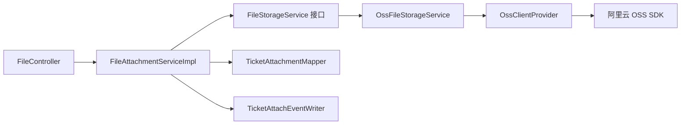

# 10 · 文件存储模块

涉及包：`com.servicedesk.storage`、`com.servicedesk.service.FileAttachmentService`、`com.servicedesk.controller.FileController`。

## 1. 模块职责

把「文件存到哪里」与「文件记录怎么管」分开：

| 层 | 类 | 职责 |
| --- | --- | --- |
| 接口层 | `FileController` | `POST /files`、`DELETE /files/{id}` |
| 业务层 | `FileAttachmentServiceImpl` | 校验、元数据落库、删除权限、ATTACH 事件、OSS 失败补偿 |
| 存储抽象 | `FileStorageService` | `upload` / `deleteByUrl`，与具体介质无关 |
| 存储实现 | `OssFileStorageService` | 阿里云 OSS 上传 / 删除 / URL 拼装 |
| 客户端管理 | `OssClientProvider` | 延迟创建、缓存、关闭 OSS 客户端 |
| 配置 | `OssProperties` | `storage.oss.*` |
| 值对象 | `StoredFile` | `record(objectKey, url)` |
| 枚举 | `FileBizType` | 目录、扩展名白名单、大小上限 |



## 2. `FileStorageService` 契约

位置：`backend/src/main/java/com/servicedesk/storage/FileStorageService.java`

```java
public interface FileStorageService {
    StoredFile upload(String bizType, String fileName, String contentType, byte[] content);
    void deleteByUrl(String fileUrl);
}
```

| 方法 | 幂等性 | 参与 MySQL 事务 | 说明 |
| --- | --- | --- | --- |
| `upload` | 否 | 否 | 同一文件重复上传生成不同对象键 |
| `deleteByUrl` | 是 | 否 | 对象不存在也视为成功，便于重试 |

契约要求：对象键由实现按 `{bizType}/{yyyyMM}/{uuid}.{ext}` 生成，**不直接使用用户输入的文件名**；文件名只取扩展名参与拼装。

## 3. `OssFileStorageService`

### 3.1 上传

```java
String objectKey = buildObjectKey(bizType, fileName);
metadata.setContentLength(content.length);
metadata.setContentType(contentType 或 application/octet-stream);
client.putObject(bucket, objectKey, new ByteArrayInputStream(content), metadata);
return new StoredFile(objectKey, urlOf(objectKey));
```

对象键规则：

```
{bizType}/{yyyyMM}/{32位无连字符UUID}.{ext}
例：ticket/202611/3f2a...e91.jpg
```

- `yyyyMM` 取注入 `Clock` 的当前月（业务时区）；
- 扩展名统一小写，必须匹配 `[a-z0-9]{1,10}`，防止路径穿越与空格；
- `bizType` 为空时目录用 `other`。

### 3.2 公网 URL

```java
urlPrefix() + objectKey
```

`urlPrefix()` 规则：

1. 配了 `storage.oss.public-url-prefix`（CDN / 自定义域名）→ 去尾斜杠 + `/`；
2. 否则用 `{scheme}://{bucket}.{endpoint}/`，`scheme` 由 endpoint 是否以 `http://` 开头决定；
3. endpoint 或 bucket 缺失 → 503「文件存储服务未配置」。

### 3.3 删除

- 按当前配置的前缀反解对象键；
- URL 不属于当前存储 → 400「文件地址不合法」；
- OSS `deleteObject` 对不存在的对象不报错，天然幂等；
- OSS 异常统一 503，原始错误码只进日志。

### 3.4 异常映射

| 异常 | 返回 |
| --- | --- |
| `OSSException`（服务端错误码） | 503「文件存储服务不可用，请稍后重试」 |
| `ClientException`（网络 / 客户端） | 503 同上 |
| 文件名缺扩展名 / 扩展名非法 | 400「文件名缺少扩展名」 |
| URL 前缀不匹配 | 400「文件地址不合法」 |
| 配置缺失 | 503「文件存储服务未配置，请联系管理员」 |

## 4. `OssClientProvider`

```java
public OSS getClient() {
    if (!properties.configured()) throw new BusinessException(503, ...);
    // 双检锁：并发首次调用只创建一个客户端
}
```

| 方法 | 说明 |
| --- | --- |
| `getClient()` | 首次调用创建 `OSSClientBuilder().build(endpoint, ak, sk)` 并缓存 |
| `shutdown()` | `@PreDestroy` 释放连接池 |

设计动机：

- 配置为空时**应用仍能启动**，只有真正上传 / 删除才报 503，方便本地无 OSS 账号时开发；
- 单元测试可整体 mock 本类，不触网；
- 客户端内部持有连接池，全应用共用一个实例。

日志只记录 endpoint、bucket、objectKey，**不记录 AK/SK**。

## 5. 配置

`application.yml`：

```yaml
storage:
  oss:
    endpoint: ${OSS_ENDPOINT:oss-cn-beijing.aliyuncs.com}
    bucket: ${OSS_BUCKET:servicedesk-ai}
    access-key-id: ${OSS_ACCESS_KEY_ID:}
    access-key-secret: ${OSS_ACCESS_KEY_SECRET:}
    public-url-prefix: ${OSS_PUBLIC_URL_PREFIX:}
```

| 环境变量 | 说明 |
| --- | --- |
| `OSS_ENDPOINT` | 地域节点，可带 `https://` |
| `OSS_BUCKET` | 桶名 |
| `OSS_ACCESS_KEY_ID` | AccessKey ID |
| `OSS_ACCESS_KEY_SECRET` | AccessKey Secret |
| `OSS_PUBLIC_URL_PREFIX` | 可选 CDN / 自定义域名 |

`OssProperties#configured()` 要求 endpoint、bucket、AK、SK 四项齐备。

## 6. 业务层：上传与删除

### 6.1 上传流程

```
解析 bizType（缺省 TICKET）
→ 规整文件名（去客户端路径、截断 255）
→ 提取小写扩展名
→ 校验：非空、扩展名白名单、大小上限
→ 读字节（IO 失败 400）
→ OSS 上传
→ INSERT ticket_attachment（ticket_id = null）
   ↳ 写库失败：补偿删除 OSS 对象，抛 500
→ 返回 AttachmentVO
```

上传**不开启事务**：OSS 写入不在事务内，若写库失败必须补偿删除对象，避免「文件在、记录不在」的孤儿文件。补偿失败只记 error，需人工清理。

### 6.2 删除流程

```
查附件（不存在 404）
→ 当前用户是上传人或 ADMIN（否则 404）
→ 若 ticket_id 非空：写 ATTACH delete 事件
→ OSS 删除对象
→ DELETE 记录
```

删除开启事务（事件 + 记录），OSS 删除本身幂等且可重试。顺序不可颠倒：先删对象再删库，避免孤儿记录无法再次删除。

### 6.3 `FileBizType` 规则

| 类型 | 目录 | 扩展名 | 上限 |
| --- | --- | --- | --- |
| `TICKET` | `ticket` | jpg, jpeg, png, pdf, docx, md | 10 MB |
| `KB` | `kb` | pdf, docx, md | 20 MB |

容器上限：`spring.servlet.multipart.max-file-size=20MB`、`max-request-size=25MB`；nginx `client_max_body_size=25m`。

## 7. 建单时的附件关联

上传只产生「未关联」的附件记录；建单时通过 `imageUrls` 关联：

| 规则 | 实现 |
| --- | --- |
| 最多 5 个 | `TicketCreateRequest.@Size(max=5)` + `TicketAttachmentLinker.MAX_ATTACHMENTS` |
| URL 去重 | `distinct()` |
| 必须本人上传且未关联 | 查询条件 `uploader_id = 当前用户 AND ticket_id IS NULL` |
| 数量不符 | 400「附件不存在或不可用」 |
| 并发抢占 | 回填时重复条件，影响行数不符 409，整单回滚 |
| 时间线 | 关联成功后逐个写 `ATTACH(upload)` 事件 |

## 8. 前端调用

`frontend/src/api/files.js`：

```js
uploadFile(file, bizType = 'TICKET')  // POST /api/files，timeout 60s
deleteFile(id)                        // DELETE /api/files/{id}
```

建单页 `TicketCreateView.vue`：

- 使用 Element Plus `el-upload` 自定义 `http-request`；
- `beforeUpload` 做前端扩展名 / 大小预校验；
- 上传成功后拿到 `fileUrl`，随建单请求的 `imageUrls` 提交；
- 删除已上传附件调用 `deleteFile`。

## 9. 测试

| 测试类 | 覆盖 |
| --- | --- |
| `OssFileStorageServiceTest` | 对象键规则、URL 拼装、删除反解、异常映射 |
| `OssClientProviderTest` | 配置缺失 503、延迟创建、关闭 |
| `FileAttachmentServiceImplTest` | 上传校验、补偿删除、删除权限、事件 |
| `FileControllerTest` | 上传 / 删除接口集成 |

## 10. 替换为 MinIO / S3 的步骤

1. 新建 `MinioFileStorageService implements FileStorageService`；
2. 新增 `MinioProperties` 与客户端 Provider；
3. 用 `@Primary` 或配置条件选择实现（当前只有一个实现，Spring 直接注入）；
4. 保持 `upload` 返回 `StoredFile(objectKey, url)`，`deleteByUrl` 按 URL 前缀反解；
5. 业务层、表结构、接口契约均不需要改。

## 11. 已知限制

| 限制 | 说明 |
| --- | --- |
| 公开读 URL | 依赖 OSS 桶的读权限或 CDN；未实现签名 URL |
| 无病毒扫描 | 只校验扩展名与大小 |
| 无图片压缩 / 缩略图 | 上传原图 |
| 孤儿文件 | 写库失败补偿失败时需人工清理 |
| 未配置 OSS 时上传不可用 | 本地开发可跳过附件功能，不影响建单 |
