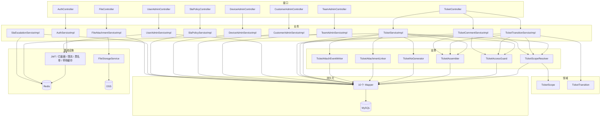
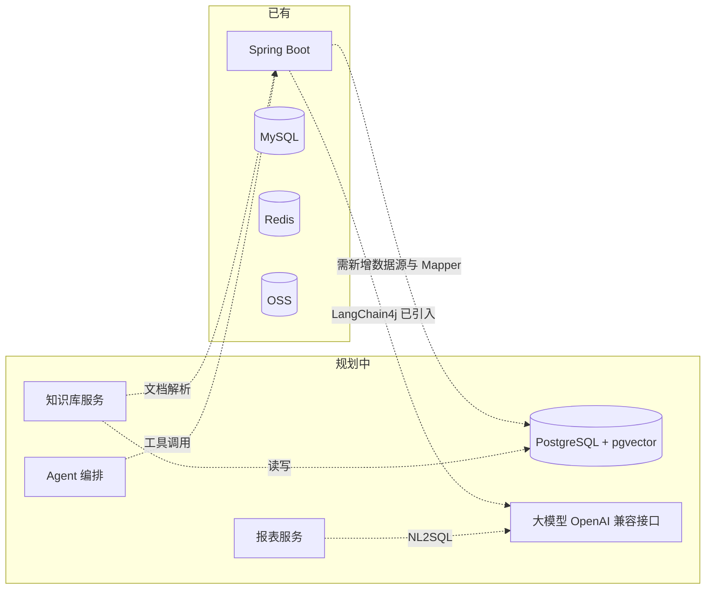

# 12 · 依赖关系与调用链

## 1. 包级依赖矩阵

`→` 表示前者依赖后者；`-` 表示无直接依赖。

| 包 | controller | service | support | domain | mapper | security | common | storage | entity |
| --- | --- | --- | --- | --- | --- | --- | --- | --- | --- |
| `controller` | - | → | - | - | - | → | → | - | → |
| `service.impl` | - | →（接口） | → | → | → | - | → | → | → |
| `service.support` | - | - | - | → | → | - | → | - | → |
| `domain` | - | - | - | - | - | - | → | - | → |
| `security` | - | - | - | - | - | - | → | - | → |
| `storage` | - | - | - | - | - | - | → | - | - |
| `common` | - | - | - | - | - | - | - | - | - |
| `mapper` | - | - | - | - | - | - | - | - | → |
| `entity` | - | - | - | - | - | - | - | - | - |

关键点：

- `common` 不依赖任何业务包；
- `domain` 只依赖 `common`（异常）与 `entity.enums`；
- `service.support` 不依赖 Service；
- `controller` 只依赖 Service 接口、`common.api`、安全注解与 DTO / VO。

## 2. 组件依赖图



## 3. 关键调用链

### 3.1 登录

```
POST /auth/login
→ AuthController#login
  → ClientIpResolver.resolve(request)
  → AuthServiceImpl#login(request, ip)
    → LoginRateLimiter#checkUserLocked / checkIpLocked  (Redis)
    → SysUserMapper#selectOne
    → PasswordEncoder#matches
    → LoginRateLimiter#clearOnSuccess (Redis)
    → JwtUtil#generate
    → toUserVO (TeamMapper / CustomerMapper)
→ Result.success(LoginVO)
```

### 3.2 认证请求通用链路

```
任意受保护请求
→ AuthInterceptor#preHandle
  → TokenBlackList#isInBlackList (Redis)
  → JwtUtil#parse
  → UserStatusCache#isDisabled (Redis)
  → UserContext.set
→ RoleInterceptor#preHandle
  → @RequiredRole 校验
→ Controller
→ ServiceImpl
  → UserContext.getRequired()
→ AuthInterceptor#afterCompletion → UserContext.clear()
```

### 3.3 建单

```
POST /tickets
→ TicketController#create
→ TicketServiceImpl#create
  → requireCustomer (CustomerMapper)
  → requireDeviceOfCustomer (DeviceMapper)
  → TicketCategory.fromOrDefault / Urgency.fromOrDefault
  → requirePolicy (SlaPolicyMapper)
  → TicketAttachmentLinker#resolveAttachments (TicketAttachmentMapper)
  → TicketNoGenerator#next (RedisAtomicCounter → Redis；异常 → TicketNoMapper)
  → TicketMapper#insert
  → TicketEventMapper#insert(CREATE)
  → TicketAttachmentLinker#linkAttachments
  → TicketAttachEventWriter#writeUploads
  → TicketAssembler#assembleDetail (Customer/Device/SysUser/Team/SlaPolicy/Attachment Mapper)
→ Result.success(TicketDetailVO)
```

### 3.4 工单列表

```
GET /tickets
→ TicketServiceImpl#page
  → TicketScopeResolver#resolve
    → [SUPERVISOR] TeamMapper#selectList
  → buildListWrapper → applyScope
  → TicketMapper#selectPage
  → TicketAssembler#assemblePage
    → 批量查客户 / 设备 / 用户 / 团队
→ PageResult<TicketListItemVO>
```

### 3.5 工单详情 / SLA

```
GET /tickets/{id}
→ TicketServiceImpl#detail
  → TicketScopeResolver#resolve
  → TicketAccessGuard#requireVisible (TicketMapper)
  → TicketAssembler#assembleDetail

GET /tickets/{id}/sla
→ TicketServiceImpl#getTicketSlaStatus
  → 同上可见性
  → TicketAssembler#assembleSla (SlaPolicyMapper)
```

### 3.6 编辑（乐观锁）

```
PUT /tickets/{id}
→ TicketServiceImpl#update
  → resolve scope → requireVisible (404)
  → assertEditable (409)
  → assertVersionMatches (409)
  → applyChanges（字段差异）
  → [紧急度变化] requirePolicy + rebaseSla
  → TicketMapper#updateById（@Version）
  → TicketEventMapper#insert(UPDATE)
  → assembleDetail
```

### 3.7 状态迁移

```
PATCH /tickets/{id}/status
→ TicketTransitionServiceImpl#transitionStatus
  → resolve scope → requireVisible (404)
  → assertVersionMatches (409)
  → TicketStatus.from(current / target) (400)
  → TicketTransition.resolve (409)
  → assertTransitionAllowed (403)
  → applyTransition（状态 + 时间戳）
  → TicketMapper#updateById
  → TicketEventMapper#insert
  → TicketAssembler#assembleDetail
```

### 3.8 派单

```
POST /tickets/{id}/assign
→ TicketServiceImpl#assign
  → requireAssignableTicket（管理员全放行 / 主管待派单池 / scope）
  → assertVersionMatches
  → 状态必须 NEW
  → requireAssignableEngineer（SysUserMapper + scope.teamIds）
  → 更新 assignee / team_id / status
  → TicketEventMapper#insert(ASSIGN)
  → assembleDetail
```

### 3.9 处理记录与时间线

```
POST /tickets/{id}/comments
→ TicketCommentServiceImpl#addComment
  → requireVisible
  → 终态检查 / 内部备注角色 / 正文校验
  → TicketEventMapper#insert(COMMENT)
  → [工程师且首响为空] TicketMapper 条件更新 first_response_at
  → TicketAssembler#assembleEvents

GET /tickets/{id}/events
→ TicketCommentServiceImpl#listEvents
  → requireVisible
  → [REPORTER] 加 metadata.internal 过滤
  → TicketEventMapper#selectList (LIMIT 500)
  → reverse → assembleEvents
```

### 3.10 SLA 超时升级（定时）

```
@Scheduled(cron = "0 * * * * *")
→ SlaEscalationServiceImpl#escalateOverdue
  → escalateResponse
    → TicketMapper#selectList（超时候选，LIMIT 200）
    → 逐条 TicketMapper#update（条件更新抢占）
    → 抢到 → TicketEventMapper#insert(ESCALATE)
  → escalateResolve 同理
```

### 3.11 附件上传 / 删除

```
POST /files
→ FileController#upload
→ FileAttachmentServiceImpl#upload
  → FileBizType.fromOrDefault
  → 文件名 / 扩展名 / 大小校验
  → FileStorageService#upload → OssFileStorageService → OssClientProvider
  → TicketAttachmentMapper#insert
  → [写库失败] FileStorageService#deleteByUrl 补偿

DELETE /files/{id}
→ FileAttachmentServiceImpl#delete
  → TicketAttachmentMapper#selectById
  → 权限校验（上传人 / ADMIN）
  → [已关联] TicketAttachEventWriter#writeDelete
  → FileStorageService#deleteByUrl
  → TicketAttachmentMapper#deleteById
```

### 3.12 用户启停（即时失效）

```
PATCH /admin/users/{id}/status
→ UserAdminServiceImpl#updateStatus
  → requireUser
  → 禁止停用自己
  → SysUserMapper#updateById
  → [停用] UserStatusCache#markDisabled (Redis)
  → [启用] UserStatusCache#clearDisabled
  → Redis 失败 → 503（数据库变更保留）
```

## 4. 依赖倒置点

| 抽象 | 实现 | 目的 |
| --- | --- | --- |
| `FileStorageService` | `OssFileStorageService` | 可替换 MinIO / S3 |
| `Clock` | `TimeConfig#clock` | 单测固定时间 |
| `ObjectMapper` | Spring Boot 自动配置 | metadata JSON 构造 / 解析 |
| Mapper 接口 | MyBatis-Plus 动态代理 | 无实现类，便于测试 mock |
| `PasswordEncoder` | `BCryptPasswordEncoder` | 统一密码算法 |

## 5. 避免循环依赖的规则

1. **三个工单 ServiceImpl 不互相注入**：公共逻辑下沉到 `support`；
2. **support 不依赖 Service**，只依赖 Mapper 与 domain；
3. **domain 不依赖 Spring / Mapper**；
4. **security 不依赖业务 Service**（`AuthServiceImpl` 依赖 security，反向不成立）；
5. **前端 HTTP 层不依赖 store / router**，401 通过 `window` 事件由根组件收口。

## 6. 第三方依赖使用情况

| 依赖 | 版本 | 实际使用 | 位置 |
| --- | --- | --- | --- |
| `spring-boot-starter-web` | 3.5.16 | 是 | Controller / 拦截器 |
| `spring-boot-starter-validation` | 3.5.16 | 是 | DTO 校验 |
| `spring-boot-starter-data-redis` | 3.5.16 | 是 | 限流、黑名单、停用标记、工单号 |
| `commons-pool2` | 由 Boot 管理 | 是 | Lettuce 连接池 |
| `mybatis-plus-spring-boot3-starter` | 3.5.18 | 是 | ORM |
| `mybatis-plus-jsqlparser` | 3.5.18 | 是 | 分页 SQL 解析 |
| `mysql-connector-j` | 由 Boot 管理 | 是 | MySQL 驱动 |
| `jjwt-api/impl/jackson` | 0.13.0 | 是 | JWT |
| `spring-security-crypto` | 由 Boot 管理 | 是 | BCrypt |
| `aliyun-sdk-oss` | 3.18.5 | 是 | 文件存储 |
| `springdoc-openapi-starter-webmvc-ui` | 2.10.0 | 是 | Swagger |
| `spring-boot-starter-actuator` | 3.5.16 | 是（健康检查） | 白名单已放行 `/actuator/**` |
| `lombok` | 1.18.48 | 是 | `@Data` / `@Builder` / `@RequiredArgsConstructor` |
| `langchain4j` / `langchain4j-open-ai` | 1.23.0 | **否** | 预留 AI |
| `pdfbox` | 3.0.3 | **否** | 预留知识库文档解析 |
| `poi-ooxml` | 5.2.5 | **否** | 预留 Word 解析 |
| `spring-boot-starter-test` | 3.5.16 | 是 | 测试 |

## 7. 未接线的依赖关系（规划）



当前代码中没有 `KbArticle`、`KbChunk`、`AgentRun`、`LlmCall`、`TicketMessage` 的实体 / Mapper / Controller；相关表也只建了 `kb_chunk`（PG）。

## 8. 依赖变更检查清单

| 变更 | 需要同步 |
| --- | --- |
| 新增枚举值 | 后端枚举、前端 `dict.js`、SQL 注释、接口文档 |
| 新增工单状态 | `TicketStatus`、`TicketTransition`、前端状态文案、SLA 终态判定 |
| 新增接口 | Controller、Service、DTO/VO、接口文档、前端 API 封装 |
| 换数据库字段 | 实体、SQL 迁移脚本、ER 图、VO 映射 |
| 换存储实现 | 实现 `FileStorageService`，检查 URL 前缀与删除反解 |
| 接入 AI / 知识库 | 新增独立模块包，避免把 LLM 调用写进现有 ServiceImpl |
