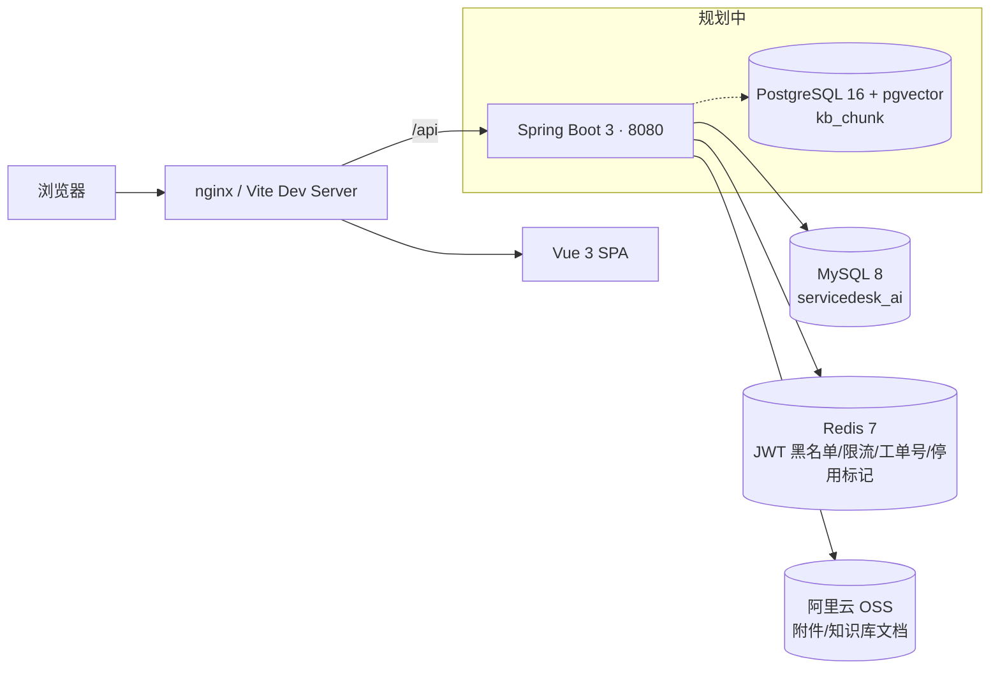

# 智维工单 ServiceDesk AI · Code Wiki

> 面向研发的代码级说明文档。目标：读完这一套文档，能在不逐行读代码的情况下理解项目架构、模块职责、关键类与函数、依赖关系与运行方式。

## 1. 这套文档怎么读

| 你的目的 | 建议阅读顺序 |
| --- | --- |
| 第一次接触项目，想快速建立整体认知 | [01 项目概览](./01-项目概览.md) → [02 系统架构](./02-系统架构.md) → [03 目录结构](./03-目录结构.md) |
| 接手后端开发，需要改代码 | [04 公共基础设施](./04-公共基础设施.md) → [05 数据模型](./05-数据模型与数据库.md) → [07 工单领域设计](./07-工单领域设计.md) → [09 业务服务层](./09-业务服务层.md) |
| 对接接口 / 联调前端 | [08 接口层与 REST API](./08-接口层与RESTAPI.md) → [11 前端架构](./11-前端架构.md) |
| 排查安全问题（登录、越权、限流） | [06 安全与鉴权](./06-安全与鉴权.md) |
| 搭建本地环境 / 部署上线 | [13 构建运行与部署](./13-构建运行与部署.md) |
| 跑测试 / 补测试 | [14 测试体系](./14-测试体系.md) |
| 想知道模块之间怎么依赖 | [12 依赖关系与调用链](./12-依赖关系与调用链.md) |

## 2. 文档清单

| 编号 | 文档 | 内容摘要 |
| --- | --- | --- |
| 01 | [项目概览](./01-项目概览.md) | 业务背景、目标用户、MVP 范围、技术栈、核心闭环、已实现 / 规划边界 |
| 02 | [系统架构](./02-系统架构.md) | 分层架构、请求生命周期、模块划分、横切关注点、关键设计决策、并发策略 |
| 03 | [目录结构](./03-目录结构.md) | 全仓库目录树、Java 包职责、命名与放置约定 |
| 04 | [公共基础设施](./04-公共基础设施.md) | 统一响应、全局异常、用户上下文、MVC / MyBatis / 时钟 / OpenAPI 配置、Redis 原子计数 |
| 05 | [数据模型与数据库](./05-数据模型与数据库.md) | 9 张已落地 MySQL 表、索引、实体映射、枚举字典、种子数据、pgvector 预留表 |
| 06 | [安全与鉴权](./06-安全与鉴权.md) | JWT、双拦截器、`@RequiredRole`、登录限流、Token 黑名单、账号停用缓存、BCrypt |
| 07 | [工单领域设计](./07-工单领域设计.md) | 8 状态状态机、迁移表、数据范围、SLA 计时与升级、工单号、乐观锁、时间线 |
| 08 | [接口层与 REST API](./08-接口层与RESTAPI.md) | 34 个已实现接口清单、通用约定、错误码、请求 / 响应结构、Swagger |
| 09 | [业务服务层](./09-业务服务层.md) | 11 个 Service 接口与实现、6 个支撑组件、核心流程逐步拆解 |
| 10 | [文件存储模块](./10-文件存储模块.md) | `FileStorageService` 抽象、阿里云 OSS 实现、上传补偿、对象键规则 |
| 11 | [前端架构](./11-前端架构.md) | Vue 3 工程结构、路由守卫、Pinia、Axios 封装、页面真实 / 原型状态 |
| 12 | [依赖关系与调用链](./12-依赖关系与调用链.md) | 包级依赖矩阵、组件图、10 条关键调用链、三方依赖使用情况 |
| 13 | [构建运行与部署](./13-构建运行与部署.md) | 环境要求、配置项、数据库初始化、启动命令、nginx 部署、故障排查 |
| 14 | [测试体系](./14-测试体系.md) | 36 个测试类、测试分层、覆盖矩阵、运行方式与测试环境要求 |

## 3. 项目速览

| 项 | 值 |
| --- | --- |
| 产品名 | 智维工单（ServiceDesk AI） |
| 仓库 / 包名 | 目录 `servicedesk-ai`；Java 包 `com.servicedesk` |
| 后端入口 | `backend/src/main/java/com/servicedesk/ServiceDeskApplication.java` |
| 后端技术栈 | Spring Boot 3.5.16、Java 17、MyBatis-Plus 3.5.18、Redis、JJWT 0.13、BCrypt |
| 前端技术栈 | Vue 3.5、Vite 6、Pinia 3、Vue Router 4、Element Plus 2.9、Axios |
| API 基址 | `http://localhost:8080/api`（`server.servlet.context-path=/api`） |
| 前端开发地址 | `http://127.0.0.1:5173`（`/api` 代理到 8080） |
| 已落地数据表 | MySQL 9 张；PostgreSQL `kb_chunk` 仅提供建表脚本 |
| 已实现接口 | 34 个（认证 4、工单 11、系统管理 13、SLA 4、附件 2） |
| 测试类 | 36 个（3 个 Mockito 单元测试 + 24 个 `@SpringBootTest` 集成测试 + 其余纯 JUnit） |
| 演示口令 | `Sd123456`（见 `backend/sql/seed/seed_demo_data.sql`） |

## 4. 代码规模与入口

| 层 | 主要目录 | 说明 |
| --- | --- | --- |
| 接口层 | `backend/src/main/java/com/servicedesk/controller` | 8 个 `@RestController` |
| 业务层 | `.../service`、`.../service/impl`、`.../service/support` | 11 个接口、11 个实现、6 个支撑组件 |
| 领域层 | `.../domain/ticket` | `TicketScope`（数据范围）、`TicketTransition`（状态迁移） |
| 鉴权层 | `.../security` | JWT、拦截器、限流、黑名单、停用缓存 |
| 持久层 | `.../entity`、`.../mapper` | 9 个实体、10 个 Mapper |
| 公共层 | `.../common` | 响应体、异常、上下文、配置、Redis 计数器 |
| 存储层 | `.../storage` | 文件存储抽象与 OSS 实现 |
| 前端 | `frontend/src` | 13 个页面视图、7 个通用组件、5 个 API 模块 |

## 5. 重要阅读提示

1. **文档描述的是当前代码的真实状态**，不是需求文档里的全部规划。仓库内 `backend/src/main/resources/docs/` 下的《开发文档》《接口文档》《ER 图》包含更完整的产品规划（知识库、AI 分类、Agent、报表等），但其中相当一部分**尚未在代码中实现**，本 Wiki 会在对应位置明确标注「规划中 / 仅原型」。
2. 路径书写约定：后端 Controller 上的路径**不含 `/api`**，因为 `context-path` 在进入 `DispatcherServlet` 前已被剥离。本 Wiki 的接口表统一写成对外完整路径（含 `/api`）。
3. 核心业务时间（工单、SLA、事件、工单号）通过注入的 `java.time.Clock` 获取，时区固定 `Asia/Shanghai`；设备保修计算目前直接使用 `LocalDate.now()`，属于待统一项。新代码请使用 `Clock`，不要直接调用 `LocalDate.now()` / `LocalDateTime.now()`。
4. 工单相关接口的「看不到」与「不存在」统一返回 404，这是刻意的防资源枚举设计，不是错误码遗漏。

## 6. 仓库既有文档

| 文档 | 位置 | 与本 Wiki 的关系 |
| --- | --- | --- |
| 项目 README | `README.md` | 产品背景与快速启动 |
| 开发文档 | `backend/src/main/resources/docs/开发文档.md` | 需求、状态机、业务规则、验收标准（源头） |
| 接口文档 | `backend/src/main/resources/docs/接口文档.md` | 完整接口契约（含未实现接口） |
| ER 图 | `backend/src/main/resources/docs/ER图.md` | 15 张表的数据字典（含规划表） |
| 需求变化 | `backend/src/main/resources/docs/需求变化.md` | RC-001 等变更记录 |
| 前端说明 | `frontend/README.md` | 页面与后端进度对照 |
| 设计稿 | `design/README.md` | 静态效果图与视觉约定 |
